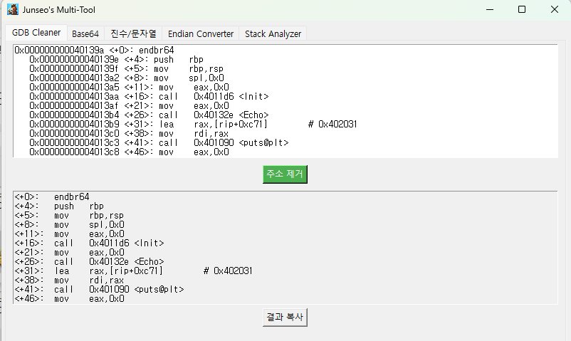
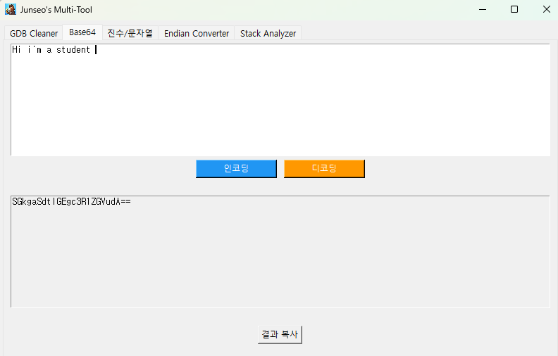
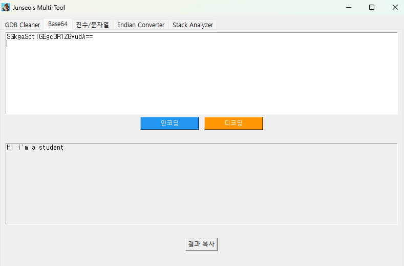
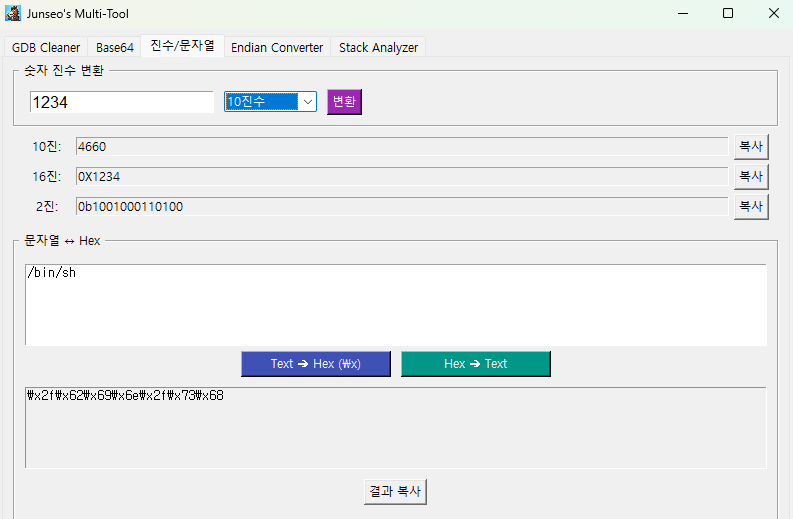
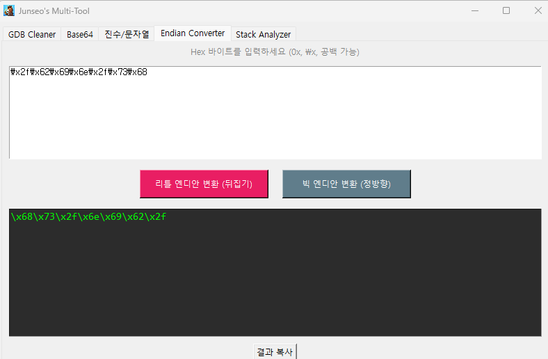
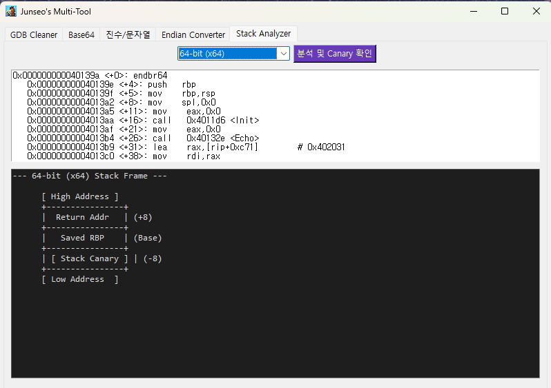

> **솔직히 밝혀 두면** — 이 도구는 바닥부터 혼자 설계해 짠 "작품"은 아니다. AI의 도움으로 뼈대를 잡고, 내가 공부하면서 "이 작업 매번 손으로 하기 귀찮다" 싶은 기능을 하나씩 붙여 왔다. 요컨대 **개인 학습용 보조 도구**. 그래서 제작기라기보단, 내가 실제로 쓰는 도구를 소개하고 왜 이렇게 만들었는지 정리하는 글에 가깝다.
>
> 레포: [github.com/junseopark0216/pwn_study_tool](https://github.com/junseopark0216/pwn_study_tool)

## 왜 만들었나

워게임·리버싱을 하다 보면 본질과 상관없는 자잘한 작업이 계속 끼어든다. GDB `disas` 결과에서 주소를 손으로 지워 write-up을 정리하고, 페이로드를 리틀 엔디안으로 뒤집고, `\x41\x42` 형태로 바꾸고, 스택 프레임 오프셋을 종이에 그려 보고… 매번 터미널·계산기·에디터를 오가는 게 번거로웠다.

그래서 이 반복 작업들을 **탭 하나씩으로 묶어** 하나의 GUI에 띄워 두고 쓰기로 했다. Python 3 + Tkinter + Pillow로 되어 있고, Windows / WSL 환경에서 돌린다.

## 구성 — 5개 탭

`ttk.Notebook` 으로 기능을 탭으로 나눴다.

### 1. GDB Cleaner

GDB `disas` 출력에서 매번 바뀌는 절대 주소(`0x5555...` 같은)를 정규식으로 걷어내고, **코드 오프셋과 어셈블리 명령어만** 남긴다. PIE 때문에 실행마다 바뀌는 주소를 지워 두면 write-up이 깔끔해지고, 글에 붙였을 때 가독성도 좋아진다.



### 2. Base64 Encoder / Decoder

Base64 문자열을 빠르게 인코딩/디코딩한다. CTF·웹 문제에서 인코딩된 페이로드를 다룰 때 터미널 안 거치고 바로 변환하려고 넣었다.





### 3. 진수 / 문자열 변환

- **숫자 진수 변환** — 10진수 ↔ 16진수 ↔ 2진수 상호 변환.
- **문자열 ↔ Hex** — 평문을 `\x41\x42` 형태의 shellcode용 hex로, 반대로도. 셸코드 페이로드를 빠르게 만들 때 쓴다.



### 4. Endian Converter

입력한 hex 바이트 스트림의 바이트 순서를 뒤집는다. `0x`, `\x`, 공백 섞인 입력도 받아 준다. x86/x64용 리틀 엔디안 페이로드를 맞출 때 쓰는, **바이트 순서 뒤집기** 기능이다. (정방향 빅 엔디안 변환도 있음)



### 5. Stack Analyzer

어셈블리 코드에서 `sub esp/rsp` 와 `[ebp/rbp - offset]` 패턴을 파싱해, **스택 프레임 레이아웃을 ASCII로 그려 준다**. 32비트(x86)·64비트(x64)를 구분해 변수 상대 오프셋과 스택 카나리 위치를 한눈에 보여 준다. (버튼도 "분석 및 Canary 확인")

```
--- x64 Stack Frame ---

      [ High Address ]
      +----------------+
      ...
```

익스플로잇에서 RET까지의 오프셋을 계산할 때, 머릿속으로 더하던 걸 눈으로 확인하려고 만든 기능이다.



## 빌드 / 실행

Python이 있으면 바로 실행한다.

```bash
pip install Pillow
python my_tool.py
```

배포용으로는 PyInstaller로 단독 실행 파일을 만든다. `my_tool.spec` 에 아이콘(`horse.ico`)과 스플래시 이미지(`horse_nu.png`)를 datas로 묶어 뒀고, `console=False`(창 모드) + `upx=True` 설정이다.

```bash
pyinstaller my_tool.spec    # dist/my_tool(.exe) 생성
```

## 쓰면서 느낀 점 / 고치고 싶은 것

- **Stack Analyzer가 너무 고정적이다.** 실제로 몇몇 워게임을 풀 때, 바이너리별 구조를 맞춤으로 반영하지 못하고 그냥 "32비트냐 64비트냐"에 따라 틀에 박힌 프레임만 그려 주는 느낌이었다. 같은 아키텍처라도 함수마다 스택 구성이 다른데, 그걸 못 따라간다. 바이너리(혹은 함수)별로 실제 레이아웃을 반영하도록 개선하고 싶다.
- 당장 "손이 자주 가는 것"부터 붙이다 보니 기능 구성이 내 공부 습관에 맞춰져 있다. 범용 도구라기보단 **내 워크플로 전용**.
- Tkinter라 가볍지만 UI는 투박하다. 탭이 늘어나면 정리 체계가 필요할 듯.
- **pwntools 연동.** 지금은 변환·정리 위주라 "실제 공격"은 결국 터미널에서 pwntools로 따로 짠다. 여기에 공격 대상 서버 주소(host·port) 입력창을 두고, 입력한 주소로 `remote()` 연결해서 페이로드를 주고받는 기능까지 붙이면, 도구 안에서 바로 원격 익스플로잇을 시험해 볼 수 있을 것 같다.
- **libc 버전 식별·조회.** 익스플로잇에서 늘 걸리는 게 libc 버전이다. leak한 함수 주소의 하위 오프셋을 넣으면 어떤 libc 버전인지 역으로 찾아 주고(libc-database 식), 그 버전의 `system`·`/bin/sh`·원가젯 오프셋까지 바로 뽑아 주는 기능을 넣고 싶다. 매번 버전 맞추느라 삽질했던 걸 줄일 수 있을 것이다.

> 정리하면, "대단한 프로젝트"는 아니지만 **공부하며 불편했던 지점을 직접 도구로 메운** 경험 자체가 의미 있었다. 남이 만든 걸 쓰는 것과, 내 흐름에 맞게 깎아 쓰는 것 사이 어딘가.
