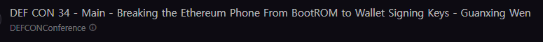
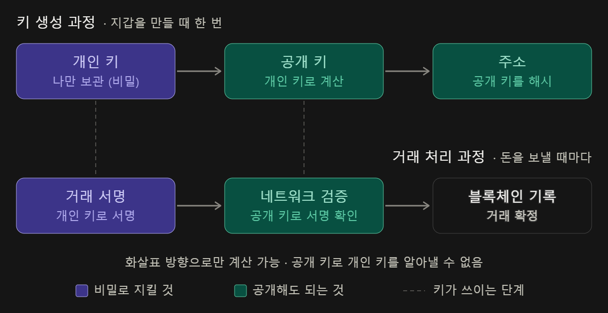
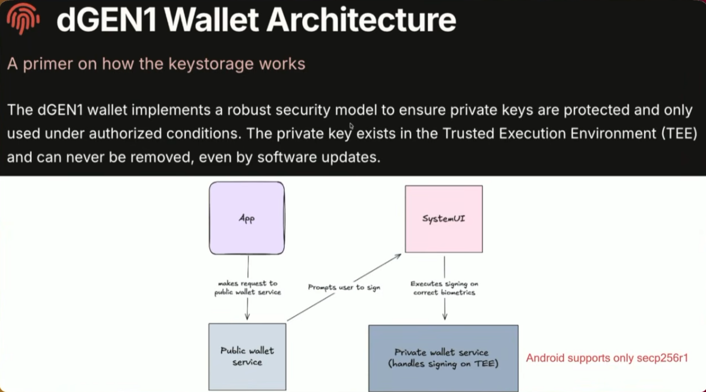
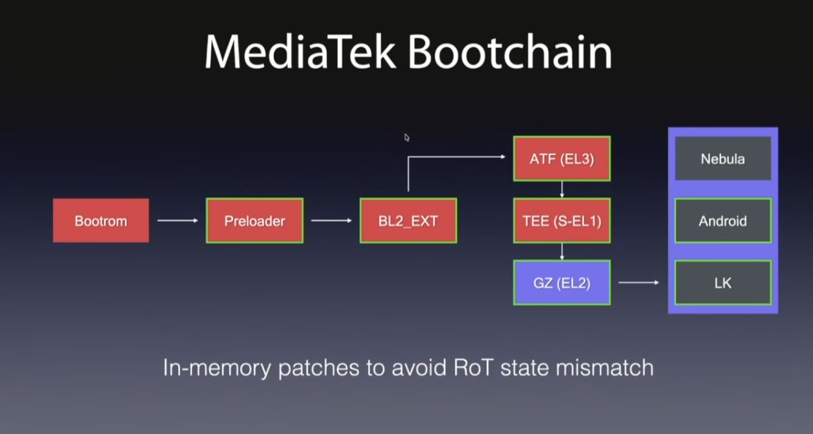
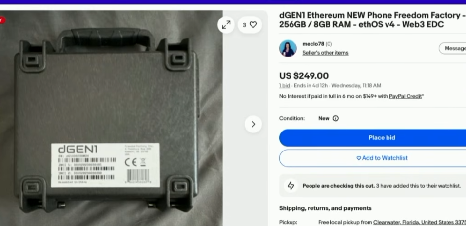

## 1. 들어가며



**이더리움 폰 탈옥: BootROM부터 지갑 서명 키 탈취까지**

### 1-1. 이 발표를 고른 이유

이 영상을 고른 이유는 단순하다. 발표 제목들을 둘러보다가 '이더리움'이라는 단어가 눈에 들어왔고, 예전에 이더리움을 샀던 기억이 떠오르면서 자연스럽게 관심이 생겼다.

이더리움 폰이라는 기기가 있다는 것도 이 영상을 통해 처음 알았다. 콜드월렛은 들어본 적이 있었지만, 콜드월렛도 아니고 일반 스마트폰도 아닌 그 중간 어딘가에 있는 '크립토폰'이라는 존재가 신기하게 느껴졌다.

## 2. 배경 지식

영상을 처음 봤을 때는 사실상 대부분의 내용을 이해하지 못했다. 이더리움을 '암호화폐의 한 종류' 정도로만 알고 있었을 뿐, 지갑이 어떻게 동작하는지, 그리고 발표의 핵심인 스마트폰 부팅 과정과 하드웨어 보안 구조에 대한 지식이 거의 없었기 때문이다.

그래서 발표 내용을 정리하기 전에, 이해에 필요한 배경지식을 먼저 찾아 공부했다. 아래는 그 내용이다.

### 2-1. 블록체인과 이더리움

#### 블록체인

블록체인은 거래 기록을 담은 장부를 은행 같은 중앙 기관이 단독으로 관리하는게 아니라, 네트워크에 참여한 여러 컴퓨터가 **각자 똑같은 사본을 하나씩** 갖고 관리하는 방식이다. 이렇게 장부 사본을 갖고 네트워크에 참여하는 컴퓨터를 <strong>노드(Node)</strong>라고 부른다. 새 거래가 생기면 노드들이 그 거래가 올바른지 확인한 뒤, 각자의 장부에 똑같이 기록한다.

거래 기록은 일정량씩 묶여 <strong>블록</strong>이 되고, 각 블록은 바로 앞 블록의 <strong>해시값</strong>을 담고 있어 사슬(**체인**)처럼 이어진다. 해시는 어떤 데이터를 넣든 정해진 길이의 고유한 값을 만들어 내는 계산으로, 입력이 조금만 바뀌어도 결과가 완전히 달라지고 결과값으로 원래 입력을 되돌려 알아낼 수 없다는 특징이 있다. 그래서 예전 기록 하나를 몰래 고치면 그 블록의 해시가 바뀌어 뒤의 블록들과 연결이 깨지고, 다른 노드들의 사본과도 달라져 위조가 바로 드러난다.

이처럼 블록체인 위에서 일어나 장부에 기록되는 활동을 **온체인(On-chain)**, 블록체인 밖(회사 서버, 개인 기기 등)에서 처리되는 것을 <strong>오프체인(Off-chain)</strong>이라고 한다.

#### 이더리움

나 역시 그랬듯이, 많은 사람들이 이더리움을 비트코인의 한 종류라고 생각할 것이다. 하지만 비트코인과 이더리움은 서로 다른 암호화폐다. 비트코인은 암호화폐 전체를 부르는 말이 아니라 여러 암호화폐 중 하나의 이름일 뿐이다.

정확히 말하면 이더리움은 네트워크(플랫폼)의 이름이고, 이 플랫폼에서 쓰는 화폐의 이름이 이더(ETH)다. 비유하자면 롤(이더리움 플랫폼)에서 스킨을 사기 위해 쓰는 RP(이더)와 비슷하다. (다만 RP는 라이엇이 발행하고 관리하지만, 이더는 특정 회사가 관리하지 않는다는 점이 다르다.)

#### 스마트 컨트랙트

비트코인은 이 장부에 “A가 B에게 1코인을 보냈다”와 같은 송금 기록을 적는다. 이더리움은 여기서 더 나아가 블록체인 위에 프로그램(코드)을 올려두고 실행할 수 있게 만들었는데, 이 프로그램을 스마트 컨트랙트라고 부른다.

스마트 컨트랙트의 역할 중 이번 발표와 관련된 것은 아래와 같다.

- **스마트 컨트랙트 지갑 (계정 추상화)**
    - 지갑 자체를 컨트랙트로 만들어 규칙을 넣는다. 예를 들어,
        - 소유자 여러 명 지정 (멀티시그: 3명 중 2명이 서명해야 출금)
        - 개인 키를 잃어버렸을 때 복구 방법 지정
        - 일반 지갑이 쓰지 않는 서명 방식 지원
- **에어드롭 토큰 지급**
    - 에어드롭은 암호화폐 프로젝트가 사용자 지갑에 토큰을 무료로 나눠주는 것을 말한다. 아이폰의 에어드롭(AirDrop)과 이름이 같아 헷갈릴 수 있지만 완전히 다른 개념이다.
    - 스마트 컨트랙트는 "조건을 만족하는 주소에 토큰을 지급한다"는 규칙을 코드로 실행해, 에어드롭을 자동으로 처리하는 데 쓰인다.

이 밖에도 토큰 발행, 탈중앙화 금융(DeFi) 등 다양한 곳에 쓰인다.

### 2-2. Wallet & Private Key

#### Wallet

블록체인에서 지갑(Wallet)은 돈이 들어있는 곳이 아니라, 사용자의 공개 키와 개인 키를 저장하고 디지털 자산을 보내고, 받고, 확인할 수 있게 해주는 소프트웨어를 말한다.

현실의 지갑과는 느낌이 꽤 다르다. 현실 지갑은 잃어버리면 그 안의 돈도 함께 잃지만, 암호화폐 자산은 지갑 안이 아니라 블록체인 장부에 기록되어 있다. 그래서 지갑 앱이 설치된 기기를 잃어버려도 개인 키만 있으면 다른 기기에서 지갑을 그대로 되살릴 수 있다. 반대로 개인 키가 남에게 넘어가면, 기기가 내 손에 있어도 자산을 빼앗길 수 있다. 즉 지갑은 '돈 주머니'라기보다 '**자산을 움직일 수 있는 열쇠를 보관하는 열쇠고리**'에 가깝다.

#### Private Key & Public Key

지갑의 소유권을 결정하는 것은 개인 키(Private Key)다.

- **개인 키**: 나만 알고 있어야 하는 비밀 값이다. 거래를 보낼 때 이 키로 서명한다.
- **공개 키(Public Key)**: 개인 키로부터 계산해서 만든다. 반대로 공개 키로 개인 키를 알아내는 것은 사실상 불가능하기 때문에, 공개 키는 타인에게 노출되어도 안전하다.
- **주소(Address)**: 공개 키를 해시해서 만든 값으로, 계좌번호처럼 다른 사람에게 알려주는 용도다. 돈을 받을 때는 이 주소만 있으면 된다.

거래는 다음과 같이 처리된다. 내가 개인 키로 거래에 서명하면, 네트워크가 공개 키로 그 서명이 진짜인지 검증하고, 검증에 통과하면 블록체인에 기록된다.



여기서 중요한 점은 네트워크가 "서명이 올바른가"만 확인할 뿐 <strong>"누가 서명했는가"는 따지지 않는다</strong>는 것이다. 그래서 개인 키가 유출되면 공격자의 서명도 정상 거래로 처리되고, 자산 전체를 잃게 된다. 이번 발표에서 공격자가 최종적으로 노린 것도 바로 이 개인 키다.

> 해시(Hash)는 <strong>어떤 데이터든 넣으면 정해진 길이의 "지문" 같은 값을 만들어 주는 계산</strong>이다. 이 계산을 하는 걸 해시 함수, 결과값을 해시값이라고 부른다.
> 

그렇다면 이 개인 키를 안전하게 보관하는 것이 제일 중요한데, 이 개인 키를 어디에, 어떻게 보관해야 안전할까?

### 2-3. Hot Wallet vs Cold Wallet

앞에서 “**지갑=개인 키를 보관하고 거래에 서명하는 도구”** 라고 표현했다. 이 지갑을 <strong>개인 키를 어디에 두느냐</strong>란 기준에 따라 **Hot** 과 <strong>Cold</strong>로 구분된다.

#### Hot Wallet

개인 키가 인터넷에 연결된 기기에 있는 것을 말한다.

- ex) MetaMask와 같은 브라우저 확장 지갑, 스마트폰 지갑 앱
- 바로바로 사용이 가능해 편리하단 장점이 있으나, 기기가 해킹되면 개인 키가 유출될 수 있단 단점이 존재한다.

#### Cold Wallet

개인 키가 인터넷과 분리된 기기에 있는 것을 말한다.

- ex) Ledger 같은 하드웨어 지갑, 종이에 적어둔 개인 키
- 인터넷과 분리되어 있어, 원격 해킹이 어렵다는 장점이 있으나 거래할 때마다 기기를 연결해야하고 버튼을 눌러야해서 불편하다는 단점이 존재한다.

> **거래소 계정**
> 
> 
> 업비트나 바이낸스에 코인을 넣어두는 건 엄밀히 말하면 **내 지갑이 아니다.**
> 개인 키를 거래소가 갖고 있고, 거래소 장부에 "이 사람 몫이 얼마"라고 적혀 있는 것뿐이다.
> 

Hot 과 Cold 둘 다 장단점이 명확하다. 이 둘을 합쳐서 어느정도의 중용의 상태를 만든다면 단점들을 해결할 수 있을 것이다. 그렇게 만들어진게 바로 Crypto Phone이다.

### 2-4. Crypto Phone

Crypto Phone이란 <strong>암호화폐 지갑 기능을 운영체제와 하드웨어 수준에 넣은 스마트폰</strong>을 뜻한다.
즉, <strong>일반 핸드폰처럼 편하게 사용하면서 개인 키는 폰 안의 보안 구역(TEE)에 넣어 하드웨어 지갑처럼 지키겠다는 컨셉</strong>으로 만들어진 것이다. (TEE는 2-5에서 자세히 설명한다.)

|  | 일반 폰 + 지갑 앱 | 크립토폰 |
| --- | --- | --- |
| 지갑 위치 | 앱 하나 | 운영체제에 내장 |
| 개인 키 보관 | 앱 저장공간 (보통) | 보안 구역(TEE)에 보관(제조사 설명) |
| 서명 확인 화면 | 앱이 보여줌 (앱이 조작 가능) | 운영체제가 직접 보여줌 |
| 에어드롭 혜택 | 없음 | 구매자 대상 에어드롭이 많음 |

이런 Crypto Phone의 예로 dGEN1(이더리움 폰), 솔라나 Saga, 솔라나 Seeker 등이 존재하며 이번 영상의 발표는 이 중, dGEN1(이더리움 폰)에 주목한다.

이런 Crypto Phone같은 경우, hot과 cold의 단점들을 해결한다는 면에서도 주목을 받았지만 그에 못지않게 에어드롭 때문에도 관심을 끌었다. Crypto Phone을 구매하게 되면, 토큰을 받을 수 있는 일종의 이벤트가 있었기 때문이다. 이 때문에 <strong>에어드롭 청구 과정 자체가 일종의 공격 대상</strong>이 되기도 한다.

결국 Crypto Phone이 Cold Wallet 못지않게 안전하기 위해서는 폰 내부에서 개인 키를 실제로 어떻게 보관하고 보호하느냐에 달려 있다. 그리고 이 발표 영상은 바로 그 부분을 직접 확인한다.

### 2-5. 스마트폰의 보안 구조

> 여기서 설명하는 스마트폰의 보안 구조는 Crypto Phone 만의 것이 아니라, 우리가 일상적으로 사용하는 스마트폰에 공통으로 들어가 있는 것이다. Crypto Phone 역시 일반 스마트폰의 하드웨어와 운영체제를 기반으로 제작되기 때문에, 이 구조를 그대로 물려받는다. 발표 내용과 직접적으로 연관되는 세 가지만 정리해보았다.
> 

#### 2-5-1. 보안 부팅 체인 (Secure Boot Chain)

스마트폰 전원을 키게 되면, 여러 단계의 프로그램을 차례로 실행하면서 부팅한다. 이때 각 단계는 **다음 단계 프로그램이 제조사가 서명한 정품인지 검증한 뒤에만 실행을 넘긴다**. ROP Chain처럼, 이런 신뢰가 사슬처럼 이어지면서 실행을 넘기는 것이다.

이 사슬의 가장 첫 고리 즉 제일 첫 번째 단계가 바로 BootROM이다. BootROM은 칩을 만들 때 새겨 넣는 코드라서 나중에 수정할 수 없다. 그래서 BootROM 단계에서 문제가 생기면 소프트웨어 업데이트로도 고칠 수 없고, 그 뒤에 이어지는 모든 단계를 신뢰할 수 없게 된다.

#### 2-5-2. 권한 레벨 (ARM Exception Level)

스마트폰에 들어가는 ARM 칩은 실행되는 코드마다 권한 등급을 아래와 같이 나눈다. 숫자가 클수록 권한이 높고, 높은 레벨은 낮은 레벨을 감시하고 통제할 수 있다.

| 레벨 | 실행되는 것 | 설명 |
| --- | --- | --- |
| EL0 | 일반 앱 | 가장 낮은 권한 |
| EL1 | 운영체제 커널 | 앱을 관리 |
| EL2 | 하이퍼바이저 | 운영체제를 관리 |
| EL3 | 시큐어 모니터 (ATF) | 가장 높은 권한, 보안 구역과 일반 구역의 전환 담당 |

공격자가 EL3을 장악한다면 사실상 폰 전체를 장악한 것이나 다름 없다.

#### 2-5-3. TEE와 키 보관

**TEE(Trusted Execution Environment)** 는 일반 운영체제와 분리된 별도의 보안 구역이다. ARM 칩에서는 TrustZone이라는 기술로 구현된다. 가령 운영체제가 해킹되더라도 TEE 안의 데이터는 꺼낼 수 없도록 설계되어, 개인 키나 잠금 화면 PIN처럼 중요한 정보를 다루는 데 쓰인다.

<strong>안드로이드</strong>에서는 다음 두 기능이 TEE와 연결되어 동작해야 한다.

1. Keystore / Keymaster: 암호 키를 저장하고 사용한다. 키는 TEE 안의 하드웨어 키로 암호화 되어 저장되기 때문에, 저장된 파일을 훔쳐도 키를 꺼낼 수는 없다. (여기서 말하는 암호 키는 블록체인 개인 키만이 아니라, 은행 앱 인증 키나 간편결제용 키 등 다양한 암호 키를 뜻한다.)
2. GateKeeper: 잠금 화면 PIN을 검증한다. **PIN 검증에 하드웨어 키를 섞고** 시도 횟수를 제한하기 때문에, PIN 해시를 빼내도 Bruite Forcing 공격이 불가하다.

> **PIN 검증에 하드웨어 키를 섞는다?**
> 
> 
> 여기서 <strong>하드웨어 키</strong>는 사용자가 정하는 값이 아니다. 사용자가 정하는 값은 <strong>PIN</strong>이고, 하드웨어 키는 폰을 만드는 과정에서 칩 안에 생성되어 TEE 밖으로 절대 나오지 않는 비밀 값으로, 사용자는 물론 제조사도 알 수 없다.
> 
> |  | PIN | 하드웨어 키 |
> | --- | --- | --- |
> | 누가 정하나 | 사용자 | 폰 제조 과정에서 칩 안에 생성 |
> | 누가 아나 | 사용자 | 아무도 모름 |
> | 어디 있나 | 사용자의 기억 | TEE 안 (외부 유출 불가) |
> 
> 폰은 PIN을 그대로 저장하지 않고, <strong>PIN과 하드웨어 키를 함께 해시한 값</strong>을 저장한다. 그래서 공격자가 이 저장값을 훔치더라도 하드웨어 키를 모르기 때문에, 자기 컴퓨터에서 PIN을 하나씩 대입해 보며 같은 값을 찾을 수 없다.
> 
> 이 계산은 TEE만 할 수 있기 때문에, TEE가 틀린 횟수를 기록하고 틀릴수록 대기 시간을 늘려 시도를 제한할 수 있다. 결국 공격자는 폰 위에서 하나씩 느리게 시도할 수밖에 없다. 이처럼 **하드웨어 키와 시도 횟수 제한은 함께 있어야 의미가 있다.** (스포 조금 하자면, 이후 발표에서 소개한 dGEN1은 하드웨어 키 없이 PIN만 해시했다.)
> 

영상 발표의 내용을 이해하기 위해서는 안드로이드의 경우만 알아도 충분하지만, 나는 아이폰(애플)을 사용하기 때문에 아이폰의 경우 또한, 별도로 알아보았다. (안궁금하다면 그냥 넘겨도 발표 내용을 이해하는데에 무리는 없을 것이다.)

#### 아이폰의 경우: Secure Enclave

아이폰도 TEE와 같은 역할을 하는 보안 구역이 있다. 다만 안드로이드의 TEE가 같은 CPU를 일반 구역과 보안 구역으로 나눠 쓰는 방식이라면, 아이폰은 칩 안에 **Secure Enclave라는 보안 전용 프로세서를 따로** 둔다.

|  | 안드로이드 | 아이폰 |
| --- | --- | --- |
| 보안 구역 | TEE (TrustZone) | Secure Enclave |
| 구현 방식 | 같은 CPU를 일반/보안 구역으로 나눔 | 보안 전용 프로세서를 별도로 둠 |
| 키 보관 | Keystore | 키체인(Keychain) + Secure Enclave |
| PIN 검증 | Gatekeeper | Secure Enclave가 직접 검증 |
| 만드는 곳 | 칩·폰 제조사마다 구현이 다름 | 애플이 칩부터 OS까지 직접 만듦 |

Secure Enclave 역시 칩마다 고유한 하드웨어 키를 갖고 있고, 비밀번호를 이 키와 섞어서 검증한다. 틀릴수록 대기 시간이 길어지며, 설정에 따라 10번 틀리면 데이터를 지울 수도 있다. Face ID, Touch ID 데이터와 Apple Pay 결제 키도 이곳에서 다룬다.

애플은 칩, 부팅 과정, 운영체제를 모두 직접 만들기 때문에 구현이 일관된 반면, 안드로이드는 칩 회사와 폰 회사가 다른 경우가 많아 **제조사에 따라 보안 수준이 달라질 수 있다.**

정리하자면, 스마트폰의 보안은 부팅 체인이 신뢰를 이어주고 → 권한 레벨이 서로를 분리하고 → TEE가 마지막으로 핵심 정보를 지키는 구조다. 크립토폰은 이처럼 일반 스마트폰에 이미 있는 TEE와 Keystore를 활용해 지갑의 개인 키를 보관하는 것이다.

## 3. 분석 대상

### 3-1. ethOS & dGEN1

#### ethOS

ethOS는 Freedom Factory가 만든 이더리움 전용 모바일 os이다.(이더리움os→ethOS인듯) 처음에는 온체인(블록체인 위에서 일어나 기록되는 활동) 상호작용을 위한 **커스텀 안드로이드 ROM**(기존 폰에 설치해 쓰는 수정된 안드로이드 os)으로, 시스템 지갑과 내장 라이트 노드를 갖춘 형태였다. 즉 기존 스마트폰에 설치해서 쓰는 운영체제였다. 발표자 역시 dGEN1이 나오기 전에 DEFCON 판매 구역에서 ethOS가 설치된 Pixel 폰을 처음 접했다고 한다.

#### dGEN1



Freedom Factory는 ethOS 제작 이후, dGEN1(이더리움 폰)을 출시했다. 2024년 10월 17일에 공개되었고 실제 배송은 2025년 9월부터 시작되었다.

| 항목 | 내용 |
| --- | --- |
| 제조사 | Freedom Factory |
| 운영체제 | ethOS |
| 칩셋 | MediaTek MT6789/MT8781V (Helio G99) |
| 화면 | 메인 터치스크린 + 거래 정보를 보여주는 별도 화면 |
| 통신 | 전화 기능 없음 |
| 지갑 | 운영체제에 내장 |
| 기타 | 이더리움 라이트 노드, dApp 스토어 내장 |

표를 보면 알겠지만 말이 Phone이지, 간단한 전화 통신 기능조차 존재하지 않는다. 그저 온체인 활동만을 위한 전용 기기인 셈이다. 또한, 기존 안드로이드 os를 기반으로 os를 제작했기 때문에 2-5에서 설명한 일반 스마트폰의 보안 구조를 그대로 가지고 있다.

dGEN1은 이 보안 구조를 이용해 개인 키를 TEE로 지키겠다고 주장했다. 

### 3-2. 제조사가 내세운 보안 주장(TEE 키 보관)

dGEN1의 공식 문서에 따르면 개인 키는 TEE 안에 머물고, 서명은 생체 인증을 거친 뒤 운영체제의 SystemUI를 통해 이루어진다.

1.  개인 키는 TEE 안에 보관한다. 운영체제가 해킹되더라도 개인 키는 꺼낼 수 없다.
2. 서명 전에 생체 인증을 거친다. 이 생체 인증 때문에 타인이 서명할 수 없다.
3. 서명 확인 화면은 운영체제가 직접 보여준다. 이를 통해 사용자가 무엇에 서명하는지 명확히 보여주고, 앱이 끼어들어 조작하는 것을 막는다. 

문제는 서명 방식이다. 이더리움은 secp256k1이라는 방식으로 서명하는데, 안드로이드 Keystore는 secp256k1 서명을 기본으로 지원하지 않는다. 그래서 TEE 기반 이더리움 지갑을 만들기 위해서는 TEE를 따로 손봐야 한다.

dGEN1은 TEE를 개조하는 대신 우회하는 방법을 택했다. 지갑에 ERC-4337 계정 추상화(2-1의 스마트 컨트랙트 지갑)를 적용하고, 서명 방식으로는 secp256r1(P-256) 키를 사용했다. 안드로이드 TEE Keystore는 k1(secp256k1)은 지원하지 않지만 r1(secp256r1, P-256)은 기본으로 지원하기 때문이다. 대신 이더리움은 기본적으로 k1 서명만 인식하므로, 블록체인 위에 있는 지갑 컨트랙트가 r1 서명을 직접 검증하도록 했다.

dGEN1의 지갑은 소유자가 여러 명인 구조다. 폰 안의 키가 첫 번째 소유자이고, NFC 방식의 “Genesis Card”에 담긴 복구 주소가 두 번째 소유자다. 각각 가중치가 1이라서 둘 중 어느 쪽이든 자금을 옮길 수 있다. 폰을 잃어버려도 카드로 자산을 되찾을 수 있도록 이렇게 설계한 것이다. 하지만 이는, 카드와 폰 안의 키 중 하나만 노출되어도 자산을 빼앗길 수 있단 뜻도 되는 것이다.

발표자는 이 부분에서 의문을 가졌다. 일반 스마트폰의 Keystore로 이더리움 지갑을 만드는건 무척이나 어려운데, dGEN1이 실제로 그 아래에서 무엇을 구현했는지 궁금해졌단 것이다. 문서에 적힌대로 TEE 보관이 정말 하드웨어로 보호받는 것인지 발표자는 BootROM부터 직접 확인을 했다.

## 4. 발표 내용

발표에 나온 공격은 BootROM에서 시작해 한 단계씩 올라가며 최종적으로 지갑의 개인 키를 exploit한다.
여기에 추가적으로, 폰을 해킹하지 않고도 에어드롭을 가로챌 수 있는 별도의 방법? 취약점?도 소개한다.

### 4-1. BootROM 인증(SLA/DAA) 미적용

MediaTek(대만의 스마트폰 칩 제조사) 칩에는 볼륨 버튼 조합으로 들어갈 수 있는 다운로드 모드가 있다. 폰을 수리하거나 펌웨어를 설치할 때 쓰이는 기능으로, BootROM 단계에서 동작한다. 그렇기에 아무 프로그램이나 실행되면 위험하다. 그래서 원래는 SLA/DAA라는 인증 기능으로 제조사가 허가한 프로그램(다운로드 에이전트)만 실행하도록 막아둔다. 이 인증 기능은 eFuse라는, 하드웨어 fuse를 끊어서 켠다.(한번 끊으면 되돌릴 수 없음.) 

> eFuse는 칩 안의 작은 퓨즈로, 끊어진 상태를 1, 연결된 상태를 0으로 읽는다. 한 번 끊으면 다시 연결할 수 없기 때문에, 보안 기능처럼 절대 꺼지면 안 되는 설정을 저장하는 데 쓰인다. 즉 퓨즈를 끊어 값을 1로 만들어야 SLA·DAA 인증이 켜진다. 
퓨즈는 전기 회로에 들어가는 얇은 금속선인데 강한 전류가 흐르면 이 선이 끊어진다. 이 성질을 이용해 칩 안에 영구적인 설정값을 새겨 두는 장치가 eFuse이다.
> 

발표자는 다운로드 모드에 들어가 MTKClient라는 도구로 eFuse 설정을 읽었는데, SLA와 DAA가 꺼져 있었다고 한다.(원래 켜져있어야 정상.) 즉, 호환되는 다운로드 에이전트라면 무엇이든 받아서 실행할 수 있는 상태였던 것이다. 게다가 일부 기기처럼 폰을 분해해 테스트 핀을 연결할 필요도 없이, 볼륨 버튼 조합만으로 쉽게 다운로드 모드에 들어갈 수 있었다고 설명을 덧붙였다.

칩 자체에 결함이 있는게 아닌, 제조사의 설정 실수로 인해 BootROM 단계에서 문제가 생겼다. 이후 모든 단계를 공격자가 조작할 수 있는 시발점이 된 것이다. 

### 4-2. Loader-of-the-Loader로 EL3 장악

dGEN1의 MediaTek칩은 아래와 같은 순서로 부팅한다.

```c
BootROM -> Preloader -> bl2_ext -> (ATF, TEE, LK) -> 커널
```



Preloader가 bl2_ext를 정해진 주소에 올리면 bl2_ext가 저장공간에서 ATF, TEE, LK를 불러오는 것이다.

4-1 상황 덕분에 발표자(공격자)는 Preloader 단계에서 코드를 실행할 수 있다. 처음에 LK를 바로 패치하려고 시도했는데 Preloader 단계에서는 LK가 아직 메모리에 올라와 있지 않아, 실패했다고 한다.

발표자는 Preloader에서 bl2_ext로 넘어가는 지점을 가로채 셸코드를 먼저 실행했다. 이 셸코드가 bl2_ext에 훅을 심어두면 나중에 ATF, TEE, LK가 모두 메모리에 올라온 뒤 두 번째 셸코드가 실행된다. 이를 통해 GZ(EL2), ATF(EL3), LK에 백도어를 심을 수 있었다. 

```c
Preloader → [훅 1] → 쉘코드 1 (훅 2 설치) → bl2_ext 실행 (ATF·TEE·LK 로드) → [훅 2] → 쉘코드 2 (백도어 설치) → 정상 부팅 계속
```

이렇게 EL3(칩 수준에서 가장 높은 권한)을 획득할 수 있었다.

### 4-3. 플래시 변조 없는 메모리 부팅과 루팅

앞서 설명했듯 EL3 권한을 얻은 상황이다. EL3 권한을 이용해 부팅 과정과 보안 구역 전환을 조작할 수 있게 되었으므로, 운영체제(안드로이드) 안에서의 루트 권한을 탈취하는 것이 가능해진다. 발표자는 플래시를 변조하지 않고 루팅을 진행했는데, 자세한 내용은 아래와 같다. 

**플래시(저장공간) 변조 안한 이유**

일반적으로는 부트로더를 언락하고 수정한 os를 플래시(저장공간)에 설치한다. 하지만 발표자는 이 방법이 TEE가 디스크 복호화를 거부하거나 키를 지울 가능성이 있다며 사용하지 않았다. 

**메모리 부팅**

대신 Fastboot의 권한 검사를 패치하고, 부팅 이미지를 저장공간이 아니라 USB로 보낸 데이터에서 읽도록 바꾸고, 부팅 이미지 검증(AVB)을 우회했다. 이어서 커널을 패치해 루트 권한을 얻고(루팅), SELinux 보안 기능도 꺼버렸다.

### 4-4. 잠금 PIN 오프라인 무차별 대입

2-5-3에서 소개한 것처럼 Gatekeeper는 TEE 안에서 PIN과 하드웨어 키를 함께 해시하고, 시도 횟수를 제한해야 한다.

하지만 dGEN1(이더리움 폰) 같은 경우, 잠금 화면이 TEE 기반 검증기가 아니라 소프트웨어로 만든 libSoftGatekeeper.so를 쓰고 있었다. “하드웨어 기반인가?”라는 확인에는 무조건 “예”를 답하도록 고정되어 있었고, 하드웨어 키는 무시되었다. 하드웨어 키가 섞이지 않았으니 저장된 해시값만 있으면 PIN을 컴퓨터에서 직접 계산해볼 수 있다. 하드웨어 키도, 시도 횟수 제한도 없어서 오프라인에서 대입이 가능했다.
M1 맥북 기준 초당 약 120개의 해시를 계산할 수 있었고 6자리 PIN이라면 약 2시간만에 풀 수 있었다고 한다. 
쉽게 말해, 겉으로는 하드웨어 보호를 받는 것처럼 응답하면서 실제로는 하드웨어를 흉내내는 소프트웨어인 것이다. 2-5-3에서 소개했듯이 “하드웨어 키와 시도 횟수 제한은 함께 있어야 의미가 있(다)”는데 이를 무시한 것이다.

### 4-5. 평문 개인 키 추출과 온체인 검증

 3-2에서 소개했듯이 개인 키는 TEE 안의 하드웨어 키로 보호되어 꺼낼 수 없어야 한다.

dGEN1 같은 경우, 키를 다루는 libpuresoftkeymasterdevice.so는 소프트웨어 전용이였고, 키 블롭(키를 하드웨어 키로 암호화해 저장한 데이터)을 만드는 함수는 하드웨어 보호 없이 키를 그대로 저장하기만 했다. 
게다가 키 데이터베이스는 잠금 해제 없이도 읽을 수 있는 영역에 있었고, “암호화된” 키 블롭은 실제로는 개인 키가 그대로 들어 있는 평문이였다.

이렇게 획득한 값이 진짜 지갑 개인 키인지는 블록체인에서 확인할 수 있다. 발표자는 추출한 키로 공개 키를 만들어, Base 메인넷에 있는 스마트 계정 컨트랙트의 첫 번째 소유자와 일치하는 것을 확인했다. (블록체인에 기록된 정보는 누구나 조회할 수 있기 때문에, 지갑 컨트랙트에 등록된 소유자 정보와 직접 비교해 볼 수 있었던 것이다.)

### 4-6. 에어드롭 “-1 클릭” 탈취

앞의 내용들과 별개로, 폰을 해킹하지 않고도 에어드롭을 가로챌 수 있는 별도의 방법을 소개했다.

원래는 에어드롭을 청구할 때 “**진짜 이 기기에서 보낸 요청이 맞는지**”를 증명해야 한다.(기기 안의 하드웨어 키로 서명하는 등의 방식으로)

dGEN1 같은 경우 에어드롭 청구 시 SHA256(IMEI | 시리얼 번호)로 기기 ID를 만들어 지갑 주소와함꼐 보내는데, 챌린지-응답이나 하드웨어 서명, 기기 인증등의 인증 방식이 전혀 없었다. 그런데 막상 IMEI와 시리얼 번호는 제품 박스에 인쇄되어 있는 것이다. 사용자들은 중고로 팔 때 박스 사진을 온라인에 게시하는 경우가 많고, 기기가 아직 구매자에게 도착하기 전일 수도 있다. 발표자는 이를 “-1-click”이라고 불렀다.



쉽게 말해, 입력값(IMEI, 시리얼)이 박스에 그대로 공개되어 있으니 해시값도 공개된 것이나 마찬가지 인 것이고 이는 진짜 주인이 폰을 켜기도 전에 에어드롭을 탈취당할 수 있단 의미인 것이다.  

### 4-7. 제보와 대응

발표자는 발견한 취약점들을 1월에 Freedom Factory에 제보했다. 제조사는 빠르게 결함을 인정했고, 이후 완화 조치를 적용했다고 한다. 취약점을 공개하기 전에 제조사에 먼저 알려 고칠 시간을 준, 책임 있는 공개(Responsible Disclosure)의 사례이기도 하다.

## 5. 핵심 인사이트

문구로 적혀있다고 해서, 그게 진짜로 적용되어있는지는 뜯어보기 전에 모른다는 생각이 들었다.

발표 내용을 자세히 보기 전에는, 엄청난 기술로 이더리움 폰을 exploit한 줄 알았는데 결국엔 제조사의 실수? 결함? 이 있었고 이 실수가 공격의 출발점이 된 것이다.

기술이 발전함에 따라 기업들은 계속해서 이런 새로운 제품들을 시장에 내놓을 것인데 발표자처럼 하나씩 다 뜯어보다보면 이런 제조사의 실수들이 무조건적으로 존재할 수밖에 없을 거란 생각이 들었다.

## 6. 좋았던 점

단순히 기술적인 부분에서 그치지 않고, 정말 실생활에서 사람들이 간과하기 쉬운 보안 사고를 이용해서도 에어드롭 탈취가 가능하단걸 알려준게 인상 깊었다.

또한, 이더리움과 같은 블록체인에 대해 흥미는 있었으나 깊은 관심을 두진 않아왔는데 해당 발표를 보고 리뷰를 위해 학습하며 내용을 정리하다 보니, 이런 블록체인 기술에 관심을 더 깊게 두게 되었다.

## 7. 아쉬운 점

발표자가 현장에서 직접 시연하려 했지만 USB 연결 오류로 진행하지 못하고, 미리 녹화한 영상 데모로 대체했다. 하드웨어 공격 특성상 현장 변수가 많아 이해는 되지만, 부팅 체인이 장악되는 과정을 실시간으로 볼 수 없어 현장감이 덜했던 점이 아쉬웠다. 다만 추출한 키를 실제 온체인 지갑 소유자와 대조해 검증했고 제조사도 취약점을 인정했기 때문에, 연구 결과 자체의 신뢰도에는 문제가 없다고 생각한다.

## 8. 앞으로 공부할 것

EIP에 대한 내용을 기술 블로그 형태로 정리할 예정이다. 

## 9. 참고 자료

**발표 관련**

- [발표자 블로그 - Break the Trust Chain of the Ethereum Phone](https://hhj4ck.github.io/en/break-the-trust-chain-of-the-ethereum-phone.html)
- [DEF CON 34 발표 일정](https://defcon.org/html/defcon-34/dc-34-schedule.html)
- [DEF CON 34 발표 영상](https://www.youtube.com/watch?v=SQxuyxqVyDI&t=294s)

**dGEN1 / ethOS**

- [Cointelegraph - Freedom Factory unveils ethOS mobile hardware](https://cointelegraph.com/news/ethos-unveils-onchain-mobile-hardware-ethereum-ecosystem)
- [The Defiant - New Ethereum dGEN1 Mobile Phone Enters the Crypto Smartphone Wars](https://thedefiant.io/news/nfts-and-web3/new-ethereum-dgen1-mobile-phone-enters-the-crypto-smartphone-wars)
- [Bankless - Freedom Factory Debuts dGEN1 Ethereum Mobile Device](https://www.bankless.com/dgen1-ethereum-everyday-carry)
- [Freedom Factory dGEN1 전 세계 출시 보도자료 (2025.09.23)](https://www.aap.com.au/aapreleases/cision20250923ae71733)

**배경 지식**

- [ethereum.org - 이더리움이란?](https://ethereum.org/ko/what-is-ethereum/)
- [ERC-4337: Account Abstraction](https://eips.ethereum.org/EIPS/eip-4337)
- [Android Keystore 문서](https://source.android.com/docs/security/features/keystore)
- [Android Gatekeeper 문서](https://source.android.com/docs/security/features/authentication/gatekeeper)
- [Apple 플랫폼 보안 가이드](https://support.apple.com/guide/security/welcome/web)

**도구**

- [MTKClient (GitHub)](https://github.com/bkerler/mtkclient)
